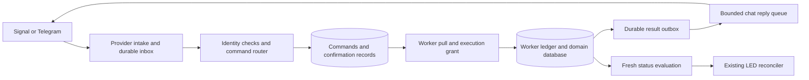

# Implementation plan for interactive worker commands

Reconciliation/rollback update (2026-11-06): the consolidated current work list is
[IMPLEMENTATION_STATUS.md](IMPLEMENTATION_STATUS.md); it is not a measured 90%
completion claim. `backup-worker notification-resolve` now records exact,
audited unsent/retry decisions for held legacy sources. Duplicate-risk
acknowledgement is required for uncertain retries; original rows, attempts and
dispositions remain retained. Independent file/SQL evidence, stale-review checks
and canonical acceptance protect release and coverage.
`notification-rollback` can restore initialized Telegram delivery after shared
revocation and outcome reconciliation, using a new canonical `legacy-active`
generation and separate native sender units. Shared dispatch cannot use that
generation; retained canonical leases protect legacy I/O. Explicit revocation
tombstones it. Capable pinned binaries are required before cutover; uncertain
shared outcomes, missing/compacted required evidence and later generation/helper
migrations remain explicit limitations. The managed startup guard now applies
inactive-producer enforcement to verification mode, allowing admitted delivery
mode to restart with active producer generations. Native restoration pins the
reviewed Telegram credentials and fails closed on canonical identity/recovery
changes. The per-criterion evidence map is [ACCEPTANCE_MATRIX.md](ACCEPTANCE_MATRIX.md).
See [the operational guide](examples/notification-worker/BACKUP_CUTOVER.md).
Recovered Telegram/Signal, command/LED production admission, later recovery epochs
and external qualification remain open. Earlier dated checkpoints below describe
the state before this update.

Managed backup cutover update (2026-11-06): the initialized outbound-only
Telegram profile now has an executable per-producer handoff and report-service
migration. `backup-worker notification-cutover --local --review` prints pinned
legacy evidence; `--apply --spec ABS` applies/resumes the exact reviewed request.
Compatible helper/image probes, exact unit checks and retained setup, notifier,
attempt, gateway operation, installation and worker leases protect the transition.
File/SQL intent anchors retain the legacy fence. Accepted history is preserved;
explicitly reviewed unsent work is exported; ambiguous/incomplete work stays held
and degrades delivery health without starving fresh reports. Credential-free
report service/timer/path installation follows exact generation staging/activation.
`--revoke --spec ABS` drains reports, tombstones the generation and imports receipts,
retaining the legacy fence. This implements fenced rollback; releasing held rows
and restoring a new legacy generation remain separate unfinished reconciliation
work. Signal/recovered gateways and command/LED admission remain unsupported.
See [the operational guide](examples/notification-worker/BACKUP_CUTOVER.md).
Earlier dated checkpoints below describe the state before this update.

Legacy backup delivery evidence update (2026-11-05): the notifier now reserves
outbox attempts durably before external I/O and commits acceptance atomically
with the outcome. Interrupted reservations retain ambiguity; attempted sources
cannot silently become fresh shared exports or batch members. The existing
notifier/command guard and legacy retry policy remain in force. An observational
`backup-worker delivery-review` exposes retained evidence without authorizing
cutover. This does not enable command admission or complete managed producer,
report-service, legacy-outcome or Signal account migration.

Delivery lifecycle update (2026-11-04): `activate-delivery --local --root
--manifest-hash --qualification-hash` now journals dispatcher activation for
initialized outbound-only fixed-recipient Telegram workers. Exact fresh
qualification, runtime/helper capabilities, file/SQL ownership, loaded manager
and process/socket pins guard activation. Admission is checked at startup,
periodically and immediately before sending. `deactivate-delivery` restores
verification without requiring live credentials or unexpired qualification;
explicit cancellation can supersede an interrupted activation. Ownership survives
updates, compatible rollback and uninstall. Producer generations stay inactive;
per-producer admission, recovered/Signal runtime handoff, command/LED activation
and legacy backup cutover remain unfinished. Native executable and SIGKILL
fixtures use simulated managers and synthetic credentials, not live qualification.
This supersedes older statements that every production lifecycle transition is
unimplemented. See the [delivery guide](examples/notification-worker/DELIVERY_ACTIVATION.md).

Outgoing Signal profile update (2026-11-04): `migrate-signal-profiles --local
--spec` now journals a proven outgoing transport transition for an already
supervised recovery verification gateway. Canonical configuration and recovery
hashes remain unchanged; a separately frozen effective runtime and profile proof
bind the new socket/inbox pins and affected route revisions. Existing queued
routes and Telegram evidence are retained. Runtime health exposes the profile
hash and periodic audits stop the gateway on proof loss. Capability checks,
interruption/SIGKILL fixtures and native-process tests cover this verification-only
transition. Production activation, Signal runtime handoff, legacy fixed-recipient
conversation enrollment and backup cutover remain unfinished. This supersedes
older checkpoint statements that all outgoing profile migration is unavailable.
See [the profile migration guide](examples/notification-worker/SIGNAL_VERIFICATION.md#outgoing-profile-migration).

Activation admission update (2026-11-04): `activation-review --local --root`
now composes the pinned verification revision, latest qualification, local provider
identity, recovered request seals/cursors and current Telegram handoffs into a
read-only prerequisite inventory. Worker inspection requires an inactive gateway
and exclusive installation/worker leases; it performs no shutdown, polling, repair
or fence changes. Managed Signal verifier health is checked separately from
outbound profile pins; stale/legacy pins require an explicit migration. A saved
review grants no authority. Production activation, command admission, Signal runtime
handoff/profile migration and backup cutover remain unfinished. SQLite inspection
refuses nonempty WAL/journals without checkpointing or ignoring their contents.
See [the admission review guide](examples/notification-worker/QUALIFICATION.md#activation-admission-review).

Managed Signal verifier update (2026-11-04): native service setup, resume,
inspection and uninstall now preserve an immutable endpoint/service binding.
The gateway can adopt a supervised endpoint directly or upgrade its existing
foreground binding with `supervise-signal`; the unit gains explicit dependency
and ordering. Capability, loaded command, process/Unix-peer identity and health
pins constrain startup. Account/intake/command fences remain closed. Local
lifecycle, crash and real-process fixtures cover the implementation, with a
simulated manager; actual user-systemd/ARM64 qualification remains open. Service
binary upgrade/re-enrollment and later recovery epochs still need explicit
transitions. Legacy backup-relay/backup cutover and production admission are not
completed by this step. This supersedes older checkpoint statements below that
endpoint supervision is unimplemented. See the
[service guide](examples/notification-worker/SIGNAL_VERIFICATION.md#managed-endpoint-service).

Status: partial implementation, with local contract tests; not production-ready. This extends
[the notification worker plan](NOTIFICATION_WORKER_PLAN.md). Its unfinished
installation, recovery, migration and qualification requirements still apply.

Implementation status (2026-11-03):

- Managed `adopt-signal` now applies the frozen endpoint configuration to an
  already recovered verification gateway. Independent endpoint evidence and a
  capability-checked helper bind the journaled stop/publish/reload/restart flow.
  The separate verifier owns the account/inbox leases; the gateway checks its
  exact health before startup and periodically and exits on proof loss. Managed
  health identifies the endpoint. Updates/compatible rollback/uninstall preserve
  it, including existing Telegram renewal history without provider re-polling.
  Lifecycle/SIGKILL and two-process native fixtures cover the transition. The
  endpoint still needs separate foreground operation; its managed supervision,
  legacy relay adoption and production activation remain unfinished.

- A completed Signal account/inbox recovery can now enroll one health-only
  verification endpoint through `signal-verification-prepare` and run it with
  `signal-verification-serve`. Immutable root records and an independent inbox
  receipt bind the endpoint, original gateway bytes and staged configuration.
  The server retains account and both inbox leases, validates evidence at health
  requests and periodically, and has no provider/intake API. Publication SIGKILL,
  no-write, corruption/replacement and native restart fixtures cover this step.
  Managed unit/configuration cutover and production activation remain open;
  the staged `gateway-next.json` must not be applied manually. Earlier entries
  describing verification startup as unfinished now refer to managed startup.

- `recovery-signal-podman-handoff` now binds the account recovery coordinator to
  a rootless interactive Signal Quadlet. It pins image/container IDs, unit/config
  hashes and storage roots; checks loaded commands, actual isolation/mounts,
  executable identity and account/inbox flocks through a descriptor-pinned
  user-namespace helper; and separately probes the image without account mounts
  or network. Container removal after stop is resumable, while replacement or
  renaming fails closed. A real generator/private-container fixture exercises
  the built CLI, lost stop response and replay with fake systemd. Endpoint
  cutover, verification startup, legacy relay adoption and activation remain open.

- Signal account recovery now has a durable service-coordination API. It fences
  ordinary receivers and linking before stopping a capability-verified service,
  requires the exclusive inherited account lease, and freezes the exact target
  plus existing maintenance history. The installer integration holds the gateway
  lease while installing and independently verifying the recovered inbox. A saved
  result is verified without reapplying; completion still denies runtime. New
  `signal-recovery-status` diagnostics and a recovery capability probe are covered
  by native executable tests, plus SIGKILL and inherited-child contracts. The
  native user-systemd adapter and `recovery-signal-handoff --local --spec` now
  verify loaded commands, pinned files and the live process/account/inbox leases before
  stop and offline inbox installation. Built-CLI tests cover interrupted stop,
  exact replay and executable/account drift with fake managers. The Podman
  adapter is now implemented for the supported interactive Quadlet profile as
  described above. Endpoint cutover, verification startup, legacy backup-relay
  adoption and production activation remain open; no command fence is released.

- Managed `renew-telegram` now coordinates local service shutdown, frozen
  predecessor selection, provider draining and independent completion records.
  Service/configuration/lease changes stop the next ACK. Exact crash retries use
  `resume`; completed retries need no credentials and never re-date observations.
  Verification restart audits the proof under its lifetime worker lease and
  exposes its exact renewal ID in health. Compatible updates/rollback/uninstall
  retain that ID. `upgrade-helper` explicitly replaces an older pinned helper
  while preserving schema/configuration/recovery identity and retaining old files.
  External account receivers must still be stopped separately. Native process
  tests use fake HTTP transports; SIGKILL covers lifecycle and helper upgrade.
  Production cutoff installation/activation and Signal service handoff remain open.

- Telegram handoff renewal now has an internal lifecycle API with separate,
  immutable page archives and a durable root acknowledgement checkpoint. Exact
  retries start polling at zero; completed retries retain their original date.
  New generations require the exact completed predecessor and retain all older
  evidence. No canonical inbox/cursor, command mapping or request seal changes.
  `recovery-telegram-check --renewal-hash` independently validates the latest
  completion, ancestry and current clocks; original/older fallback is refused
  as soon as a successor starts. Tests include eight SIGKILL boundaries, response
  loss after provider ACK, identity conflicts and authority loss before the next
  ACK. Managed local Telegram shutdown/restart is implemented above; production
  cutoff installation and activation remain open.

- `recovery-telegram-check` now inspects the original Telegram handoff in a
  completed publication under the worker lease. Retained and live cursors,
  request seals, exact operational zero offset, current boot/clocks, ten-minute
  freshness and the five-second cutoff are checked. It is offline, preserves all
  historical evidence and returns no activation grant. Clock/binding/corruption
  tests and CLI coverage accompany it. The separately journaled renewal API is
  described above; managed production activation remains unfinished.

- `recovery-signal-install` connects the published gateway cursor to an installed
  relay runtime baseline in a separate private directory. The old relay stays
  fenced; event history and missing-position reservations survive. Independent
  source/destination completion records, immutable image verification and ten
  SIGKILL boundaries cover exact retry. Verification instances cannot receive,
  list or ACK. Current Signal account/service handoff, endpoint cutover and
  production activation remain unfinished. The legacy Telegram intake loop now
  also rejects verification mode before any provider preflight.

- `adopt-recovery` now starts an existing managed installation against its
  completed published recovery in verification mode. Retained Signal/Telegram
  cursors and inherited LED state compose with adoption and runtime reopening.
  Health binds the publication commit, new worker identity and release revision;
  provider intake, replies and command grants remain disabled. Crash resume,
  verification updates and uninstall are implemented. Production activation,
  receiver handoffs and later recovery epochs remain unfinished.

- `recovery-publish` now installs a reviewed database atomically while preserving
  execution and intake fences. Missing request seals or provider cursors block
  publication before it freezes reconciliation; durable cursors do not waive
  current activation rechecks. SIGKILL tests cover every publication boundary.
  Managed activation and subsequent recovery epochs remain unfinished.

- `recovery-publication-verify` validates prepared images and their full retained
  proofs independently of current canonical and reconciliation files. Composition
  tests cover retained command outcomes and Signal/Telegram cursors. It grants no
  execution or intake permission and does not complete publication or activation.

- `notification-worker recovery-publication-prepare` creates a sealed image with
  the exact historical checkpoint proof anchored in SQLite. Composition tests
  cover recovered command outcomes and Signal/Telegram cursors; preparation
  preserves their reviewed data and fences. It does not grant execution, advance
  intake or publish canonical state. Ancestor-chain handling, completed publication
  authority and managed activation remain unfinished.

- `notification-worker recovery-checkpoint-verify` now validates an exact
  historical checkpoint independently of later canonical state. Composition tests
  cover retained command outcomes, Signal/Telegram cursors and inherited LED
  evidence. The returned proof pins the saved state without recreating commands,
  receipts, confirmations or grants. Ancestor/publication integration and managed
  activation remain unfinished.

- Recovery checkpoints now preserve the independent JSON proof bytes alongside
  the SQL projection, including ownership history and administrative audit files.
  Archive verification remains possible after live ownership heads advance.
  Pending administrative intents remain fenced and missing acknowledgment files
  stay pending. This supplies retained current-epoch proof material; publication,
  ancestor-chain integration and managed activation remain unfinished.

- `notification-worker recovery-checkpoint` now captures the exact reviewed SQL
  projection with command outcomes, request seals and provider cursor records
  intact, without granting execution or advancing intake. Checkpoint/review
  digests remain stable on exact replay. Independent evidence and original
  archives must remain alongside it; final publication, repeated recovery and
  managed activation are still unfinished.

- `notification-worker recovery-status` now reviews installed command outcomes,
  request seals and Signal/Telegram cursor proofs without executing, acknowledging
  or repairing them. It distinguishes pending stages from damaged completed
  history, retains uncertain outcomes and requires a later activation-time intake
  recheck. Logical projection and evidence hashes identify the review. Native CLI
  and backup handoff integration exercise the read-only path; final publication,
  repeated recovery and managed runtime activation remain unfinished.

- Recovery preparation now retains a checksum-pinned original database archive,
  including committed WAL contents, before reporting success. File and SQL proofs
  survive interrupted copies and lost output; old command/grant/result history is
  preserved without execution or receipt acknowledgment. Backup handoff tests now
  start through this preparation path. Final database publication, ancestor-proof
  preservation for repeated recovery and managed runtime handoff remain pending.

- Local `backup-worker recovery-handoff` now composes command reconciliation,
  delivery ownership transfer, source identity/cursor commits and installation of
  retained command outcomes under one offline gateway lease. The command-runner
  lease and original archive binding stay required; missing/foreign command state
  is never initialized or silently skipped. Exact recovery operation/summary pins,
  strict old/new ledger opening and durable stage proofs support interruption and
  SIGKILL resume. Original results/request mappings survive; no old grant,
  confirmation, pending mutation or chat reply is re-enabled. Managed runtime
  configuration/service handoff and final recovered publication remain unfinished.

- The local `notification-worker recovery-prepare` CLI now prepares/resumes a
  verified snapshot under exact snapshot ID/database hash and full-manifest pins. Original state
  is preserved; old grants, confirmations and intake/reply work stay quarantined.
  Native and SIGKILL tests cover retry without another epoch rotation. No command
  reconciliation, runtime publication or production activation is implied.

- Backup's local `recovery-notifications` CLI now exchanges retained producer
  messages/receipts with an already quarantined worker under an exact recovery
  operation pin. Durable summary replay survives interruption without granting
  delivery, command reconciliation, ownership handoff or activation. Source and
  gateway fences remain in place; managed recovery publication is still pending.

- Backup's local LED evidence/cleanup coordinator now has explicit operator CLI
  commands, including exact successful cleanup import and crash retry. They use
  the backup domain guard and exact notification recovery evidence; they are not
  chat commands and grant no interactive permission, provider send, producer
  activation or database publication. Remote recovery orchestration and worker
  aggregate reconciliation remain unfinished.

- The local `recovery-led-import-cleanup` command now retires an exact inherited
  named-binding fault only through a committed domain-authorized cleanup receipt.
  Crash-resumable imports preserve archived ownership and block incomplete or
  damaged history at runtime. This grants no chat permission, provider send,
  command mutation, new domain resolution or recovered runtime activation.
  Worker-wide reconciliation, managed cleanup orchestration and final publication
  remain unfinished.

- The notification recovery CLI now archives old LED history and starts new-epoch
  operation/mapping journals through `recovery-led-handoff`. Original fault
  identities and immutable history remain validated. This makes no command,
  intake, reply or domain decision and leaves recovery quarantined. Worker-wide
  reconciliation and final recovered-state publication remain unfinished.

- Inherited LED ownership now has runtime validation and conservative output guards.
  This preserves original fault identities and refuses ordinary cleanup, old-epoch
  operation-history reuse and healthy output while inherited faults remain.
  These primitives neither change command/intake/reply state nor release recovery
  fences. Worker-wide reconciliation and final publication remain unfinished.

- Local producer retirement now requires settled command outcomes, acknowledged
  results and terminal replies before permanently fencing new worker commands,
  grants and results. Existing historical command queries remain authorized by
  current chat policy. Ownership recovery cannot unretire the producer. This
  operator CLI grants no chat retirement permission or production activation;
  managed decommissioning and final recovery publication remain unfinished.

- Managed LED binding migration now stops, migrates and restarts the verification
  service with pinned configuration/identity, inactive producer ownership and a
  resumable mapping operation. The new helper is capability checked and retained.
  Command ledgers/providers remain unchanged; this grants no intake, replies,
  command execution or recovery publication. UID/socket and other configuration
  transitions remain separate unfinished work.

- Absent producers can now move to the new recovery epoch under an explicit
  `recovery-fence-producer` journal while remaining unable to stage or activate.
  A real challenged producer summary is required to release this ownership fence.
  This preserves independent producer recovery; it does not reconcile command
  ledgers, release receiver/request fences or publish recovered state.

- Managed schema 9 → 10 migration now preserves command/intake/outbox ledgers and
  producer ownership while replacing the verification executable and compatible
  recovery helper. A retained original DB, atomic upgrade/checkpoint and independent
  state/lifecycle gates survive interruption. It grants no command or receiver
  activation; configuration migrations and final recovered-state publication remain
  unfinished. See the native installation guide's explicit migration section.

- The preserved LED union can now be applied atomically to the quarantined ledger
  using `recovery-led-adopt`. Original identities and independent source evidence
  survive; old cleanup flags cannot become executable authority. Exact interrupted
  retries do not renew observations or contact the daemon. This does not release
  any command/intake/receiver fence, discharge an incident or publish recovered
  state; normal-runtime acceptance and final recovery publication remain required.

- Recovery can now freeze the exact union of LED fault provenance across the
  snapshot and preserved original database. The immutable, crash-resumable record
  retains old IDs/epochs and cleanup history without relabeling faults or granting
  domain resolution. Foreign registry states remain unowned. This local
  `recovery-led-preserve` operation leaves command/intake/receiver and quarantine
  fences intact; runtime ownership adoption and final recovery publication remain
  required before any activation.

- Shared and legacy Signal relays now honor one account maintenance gate. Linking
  uses a durable launch journal and inherited account lease inside the container;
  a surviving CLI child blocks any new account owner, and uncertain outcomes need
  explicit local review. The real pinned AMD64 CLI was exercised without network
  or accounts. Backup linking now uses a crash-resumable service coordinator to
  capture and restore prior relay activity. The service gate survives interruption
  and account review; exact resume cannot replay a possibly executed link. This
  does not qualify live device linking or activate a receiver. Shared relay
  installation/account handoff and live qualification remain unfinished.

- Managed qualification evidence now includes per-conversation reply identity,
  sender authorization and replay cutoff; per-worker read routing/drain recovery;
  and confirmation/idempotency/authorization expiry for configured mutation
  commands. Exact revision/configuration/credential binding, immutable reports
  and freshness checks prevent a historical report from becoming current after
  an update. These are operator attestations, never command activation grants.
  Live provider qualification and managed mutation activation remain pending.

- Acknowledged intermediate receipt compaction now preserves full immutable
  message/context records, final outcomes, command ledgers and chat-reference
  expiry. Tests cover fresh native replies and rejection of expired references
  after compaction. It neither changes cursor authority nor removes replay fences.
- Managed executable rollback now uses the existing crash-resumable update path
  and preserves current state, configuration, schema and recovery helper. It remains
  verification-only; it cannot restore old command grants or activate chat mutations.

- Local offline message retry/cancel administration now uses fresh pinned reviews,
  explicit duplicate-risk acknowledgement, durable file/SQL audit and idempotent
  completion. Old-epoch administrative decisions survive snapshot reconciliation
  solely as history. This is an operator CLI, not a chat command or authorization
  for command execution; queue/receipt consumer floors and interactive command
  ledgers remain unchanged. See `examples/notification-worker/ADMINISTRATION.md`.

- Managed native local setup/update/resume/uninstall now pins verification mode
  across service restarts, checks the exact installation revision in health and
  retains state and a separate recovery helper. It refuses implicit schema/config
  migration, active/draining producers and foreign service overrides. Interruption
  and SIGKILL tests plus a built-executable/socket integration exercise this path.
  It still grants no chat intake, replies or commands; relay/account installation,
  recovered ownership publication and qualified mutation activation are unfinished.
- Producer-scoped queue/receipt inspection is available through CLI/API without
  advancing receipt acknowledgement authority. These diagnostic positions are
  distinct from consumer/recovery cursors; inspecting a page cannot acknowledge it.

- Explicit verification mode now disables chat/provider intake, command/reply grants
  and message delivery while retaining durable producer submissions and diagnostics.
  LED output stays at unknown baselines with old faults preserved. The native unit
  template uses this mode; its renderer and Unix API tests are local validation,
  not managed installation or qualification for mutations.

- Named-binding LED cleanup now has a bounded journaled execution contract with
  exact inventory/evidence/UID/fault pins, fresh daemon reads and producer domain
  revalidation. Backup supplies the guard while retaining its source leases, using
  an evaluation that always rolls back. Interrupted/uncertain attempts are never
  replayed; a new attempt needs fresh inventory and domain proof. Seven SIGKILL
  cases and the pinned daemon's mock-driver integration cover the mutation path.
  This adds no chat clear command, delivery authority or activation grant. The
  worker aggregate and restored ownership adoption still need runtime reconciliation.

- Backup is now connected internally to the LED recovery evidence contract. Its
  coordinator evaluates archive/incident/host-probe state while delivery is fenced,
  freezes the report with its status sequence, and journals the gateway's receipt.
  Retries never reevaluate an already frozen report or enable commands/delivery.
  Fresh inventory rounds capture newer failures. Six source-side SIGKILL boundaries
  and real quarantined-worker integration cover the exchange without real sockets,
  providers or LEDs. Managed command orchestration remains pending; the separately
  guarded cleanup path above supplies bounded LED mutation.

- LED recovery now has an internal challenged producer-evidence exchange with
  immutable journaled reports. Its protocol binds the exact inventory and source
  histories and preserves revision floors across refreshes. Review can propose
  exact binding fault IDs only after fresh complete resolution/retirement evidence;
  policy faults require matching transitions and unexpired acceptance support.
  An unrelated acceptance cannot remove an existing policy dependency. Proposals
  expire, remain separate from mutation authority and cannot clear the worker-wide
  runtime fault. Six SIGKILL cases cover persistence. Other producer adapters, restored LED ownership
  adoption and managed activation remain unimplemented.

- Quarantined notification recovery now supports durable LED inventory/review.
  It combines restored and preserved-original fault ownership with read-only
  registry observations, retaining newer faults, historical epochs, mapping
  revisions and unknown/foreign states. Repeated reads do not refresh evidence;
  interrupted captures retain their age, and explicit refresh has bounded history.
  Five SIGKILL boundaries test restart behavior. This review cannot resolve a
  domain fault, adopt ownership, clear an LED, publish healthy output or activate
  commands. Domain-proof reconciliation and managed activation remain pending.

- Notification schema 9 adds a journaled local LED-binding migration command with
  startup fences, exact reserved-state operations and archived mapping/operation
  history. Changed/removed bindings must have their faults and cleanup records
  resolved first. Migration never treats a config change as domain resolution or
  publishes healthy output. Interrupted work resumes with the original configs;
  new mapping revisions and prior acknowledgements remain distinct. Eleven real
  SIGKILL cases cover publication and daemon-call boundaries. The managed
  verification lifecycle now wraps this protocol through `migrate-led`; UID/socket
  changes and restored LED ownership activation remain pending.

- Notification schema 8 adds durable LED mutation intents and acknowledgement
  history. Evidence is rechecked after intent commit, and healthy/pause leases
  are clamped again before RPC. Pending/uncertain history is never replayed after
  restart or treated as current health. Its bounded retention and latest historical
  acknowledgement are exposed by status. Schema-6/7 snapshots remain readable;
  restored history stays tied to its original epoch in quarantine. This does not
  enable managed activation or production command mutations.

- Notification schema 7 now supports independent, pinned LED subject bindings.
  Selected policy evidence retains its existing validity bounds, missing selectors
  are unknown, and healthy runtime loops cannot turn retired subjects into health.
  Bindings and old fault identities survive snapshots in quarantine. Restored LED
  ownership reconciliation and managed activation remain unfinished; this does not
  enable production mutations or a real vulnerability scanner.
- `internal/notification/interaction` defines the grammar, approved manifests,
  actor/subject scopes, immutable command/result contracts, and the specialist
  worker's SQLite ledger. Domain admission and its result share one transaction.
  Preparation, job completion, result acknowledgements and non-admission fences
  are durable. The ledger never invokes a shell or executes external job effects.
- `worker` and `client` implement stable request-to-command identity, confirmation
  aliases, imported-command execution grants, ordered result receipts, terminal
  conflict handling, bounded pull pages and the worker-pull runner. Schema upgrades
  from the previous notification database are transactional. Burst limits survive
  restart. Each specialist worker must still supply its own approved handlers and
  current domain/policy checks.
- Telegram has bounded polling, read-only webhook/account checks, durable normalized
  intake and offsets, explicit `/worker@Bot alias verb` normalization, and a separate
  reply transport that pins account, chat and thread. Reply attempts and accepted
  provider references are retained; uncertain sends are not automatically retried.
  An optional `interactive_telegram` runtime profile enables these loops only in
  local staging and only with read-command manifests. No provider is contacted by
  the test fixtures. Telegram/Signal intake, command conversion and command replies
  now retry independently with bounded 1–30 second backoff. Process-local health
  observations expire after 90 seconds; failure/recovery and stalled-loop renewal
  invalidate previously prepared LED work. Successful polling cannot extend the
  underlying producer evidence. Ambiguous/blocked replies degrade worker health.
  Runtime group tests prove a report can be accepted during an intake outage and
  that fatal service exit cancels and joins peers before the database closes.
  Managed service installation, recovery cutover and production activation remain
  unfinished; this supervision applies to the staged runtime.
- Typed notification contexts are validated against enrolled target kinds and
  retained immutably. Current acceptance support and batched fault transitions use
  separate storage and admission quotas. A transition backlog cannot consume a
  snapshot's 128 support slots. Matching transitions clear only their fault revision;
  support expiry bounds health even when the producer stops.
- Schema 4 introduced native delivery identities and opaque `N-...` references,
  original producer/epoch/generation and alias reservations. Telegram bot-message
  replies and Signal ACI-authenticated quotes resolve stored context, never quoted
  prose. Context lookup expires after 90 days; physical compaction is unfinished.
  Ambiguous summaries require explicit selection, and the gateway filters context
  to authorized subjects before handing it to a worker. Alert profiles opt into
  an enrolled conversation; legacy alert profiles do not acquire reply context.
- Schema 5 adds independent, journaled delivery-ownership history and recovery of
  interrupted lifecycle transitions. Legacy ownership is preserved as incomplete
  historical evidence. SIGKILL tests cover staging, activation, drain, revocation
  and adoption; old owner/head pairs cannot override newer retained revocations.
  This does not implement command/snapshot recovery, fresh authorization after
  restore, producer reconciliation or production activation.
- Schema 6 adds snapshot capture/verification and an internal journaled restore
  quarantine. It preserves command/input history, closes old grants and
  confirmations, quarantines provider inbox records and prevents normal worker
  startup. Restored message ambiguity and old receipt provenance have local tests,
  including seven SIGKILL boundaries. No restore CLI or command activation is
  enabled: fresh authorization, request-key reconstruction, specialist reconciliation
  and final candidate installation remain required.
- Internal delivery-producer reconciliation now imports bounded, immutable
  payload/receipt pages under epoch/boot-bound challenges. It retains acceptance
  provenance, reconstructs missing payloads as ambiguous and records unknown
  compacted ranges. Seven additional SIGKILL cases cover its initialization and
  page commits. This does not reconcile command execution or replayed input;
  command grants, confirmations and provider inboxes remain quarantined.
- Backup's internal delivery recovery exporter now retains complete receipts and
  captures bounded immutable evidence under the notifier lease. Its atomic local
  fence stages the target recovery identity without replacing the active binding
  or resetting receipt cursors. Domain obligations and cancellation intent remain
  intact; legacy rows without terminal proof remain explicitly unproven. Two
  SIGKILL boundaries verify capture/fence durability. An internal delivery recovery
  coordinator now transfers these pages to the real quarantined worker and records
  fresh status as reconciliation evidence. Durable finish intents and exact summary
  matching support lost-response replay; four more SIGKILL boundaries cover the
  intent and completion commits. Completion never renews health or activates
  dispatch. Managed command recovery, command/LED reconciliation and managed
  installation remain pending; the independently pinned command ledger stays fenced.
- Internal specialist command-history reconciliation now captures the original
  request-to-command mapping, complete ordered result history, old-epoch result
  receipts/acknowledgements and non-admission proofs. Its transaction atomically
  fences ordinary writes, including execution and job-completion callbacks, through
  existing compatible ledger handles. A recovery-operation field in the identity
  pin also makes older helpers refuse normal reopen; the active gateway identity
  remains unchanged. Recovery pages are bounded and bind the complete export with
  an ordered digest. Missing records, altered receipts, result gaps and orphaned
  history are rejected.
  A separate offline gateway session imports the retained history, reconstructs
  exact original request keys and command IDs, and classifies outcomes as audit
  evidence. Terminal outcomes retained after the snapshot survive; running jobs,
  unconfirmed mutations and execution conflicts remain uncertain. Restored commands
  missing from the specialist history are counted explicitly. No new grant, result
  receipt, confirmation token or outbound reply is created.
  End-to-end tests cover actual specialist domain transactions and gateway
  databases, retained receipts, lost import/finish responses, restart replay and
  old-handle fences. Four additional SIGKILL cases cover specialist capture and
  gateway page commits. Ordinary execution stays blocked after completion.
  Complete provider replay reconciliation, unresolved domain-job outcomes, final
  command/result epoch mappings and managed lifecycle integration remain unfinished.
  Older command consumers must be drained before capture. This exchange has no
  production CLI and does not remove the notification-worker recovery gate.
- Signal retained-history reconciliation is now implemented as an internal offline
  exchange. It reads a sealed, bounded export of relay events, including events
  beyond a restored gateway's cursor that the relay already acknowledged. The
  source retains original identity, account, sequence, provider hash, normalized
  body and rejection evidence; missing/changed history cannot become an empty
  history. The gateway validates its own boot/monotonic lease and restores only
  request mappings proven by retained records. Unknown requests and confirmation
  replays stay quarantined without fresh routing, deadlines or execution grants.
  Original gateway queries and redacted rejections keep their original mappings.
  Completion is durable audit evidence, without provider ACKs, operational cursor
  movement, replies or intake activation. Tests exercise post-snapshot successful
  commands, both SQLite stores, lost import/finish responses, page bounds, sequence
  and digest damage, expired/rebooted leases and four additional SIGKILL cases
  before/after relay capture and gateway import commits.
  Provider recovery cutoffs, relay epoch cutover, missing original
  mappings, final cutover and managed lifecycle integration remain unfinished.
  Ordinary relay startup supports the new recovery schema but rejects lost tables
  or locks. Recovery still requires an exclusive offline relay lease.
- Telegram retained history can now be imported from a separately verified gateway
  snapshot under the offline recovery lease. Identity/configuration, retained
  cursor, original event hashes and the restored subset are checked before import.
  Original command IDs, confirmation aliases, deadlines and query/rejection
  mappings are preserved. Newly recovered commands remain `outcome_unknown`;
  unmapped pending input cannot become a fresh request. Signal and Telegram share
  the retained-request validation code, including redacted rejection handling.
  Ordered pages and immutable source manifests make retries and completion
  resumable. Four additional SIGKILL tests cover page and summary transactions;
  integration tests cover successful post-snapshot commands, confirmation replay,
  empty/multi-page histories, conflicting evidence and lost responses. Recovery
  database limits now count logical SQLite pages, including committed WAL growth.
  The summary deliberately marks history incomplete and intake disabled. Neither
  native update-ID gaps nor an empty local history prove provider completeness.
  Operational offsets remain unchanged and the exchange never polls or ACKs
  Telegram. Managed provider drain/cutoff integration, missing historical evidence, relay
  epoch recovery and managed cutover remain required before production restoration.
- Internal Telegram recovery polling now persists replay pages before requesting
  an acknowledging offset. It requires completed retained-history reconciliation,
  an exclusive offline worker lease and successful webhook/account preflight.
  Every invocation starts at zero, including after interruption; retained
  operational offsets cannot discard unseen or newly numbered updates.
  Pages form a hash chain with an independently published progress file. A missing
  file, missing page/inbox evidence or database rollback blocks further polling.
  A committed page whose file publication was interrupted resumes idempotently.
  Unknown inputs stay quarantined; known command/confirmation mappings are checked
  without creating requests or fresh deadlines. Newly unauthorized text is redacted.
  An empty response produces a dated audit summary, never intake permission or a
  complete-history claim. A completed summary is returned without repolling or
  refreshing its timestamps. Operational cursors and the root recovery fence remain.
  Seven new SIGKILL cases, real-adapter fake-HTTP tests and response-loss, lower-ID,
  malformed-page, receiver-conflict and progress-corruption tests exercise this path.
  Live-provider qualification and managed receiver shutdown/cutoff/activation are
  still pending; the internal API is not exposed through a production CLI.
- Signal relay snapshots and resumable restore quarantine are now implemented.
  The private standalone artifact binds the original account/epoch, complete retained
  event sequence and original ACK/listed positions. Restore stages an immutable
  source and separate candidate, publishes a new epoch plus recovery-operation pin,
  and keeps normal startup/receive/list/ACK/send/reply fenced. Existing compatible
  handles observe the fence; deleting the journal cannot reopen the pinned epoch.
  The original live database is preserved, including missing or corrupt state.
  The candidate retains old watermark/export audit data without inheriting ACK
  authority or claiming complete history. It is not installed into the live path.
  Five SIGKILL tests exercise preparation, epoch publication, candidate transaction,
  commit and completion; additional tests cover lost responses, loss of the backup
  mount, sidecars, aliases, schema-1/2 snapshots and damaged authority/evidence.
  Installation of the new relay pin/cursor, unresolved historical evidence, managed
  draining of all account consumers (including orphaned Signal CLI children), and
  final activation remain unfinished; the inbox lease alone does not prove that
  all provider consumers have stopped.
- Quarantined relay history now participates in the gateway recovery exchange.
  A typed manifest binds the old identity and immutable snapshot to the relay's
  restore operation/new identity. Explicit restore evidence permits a snapshot
  behind the gateway's retained cursor; ordinary exports still reject rollback.
  The gateway preserves its original mappings and records the known missing
  relay suffix against its pre-import watermark. Unknown history beyond that
  watermark stays unknown; an empty missing range is never a completeness claim.
  Replays cannot create commands, confirmations, deadlines or execution grants.
  Atomic source export/completion records are pinned to one gateway operation,
  survive restart and reject missing evidence or changed authority. A separate
  root completion digest detects rollback of the source completion record. Restored
  relay source/candidate files and operational gateway cursors stay unchanged.
  Seven additional SIGKILL cases cover source publication and gateway page commits.
  Real SQLite integration tests include empty/older/equal/newer snapshots, lost
  responses, retained commands, conflicts and restart. Both history completeness
  and intake-enabled flags remain false. Runtime cursor activation, missing
  request dispositions and managed drain/cutoff/activation still remain required.
- Recovery delivery ambiguity now has a separate internal local decision journal.
  Retry/cancel instructions bind an exact message and completed producer evidence
  to the new recovery epoch, with an operator identity, reason and explicit
  duplicate-delivery consent for retry. An independently durable file preserves
  the choice across a lost SQLite commit response. Conflicting replacements and
  retained terminal outcomes are rejected; three new SIGKILL cases cover the
  publication boundaries. Shared recovery transactions also reject replaced locks,
  changed epochs and damaged recovery manifests, including before commit.
  This API concerns outbound delivery only. It does not authorize chat commands,
  revive confirmations, mint receipts or remove any recovery fence. Separate
  offline application is described below; managed activation remains pending.
- The local staging CLI now provides `recovery-review` and `recovery-decide`.
  Reviews expose exact outbound messages and pending/recorded decision evidence;
  private saved reviews bind later choices to the same payload, summary and epoch.
  The OS UID supplies the actor, retry requires duplicate-risk consent, and
  conflicting replacements remain rejected. Pending file intents can be inspected
  without projecting them, then resumed with the original request identity.
  CLI integration tests and the existing disposition crash tests cover this flow.
  These commands require an offline quarantined worker and do not expose recovery
  decisions over Signal/Telegram or enable delivery or command execution.
- Internal offline recovery can now move canonical producer ownership to the new
  epoch, bound to its completed reconciliation summary. It preserves ownership
  history and revokes every old generation. Restart tests kill the process after
  each of the three publication boundaries; retries preserve the chosen epoch.
  This preparation leaves messages, receipts and recorded decisions unchanged.
  Managed producer recovery and activation
  remain pending; it provides no new chat command or delivery authority.
- Backup's internal recovery coordinator now journals the ownership handoff on
  its side as well. It compares completed summaries, persists intent before worker
  migration and records the exact proof afterward. Five process-kill cases cover
  the local commits and a lost worker response; retries retain the same binding.
  Old identity/cursor values, receipt provenance and outstanding obligations remain
  intact until the final producer commit. This does not enable chat mutations.
- Internal offline application now consumes recorded delivery decisions after
  ownership migration. Cancellation produces a cancellation outcome; retry stays
  fenced under the revoked generation. Application and its new-epoch outcome
  receipt commit together, preserving the original decision and payload. Six
  process-kill cases cover both choices; retries produce no duplicate receipt.
  Reviews show pending/applied application evidence, and old saved reviews still
  replay the same decision. No chat or CLI command applies these choices, and
  managed producer recovery and activation remain pending.
- An internal generation session now stages one fresh canonical generation and
  binds applied retry decisions to it with durable evidence. The immutable message
  envelope and receipt history remain unchanged; operational generation ownership
  moves to the staged successor. Seven process-kill tests cover restart boundaries.
  Runtime verifies the binding before considering a grant, retaining all current
  activation, freshness, route and revision checks. Reconstructed report/incident
  floors include newer retained revisions, preventing obsolete retries. Review
  exposes pending/bound proofs; CLI decision replay and backup handoff replay
  continue to work. This adds no chat command, source commit or managed activation.
- Backup's internal delivery commit now atomically installs the new delivery
  identity, staged generation and zero receipt cursor with a durable recovery
  mapping. Old receipts, immutable envelopes and outstanding obligations survive;
  retained submissions are not enqueued again and cancellations remain replayable.
  Where commands are installed, both sides must present matching completed command
  recovery and intact evidence. Five process-kill cases and rollback/corruption
  tests cover this handoff. The command ledger keeps its old identity, result
  cursors and execution fence; delivery also stays fenced. The separate internal
  command commit is described below; managed orchestration and activation remain
  pending, with no new chat command.
- `CommitCommandRecovery` now commits a specialist's command identity and result
  revision checkpoints after matching source/gateway reconciliation. The gateway
  checks retained history, original request mappings and closed grant/confirmation
  gates; the source validates both its captured evidence and current ledger before
  committing. Every historical command receives an admission fence. Original
  results and receipt/ACK provenance are preserved, including uncertain jobs and
  unacknowledged results. The result outbox refuses reads during recovery before
  the runner can perform network I/O. Five SIGKILL cases cover intent and commit
  boundaries; corruption, rollback and real gateway tests exercise refusal and
  replay. Backup delivery and command commits work in either order. Outcome
  installation is described below; unresolved request mappings, execution/provider
  fences and managed recovery/activation remain pending.
- `InstallCommandRecovery` now validates the completed specialist checkpoint on
  both sides of an offline gateway installation call. `OpenCommandRecoveryInstallSession`
  journals the expected projection and historical receipt digest before atomically
  installing reconciled command states/revisions and a completion record. Outcomes
  are derived from original evidence, including retained non-admission decisions;
  conflicting or uncertain jobs stay `outcome_unknown`. Surviving higher revision
  floors are preserved. Historical result/receipt/ACK bytes, original requests and
  quarantined replies remain audit evidence; the step mints no new receipt,
  confirmation, grant or reply. Runtime admission, result and acknowledgement paths
  reject historical IDs, and command pulls skip them without starving fresh work.
  Three SIGKILL boundaries, lost responses, corruption, partial rollback, source
  changes, authority loss, capacity and backup delivery/command replay are covered
  by local tests. Unknown specialist mappings remain quarantined. No public command
  invokes installation; provider handoffs, unresolved mappings, managed candidate
  installation and activation remain unfinished.
- Recovered request inventory sealing now preserves original command, query and
  confirmation mappings and records durable fences for unmapped inputs. It runs
  after available mappings have been imported; its immutable intent and atomic
  completion prevent later imports from changing identities. Command outcome
  installation can still proceed. Runtime admission quietly refuses an unmapped
  historical request even if its text/policy changes or its timestamp is recent;
  rejection handling cannot create a new query/reply for it. A new native request
  identity is required for fresh authorization. Known mappings retain their frozen
  targets/deadlines, and gateway-only reconstructed commands remain execution-fenced.
  Signal keys are verified against completed relay recovery; spool positions are
  never substituted for native identities. For positions explicitly missing from
  that export, the immutable, checksum-verified gateway quarantine supplies surviving
  input evidence. Fully redacted rows retain an explicit `MissingSignalRows` count
  and sealed evidence without an invented native key. Existing mappings survive.
  Tests include three SIGKILL boundaries,
  restart/response loss, partial rollback, corrupted identities, authority loss,
  capacity, empty inventories and both provider replay paths. This internal step
  does not establish provider coverage, reconcile missing specialist outcomes or
  activate intake. Provider cutoffs/handoffs and managed activation remain pending.
- Telegram now has an internal candidate cursor handoff after completed drain and
  request sealing. The file intent and atomic SQL completion bind the exact history,
  drain and request inventory. The first operational offset is zero. New/unmapped
  input at or before the drain observation plus five seconds cannot create commands,
  queries, confirmations or rejection replies; original mapped requests stay read-only
  replays. Fresh commit and activation validation enforce same-boot wall/monotonic
  consistency and a ten-minute observation lifetime. Activation validation also waits
  until the cutoff has passed. Audit replay does not renew stale evidence, and pending
  stale intents cannot manufacture a fresh observation. Three SIGKILL tests plus
  response-loss, rollback/corruption, clock/expiry, receiver-cursor, old/fresh input
  and authority-loss tests cover this step. Intake remains fenced. Managed receiver
  shutdown and fresh/stale handoff orchestration, Signal runtime handoff and managed activation
  are still required; these APIs do not contact a live provider or prove history complete.
- Internal `PrepareSignalRecoveryHandoff` now obtains matching relay/gateway
  checkpoints after completed Signal reconciliation and request sealing. The
  checkpoint binds the exact summary, request seal, original gateway cursor and
  intended relay pin. Its reserved position is `max(relay_highest, gateway_highest)`;
  this is a future baseline, never an ACK or proof that a missing suffix was read.
  Retained relays keep their pin; restored relays bind the staged fresh identity.
  Both sides recheck retained evidence under offline leases. Gateway intent/SQL
  completion, retained-relay intent/export completion and restored-relay intent/root
  journal binding survive interruption without changing operational cursors, relay
  sequences, ACK/listed watermarks or request mappings. Eight SIGKILL tests plus
  restart, lost-response, corruption, replaced-lease and cancellation cases cover
  these checkpoints. Preparation does not install pins, enable intake, renew freshness
  or prove managed receivers stopped. Runtime activation and live qualification remain pending.
- `InstallSignalRecoveryCursor` now stages a separate private relay cursor database
  and atomically installs the agreed pin/baseline into the gateway reconciliation
  database. Both retained and restored relays preserve old events and ACK/listed
  evidence, reserve future positions above the retained/gateway high watermarks,
  and bind the standalone candidate digest to durable source completion. The gateway
  validates the original handoff, sealed requests and cursor preimage; intent,
  cursor and completion replay cannot silently rewind a committed installation.
  Thirteen SIGKILL cases cover both relay staging paths and gateway commits, alongside
  response loss, corruption, missing artifacts, empty history, reserved positions,
  authority loss and cancellation. Root quarantine remains, and normal relay startup
  rejects the candidate format. Final managed publication/activation and live
  qualification are still required; no production
  CLI invokes candidate cursor installation.
- Signal's runtime now supports a distinct baseline-aware inbox format, requiring
  a matching external runtime proof, SQL proof and identity pin. Candidates remain
  inert; test fixtures simulate publication, and no staging API activates services.
  List/ACK reject cursors before the baseline, empty baseline acknowledgements do
  not create ACK/listed evidence, and archived history is excluded from pending
  capacity. Startup verifies historical digests and stream continuity; ongoing
  operations recheck pins, proof/schema and watermarks, and listing rejects changed
  events or gaps. The gateway requires its installed cursor proof and exact persisted
  post-baseline input for fresh commands, queries and rejection replies. Known
  historical mappings remain read-only replays. Tests cover restart, lost ACK/list
  responses, pending capacity, corruption, authority loss and three SIGKILL cases
  after enqueue/list/ACK commits.
- Baseline-aware relay snapshots now use manifest version 2, retaining the full
  proof, historical prefix and fresh tail with their actual positions. Retained
  counts are separate from the highest position; reserved gaps never become events
  or ACK evidence. Verification is self-contained and streams event digests. Restore
  retains the live inbox, copies immutable source evidence and stages format-6
  quarantine with an archived old pin and a new fenced identity. Tests cover empty
  histories, large gaps, tail/ACK combinations, changed evidence, lost responses and
  SIGKILL at all five restore boundaries, including unavailable original backups.
  Version 3 also separates historical event count from its highest reserved position
  for repeated recoveries. Managed shutdown, fresh cutoffs, runtime publication/
  activation and live qualification remain pending.
- Signal recovery export, gateway import and cursor staging now preserve up to 32
  canonical retained ranges across successive relay recoveries. Page cursors count
  retained events; event bodies retain actual stream positions. Missing ranges and
  a newly lost suffix remain explicit audit evidence. Existing contiguous manifests
  preserve their original serialization. Gateway request sealing can bind missing
  rows to the immutable snapshot, rejects altered evidence and never fabricates
  opaque request identities. Tests exercise five successive relay recoveries,
  snapshots with multiple gaps, retained/restored sources, response loss, gateway
  sealing/cursor installation and ten additional source SIGKILL cases. Normal
  startup still rejects staged candidates; this does not implement managed gateway
  installation, receiver shutdown, cutoffs or activation.
- `workers`, `help`, `<alias> help` and `command C-...` return durable, scoped
  gateway replies. Snapshot pagination expires after ten minutes and is bound to
  actor, account, conversation, query and policy. Queries, commands, confirmations
  and error replies share durable admission limits. Permanent rejected inputs
  retain their identities across replay and cannot revive after a policy change.
- Backup supplies approved `status`, `details` and `why` handlers and a staged
  `commands-init` / `commands-step` CLI. The specialist ledger is initialized
  atomically with its domain tables and pins the gateway and local archive authority.
  Tests exercise the real backup database and gateway over a temporary Unix socket.
  `ack`, bounded `snooze` and `unsnooze` have local transactional handler tests:
  suppression never resolves incidents; expiry and changed evidence restore reminders;
  cancelling a mixed batch preserves unrelated obligations. A durable dispatch guard
  rejects reminder mutations during legacy sends. Mutation manifests remain blocked
  by the staged CLI; managed shared-exporter activation and retry jobs remain unfinished.
- Backup event creation now freezes typed reply context alongside the original
  outbox record. The private exporter preserves it across evidence changes and
  report replacement; historical events without retained context never acquire it
  retrospectively. Local tests send real backup envelopes through the gateway and
  resolve a native reply to the original incident/evidence revision.
- The private backup pipeline maps source rows, reports and batch obligations to
  immutable shared messages and performs pinned status/submission/receipt handoff.
  Reminder suppression, resolution and retirement commit cancellation intent with
  their domain changes. Tests cover cancelled sequence tombstones, in-flight
  uncertainty, preservation of unrelated batch members, post-commit ack loss and
  restart replay. Large daily histories now use bounded catch-up pages; only the
  final accepted page covers the outage. A private delivery-monitor publisher
  checks exact eligible coverage and retains a durable same-day recovery latch.
  Tests exercise partial-page restart/replacement and stale heartbeat completion.
  The report evaluator now reads current backup evidence and commits incident
  changes, cancellation, snapshot revisions and exports in one transaction.
  Healthy leases end at the underlying probe/freshness/run deadlines; clock
  uncertainty survives restart. Real temporary archive/gateway tests cover these
  transitions and rollback. A bounded report entry point now connects evaluation,
  export and separate monitoring, with native unit rendering and local sender
  fences. It requires a committed local owner and matching canonical active
  generation; no production command creates that handoff yet. Managed installation,
  ownership migration and scheduling remain required.
  Compatible backup setup/rollback also honors the local ownership fence, including
  interrupted setup recovery; shared-mode lifecycle reconciliation remains pending.
- `internal/testutil/vulnerabilityfixture` now supplies a synthetic specialist
  with its own inventory, occurrence/evidence records, immutable risk decisions,
  audit history and durable coalesced scan jobs. It implements the approved
  status/details/why, prepare/confirm acceptance, revocation and rescan contracts.
  Acceptance leaves detection present, retains its original absolute expiry, and
  revalidates role, artifact, occurrence, evidence and decision revisions. Partial
  scans preserve known findings and decisions while withdrawing healthy support;
  only successful matching coverage can establish a fix. A reintroduced finding
  starts a new occurrence without inherited acceptance.
- The synthetic evaluator publishes full current support independently of durable
  fault-transition batches, preserves exact transition IDs across lost receipts,
  and can supply a later resolution proof when an old acceptance proof is obsolete.
  Explicit startup/timer evaluations detect expiry and sticky clock rollback.
  Tests exercise two workers through a real temporary Unix socket: native replies,
  confirmation, specialist restart, receipt acknowledgement, subject isolation and
  aggregate health deadlines. Other cases cover stale preparations, decision
  rollback, scan-job replay/coalescing, late scans and inventory replacement.
  The fixture is excluded from the production binary; it runs no scanner, host
  command or background service and qualifies no live vulnerability evidence.
- Permanent preparation refusals now have a complete durable result path from the
  specialist ledger through the pull runner and gateway. They fence admission and
  produce no confirmation token. Transient storage/transport failures remain errors.
  The approved `revoke-acceptance` descriptor can narrow a decision without extra
  confirmation, while retaining risk permission and exact subject/target scope.
- Signal has bounded structured receive parsing, immutable ACI account and actor
  checks, a private durable relay inbox, and cursor-pinned list/ack handoff. The
  gateway commits normalized intake before acknowledging the relay. Conversation
  replies pin their destination generation and retain the CLI's send timestamp.
  `signal-inbox-init --local` explicitly initializes the spool; normal startup
  refuses missing state. `interactive_signal` enables explicit read commands in
  local staging. The receive-to-local-commit loss window is not eliminated; an
  incomplete receive stops the relay. Oversized unsupported records are hashed
  and rejected without retaining plaintext or blocking subsequent records.
- Tests cover real temporary Unix-socket handoff, restart replay, domain rollback,
  result acknowledgement, late preparation, confirmation identity, disclosure scope,
  delayed-grant fencing, migration rollback, durable Telegram cursors, pinned replies,
  context conflicts and independent status/transition backlogs. Provider HTTP is
  mocked. These tests do not qualify a VM power-loss boundary or live provider.
- The AMD64 upstream Signal CLI 0.14.9 image is pinned by verified registry digest
  in `packaging/notification-worker/signal-cli.lock.json`. The offline rootless
  Podman fixture checks its version, real JSON-RPC readiness with no accounts, and
  inherited account-lock exclusion/release through the actual JVM. Its temporary
  filesystem needs 256 MiB: readiness created 197,221,575 bytes of temporary files.
  Both relay entry points now share the canonical account lease and pass it to
  CLI children. Signal container/linking limits use the measured temporary-space
  budget and a 256 MiB JVM heap. Run `make test-signal-cli-offline` with the pinned
  image already present to repeat the offline check.
  This is an offline dependency check, not receive/send or ARM64 qualification.

Still required before completing this plan: reference/final-outcome compaction, restore
reconciliation and managed activation/scheduling; backup report-service installation,
ownership migration, monitoring activation and retry jobs; full resource/fault
qualification and live provider tests. Real vulnerability inventory/scanning is
separate future integration work before real risk acceptance can be enabled.
Native ARM64 qualification remains deferred.
The local mutation protocol is testable, but production mutations are not enabled.
The phases and acceptance scenarios below remain requirements, not completed items.

Run `go test -race ./internal/testutil/vulnerabilityfixture` for the synthetic
decision/rescan contracts. The tests use temporary SQLite databases, deterministic
clock evaluations and local Unix sockets, with no real accounts or destinations.
They demonstrate the specialist interfaces; they do not enable chat mutations,
replace production restore reconciliation, or establish power-loss durability.

For local read-only backup staging, use
[`examples/notification-worker/backup-commands.json`](examples/notification-worker/backup-commands.json).
Its account, actor, subject and gateway IDs are placeholders. The producer ID must
equal the existing backup control's writer ID; choose and retain its installation
epoch. Copy the same policy into the gateway runtime's `worker.interaction`, enroll
the matching producer under `worker.producers`, and substitute the gateway identity
reported by `notification-worker status --local`. Keep configuration files mode 0600
inside mode-0700 directories. No service is installed by these commands:

```sh
deploy backup-worker commands-manifest --local
deploy backup-worker commands-init --local --config /absolute/private/commands.json --state-dir /absolute/existing-backup-state
deploy backup-worker commands-step --local --config /absolute/private/commands.json --state-dir /absolute/existing-backup-state
```

`commands-init` is explicit, one-time initialization against an existing backup
database. Normal steps refuse missing ledgers or changed archive/gateway identities.
`commands-step` performs one bounded pull/execute/result-ack cycle. It does not create
a polling service. Read-only status reports scoped incident counts, not a claim of
current backup freshness. Use `<alias> details subject=<instance-key> target=<incident-id>`
for an exact incident. Legacy backup notifications do not yet publish interactive
contexts, so their quoted text cannot select a target automatically.

Interactive alert profiles use `conversation` equal to an enrolled destination and
`destination` equal to its canonical `Destination.Fingerprint()`. Telegram uses the
profile's token file without a chat file; Signal uses its socket and `relay_identity`.
The profile generation and identity participate in the frozen route revision.
Actual intake still requires the corresponding `interactive_telegram` or
`interactive_signal` account configuration and explicitly selected test credentials.

Signal and Telegram will provide a common interface to enrolled workers. A reply
to a notification identifies its worker and incident automatically. A new command
names a worker explicitly. The notification worker owns transport, authentication,
routing and durable handoff; each specialist worker owns its commands, domain
database and decisions. pi-status-led remains an output driven by published health.

## 1. User interaction and addressing

Give each enrolled worker instance a unique, administrator-configured alias:

| Alias | Meaning |
| --- | --- |
| `backup/storage` | Backup worker responsible for storage backups |
| `vuln/pi-storage` | Vulnerability worker responsible for that host and its images |
| `uptime/public` | Monitor responsible for the public services |

Aliases identify worker instances, not necessarily deployment hosts. One worker
may manage multiple hosts or services. Persist the mapping to its producer UUID,
installation epoch and command enrollment generation. Aliases are presentation;
queued commands always retain the resolved immutable identity. Renaming an alias
cannot redirect existing work. Retired aliases are reserved until an explicit
administrative reassignment; old notification references never follow reassignment.

Use these interactions:

```text
workers
help
vuln/pi-storage help
vuln/pi-storage status
vuln/pi-storage rescan
vuln/pi-storage details finding=F-42
backup/storage retry incident=B-17
command C-184
```

In Telegram, offer `/worker@DeployBot vuln/pi-storage status` as the explicit
group-chat form. Normalize it to the same command as the plain text form. Direct
messages and supported replies may use the shorter syntax. Qualify actual group
delivery with the bot's configured privacy settings; ordinary group text is not
guaranteed to arrive. Telegram documents which commands and replies privacy-mode
bots receive in its [bot FAQ](https://core.telegram.org/bots/faq#what-messages-will-my-bot-get).

A vulnerability notification might read:

```text
[vuln/pi-storage] F-42: vulnerable build dependency
Present in frontend-builder; not present in the deployed runtime image.
Reply: details | why | rescan | accept-risk 90d reason="..."
Reference: N-7KM4...
```

Replying `details` uses that notification's stored context. Replying
`accept-risk 90d reason="Build-only dependency; absent from runtime image"`
prepares a narrowly scoped decision and returns its exact scope for confirmation.
The example describes established evidence, not an inference from a package's
development-dependency label.

Routing rules are deterministic:

1. Authenticate the sender and conversation before revealing workers or context.
2. Resolve a native reply through a stored provider-message mapping. Verify the
   account, conversation, thread where applicable, and original sending identity.
3. Otherwise require an explicit worker alias; accept an opaque `ref=N-...` when
   native reply metadata is unavailable. References are lookup keys, not authority.
4. If explicit addressing and reply context disagree, reject without execution.
5. Require a specific incident/finding for commands whose descriptor requires it.
   A summary of multiple findings cannot silently select the first or all of them.
6. Reject ambiguity with authorized choices. Never infer a target from the last
   message, a conversational session, a display name, quoted text or an LLM.

`workers`, `help`, `command <id>` and `confirm <token>` are gateway commands.
They reveal only information the sender may access. There is no persistent
"selected worker" in version one, and no wildcard mutation or broadcast command.

Use a small explicit grammar: one command per message, bounded quoted arguments,
durations, enums and named identifiers. No shell expansion, chained commands,
arbitrary URLs, filesystem paths or natural-language execution. Unsupported
syntax returns a contextual example rather than guessing.

### Typed notification context

Negotiate an optional `interaction_context` extension to the producer message
envelope. The producer freezes it with the event before enqueue; it participates
in the immutable payload hash. Its fields are `schema_version`, producer-scoped
`context_id`, `context_revision`, `kind` (`single` or `summary`), and `targets`.
Each target contains its enrolled subject key, target kind (for example `finding`
or `incident`), stable target ID, occurrence ID, evidence revision and decision
revision. IDs are bounded protocol tokens; revisions are positive monotonic values.
The containing message supplies the producer UUID/epoch, which cannot be overridden.

A single context has exactly one target. A summary has 1–128 distinct targets and
always requires explicit selection for a target mutation, even when only one target
remains. Split larger summaries into separate bounded events; never truncate a
target list. Reject context identity/revision reuse with different contents. The
router validates the generic schema and enrolled target kinds without parsing
notification text or interpreting vulnerability evidence. Allowed commands still
come from the approved manifest and current actor/subject policy, not the context.

The public `N-...` reference and every native provider reference map to this exact
context revision. Workers validate both evidence and decision revisions before a
mutation. Old references never resolve to a replacement occurrence. Messages without
this extension remain valid outbound notifications, but cannot supply an implicit
target; return explicit addressing instructions instead of guessing.

Retain the compact typed context, event mapping and necessary worker target history
for the advertised reply window (initially 90 days after the last known provider
acceptance). Context compaction is separate from delivery-receipt compaction. An
active command or confirmation pins its context through its terminal reconciliation.
If required history is unavailable, mark the reference expired/historical and reject
mutations; do not reconstruct targets from prose. Shorter configured retention must
shorten the advertised window. Preserve a retired-context tombstone against reuse.

## 2. Command ownership and extensibility

Each worker advertises a versioned, bounded command manifest over the existing
local trusted-UID transport. Configuration must enroll the worker and approve its
capabilities before they are available in chat. Self-registration cannot grant
permissions, choose a new executable, or change the recipient of results.

Each descriptor contains a namespaced command ID, contract version, argument
types and bounds, required target kind, required permission, effect class,
confirmation policy, admission deadline, execution timeout and help text. Use a
small built-in schema vocabulary rather than executable plugins or arbitrary
schema evaluation. Limit each manifest to 32 commands and 16 arguments per command;
validate unique names and reserve the gateway names.

| Shared verb | Owner and meaning |
| --- | --- |
| `status` | Worker returns current evaluation, evidence age and running work |
| `details`, `why` | Worker returns bounded evidence and decision history |
| `ack` | Worker records the actor and pauses this incident's reminders for a configured duration |
| `snooze 2h` | Worker pauses this incident's reminders until a recorded deadline |
| `unsnooze` | Worker ends this incident's reminder suppression without changing its health |
| `check`, `rescan` | Worker schedules its supported evaluation and reports the resulting job |
| `retry` | Worker validates and schedules a retry of a specific failed operation |
| `accept-risk`, `revoke-acceptance` | Vulnerability worker changes a scoped risk decision |

Workers expose only supported verbs. Do not map an unsupported `retry` to
`rescan`, or give every worker every verb. Common verbs have consistent semantics;
worker-specific options and additional commands come from the manifest. The
gateway must not import backup, vulnerability or uptime domain packages.

The first release implements the generic contract, backup read/ack/snooze handlers
where its domain model supports them, and a synthetic vulnerability worker for
contract tests. The real scanner, package detection and inventory acquisition need
a separate implementation plan. Do not present synthetic findings as scan evidence.

## 3. Authentication and authorization

Inbound chat access is a separate, disabled-by-default enrollment from outbound
notification destinations. A destination receiving alerts grants no command rights.
Require an enrolled provider account, conversation and actor for every command.

Use Telegram numeric user/chat identifiers and a qualified stable Signal account
identifier from the received envelope. Never authorize by usernames, display
names, supplied phone-number text, forwarded authors or quoted content. Missing or
unsupported identity fields fail closed. Reject anonymous group senders, channel
posts, other bots, own-message sync copies, edits, reactions and attachments as
commands in version one. A message edit neither changes nor cancels an admitted
command. Link the same human's Signal and Telegram identities only through explicit
local configuration.

Permissions are scoped to worker and, where configured, subjects. Start with
`read`, `incident.manage`, `job.request` and `risk.accept`. Enforce the conversation's
disclosure policy as well as the actor's permissions: permission to read in a
private chat does not permit posting the result into a group. Unauthorized input
gets no domain details and no unbounded error-response stream.

### Subject scope for queries and replies

For every worker command, the gateway freezes an `authorized_scope`: either an
explicit set of at most 128 enrolled subject IDs, or `whole_worker` when both the
actor and conversation have that permission. Include the scope and its policy
revision in the command hash, execution grant and result metadata. Subject-scoped
permission never implicitly becomes whole-worker access for `status`, `help`,
`details`, command history or a summary. An empty scope returns no domain data.

Workers intersect that scope with their current local policy before querying data.
Filter inputs before calculating counts, severity, lists or pagination; do not
render a worker-wide report and remove a few lines afterward. Results must not
include names, counts, global totals, snippets, error text or pagination offsets
derived from excluded subjects. Describe summaries as covering the authorized
scope without revealing how many subjects were excluded. A worker manifest declares
whether each read/summary command supports scope filtering; an unsupported command
requires whole-worker permission and otherwise fails without running the query.

Return the exact effective scope and policy revision with each result. The gateway
checks them against the immutable command and current actor/conversation permissions
before each send. If rights have narrowed, suppress the frozen reply and invalidate
its pagination tokens; a fresh query may produce a newly filtered result. Expanded
rights never broaden an existing command or cached result. Pagination and cached
results bind the scope hash, actor, conversation/thread, worker and result snapshot.
Apply the same rules to preparation previews and mutation outcomes that contain
domain details. Sender authorization alone is not approval of a result's contents.

Check authorization at intake, confirmation, execution grant and result delivery.
Pin the policy revision on prepared actions. A changed policy invalidates pending
confirmation. Workers check their local execution policy and current domain state
before committing changes. The notification service remains in the same trusted
Unix-account boundary as the base plan; UUIDs are not protection against a malicious
local process sharing that account.

A grant authorizes one exact command to begin within 10 seconds, bounded by its
overall deadline. Revocation prevents new grants; it cannot undo an already
committed action or guarantee cancellation of an operation that already began.
Disabling chat control closes new grants immediately and reports in-progress work
explicitly. Clock uncertainty disables mutations and expires confirmations.

## 4. Provider intake and reply correlation

### Telegram

Start with one long-poll receiver per enrolled bot account. An existing webhook
or another known receiver is a setup conflict, not permission to silently replace
it. Persist each accepted update or minimal rejection record before advancing the
poll offset. Telegram confirms updates when a later offset is requested and keeps
unreceived updates for at most 24 hours; intake therefore cannot promise recovery
after an arbitrary outage. See the [Bot API update contract](https://core.telegram.org/bots/api#getupdates).

Persist outgoing Telegram message IDs and conversation/thread identity along with
the event reference. Native same-chat replies use this mapping. The
[message schema](https://core.telegram.org/bots/api#message) distinguishes ordinary
replies from external reply information; external replies must not import authority
from another chat. Start with text commands; buttons are a later adapter feature
using the same command and confirmation contracts.

### Signal

Extend the existing relay rather than starting a second account owner. Its current
receive maintenance discards output. Replace that path, when interactive intake is
enabled, with parsed, bounded structured events and a durable relay inbox. Keep the
canonical account lease across send, receive, linking and all child processes.

Qualify the pinned signal-cli image's receive identities, quote references,
timestamps and send references. Upstream documents structured receive events and
manual subscription in its [JSON-RPC manual](https://github.com/AsamK/signal-cli/blob/master/man/signal-cli-jsonrpc.5.adoc).
That documentation does not establish a transactional acknowledgement boundary
between Signal receipt and our SQLite commit. Fault-inject that boundary; document
possible loss before durable relay admission. Never claim exactly-once reception.

Expose private `inbound.list` and `inbound.ack` relay operations with an independent
inbox identity and ordered cursor. Ack only after notification-worker persistence;
lost acknowledgements replay the same relay event IDs. Persist native event identity
when available; otherwise use the qualified account/sender/device/conversation/
timestamp tuple with a payload digest, detecting conflicting payloads explicitly.
Native reply routing is enabled only when its author and reference fields have
been qualified. The explicit worker and opaque reference forms remain available.

### Shared transport requirements

Persist every known outbound provider reference, including primary and fallback
attempts, against one logical notification context. An ambiguous send may lack a
native reference; it must not invent one. Replace the current short hash footer
with a collision-checked opaque reference scoped to worker recovery identity,
producer identity, event and context revision. It grants no permissions.

Inbound deduplication keys include provider account and native event identity.
Conflicting content under one key is rejected and audited. Cross-provider copies
are not automatically the same command; worker job coalescing and revision checks
provide an additional safeguard against two intentional requests.

### Stable request and execution identity

Define `request_key` as the canonical tuple of provider kind, immutable enrolled
account identity, and native inbound event identity. Signal uses the qualified
tuple described above, independently of relay cursor IDs. Store the normalized
input digest separately: changing a payload under the same key is a conflict, not
a new request. Neither the notification recovery epoch, worker alias, receipt time
nor input text participates in this identity. Account identity survives supported
restore; replacement accounts require explicit enrollment and an intake cutoff.

Derive the command UUID deterministically from `request_key` using a versioned,
domain-separated cryptographic derivation, and retain the full key to detect a
collision. Pin its derivation version to the immutable account enrollment across
upgrades and restore. Enforce uniqueness of both the key and command UUID for
original requests, with confirmation aliases handled explicitly below. In one notification
database transaction, bind the inbox record to that UUID, freeze the resolved worker,
context, payload hash and original deadlines, create the command and receipt-outbox
intent, and mark the inbox record converted. Before this commit nothing is visible
to worker pulls; afterward replay returns the same command. Persisting raw intake
and acknowledging the provider may happen earlier, provided the durable inbox can
resume conversion. Never generate another command UUID during retry or recovery.

Workers retain the request key, frozen command envelope/hash and outcome with their
execution ledger. Enforce a second uniqueness constraint on the request key as well
as command UUID, so an inconsistent UUID cannot bypass deduplication. Recovery imports
the original mapping and deadlines from retained evidence; it does not re-resolve an
old request through today's aliases or manifests. Missing or conflicting evidence
quarantines the request and requires a new explicit user request after reconciliation.

A confirmation is another inbound request, but its conversion atomically consumes
the token, maps that request to the original command UUID, and records one execution
authorization for that command. It does not create a fresh domain command. Concurrent
confirmations and replays resolve to the same authorization and outcome. The generic
request-to-command relation therefore permits these explicit confirmation aliases,
but never two commands for one request. Worker uniqueness uses the original request key.

### Account credentials and conversation destinations

For interactive mode, separate the provider account profile (bot/account identity
and credentials) from an administrator-enrolled conversation destination. Keep one
Signal account and one Telegram bot initially, with up to 32 enrolled conversations
per account. Preserve the base alert routes' fixed destinations and existing
fingerprints through migration; do not reinterpret their recipient configuration
as permission to answer arbitrary chats.

Each conversation enrollment has an immutable ID/generation, provider account ID,
native chat or Signal recipient/group ID, Telegram thread ID where applicable,
disclosure policy and destination fingerprint. Freeze that tuple on command intake
and every result-outbox item. Bind confirmation and pagination tokens to the same
tuple, including thread. A result can use only this enrolled destination, through
a typed reply-send path; workers supply no recipient addresses. Unknown conversations
are rejected. Never fall back to the account's default alert recipient or another
thread when the original destination is unavailable.

Extend the Signal relay with an enrolled destination-ID lookup and expected
fingerprint check; retain its legacy fixed-recipient send path for ordinary alerts.
Extend Telegram sending to accept the gateway-resolved enrolled destination rather
than always reading the alert chat file. These are required adapter changes before
multi-conversation commands are enabled. Adapter outcomes retain provider message
references with their account/conversation/thread identity.

Before every attempt, validate current actor disclosure rights and the exact enrolled
destination generation/fingerprint. Removing or changing a conversation blocks its
queued replies; account credential rotation for the same identity does not redirect
them. Persist provider attempt outcomes even if authorization changes while sending;
an already in-flight message cannot be recalled by this contract. No automatic rebind
of queued command results is allowed.

Receive, command processing, sending and LED reconciliation have separate bounded
budgets. Receiving must not starve sends; a busy chat cannot block health snapshots.
Raw conversations, credentials and provider payloads do not enter logs. Persist only
the normalized command, necessary identities, context and audit data.

## 5. Durable handoff and execution

Use a worker-pull protocol on the existing local Unix API. The notification worker
does not dial arbitrary worker-provided endpoints or execute worker shell commands.
Workers remain free to schedule domain tasks using their existing runtime.



Add separately versioned `command.manifest`, `command.list`, `command.import-ack`,
`command.grant`, `command.result`, and `command.result-ack` contracts, with
identity-fenced cursors.
`command.list` transfers proposals for durable import; it does not authorize side
effects. The worker returns its retained execution outcome for a duplicate command
before requesting any new grant; a prepared-only record follows the confirmation
rules below. Capability negotiation must leave existing outbound-only
clients working and reject unknown command versions without reinterpretation.

An immutable command envelope contains command UUID, inbound identity, actor and
conversation identities, policy revision, worker UUID/epoch/enrollment generation,
contract version, typed arguments, context ID, target revision, issue/deadline times,
authorized subject scope and canonical payload hash. A grant additionally binds
its attempt, expiry and notification recovery identity. A worker may receive only
its enrolled queue.
Keep command enrollment generations separate from the base plan's outbound
delivery ownership generations: disabling command authority must not revoke alert
delivery. Both generations remain subject to their own recovery fences.

Use these observable stages:

| Stage | Meaning |
| --- | --- |
| `received` | The request is durably recorded; no action promised |
| `needs_confirmation` | The worker prepared a specific proposed change |
| `queued` | Authorized for worker consideration before its deadline |
| `running` | Worker durably admitted the action/job |
| `succeeded`, `failed`, `rejected`, `expired` | Explicit terminal outcome |
| `outcome_unknown` | Execution may have happened; reconciliation required |

### State transitions and result ordering

Use the following rules for applying lifecycle changes; all unlisted transitions
are rejected. Recording and acknowledging a valid late result is a separate action,
defined below. Repeated identical transitions cannot reset deadlines.

| Current stage | Allowed next stage and condition |
| --- | --- |
| `received` | `queued` for execution or read work, `needs_confirmation` after durable side-effect-free preparation, or `rejected`/`expired` before any execution grant |
| `needs_confirmation` | `queued` after atomic confirmation, or `rejected`/`expired` while no execution grant exists |
| `queued` | `running` from durable worker admission; `succeeded`/`failed` for a durably recorded immediate outcome; `rejected`/`expired` only with proof of no admission; `outcome_unknown` when a grant may have been used |
| `running` | `succeeded`/`failed` from the worker's durable outcome, or `outcome_unknown` when job state cannot be reconciled |
| `outcome_unknown` | `running` or a terminal outcome only from retained worker/job evidence; `expired`/`rejected` requires durable proof that admission never occurred |
| Terminal | No lifecycle change; identical outcome replay or audit-only recording of a late result under the rules below |

Preparation is a distinct non-executing phase recorded under the original command
UUID. Its result contains the prepared-action hash and exact preconditions, but is
not a successful domain mutation. Execution of a confirmed command uses that same
UUID plus the frozen preparation record; the worker ledger distinguishes preparation
from execution rather than treating the prepared response as a terminal dedup hit.

Workers append immutable result records with strictly increasing, contiguous
`result_revision` per command, beginning at 1. Records include command/request identity,
input hash, worker epoch, phase, stage, job ID where applicable, prepared-action hash
where applicable, effective authorized scope, and bounded outcome/evidence. The gateway
stores each record, its application disposition and any permitted result-reply intent
atomically. Same revision and hash is a replay; different
content is a conflict. A gap returns the next expected revision without advancing
state or acknowledgements. A delayed earlier revision cannot regress terminal state.
Gateway intake, confirmation and timeout decisions are serialized in its own audit
log; they do not manufacture worker result revisions.

For a valid next-contiguous result, persist one application disposition: `applied`,
`superseded_no_effect`, or `execution_conflict`. A late preparation or pre-admission
rejection received after a proven non-executed command was expired/rejected is
`superseded_no_effect`: advance the result cursor and acknowledge its hash without
changing the terminal state, minting a confirmation token, creating a grant or
sending obsolete progress. Include the immutable gateway terminal decision ID,
state and non-admission basis in the receipt. The worker atomically imports that
receipt, closes its prepared-only record under the terminal decision and marks its
result acknowledged before replying with `command.result-ack`. Normal retention
can then compact both sides; lost receipts/acks return the identical disposition.

A result claiming admission or an effect that contradicts a gateway non-admission
tombstone is not harmless lateness. Record it as `execution_conflict`, preserve both
pieces of evidence, fence further execution and require reconciliation. Surface the
conflict in command status alongside the prior terminal decision rather than hiding
it as a successful expiry. This diagnostic overlay does not rewrite the terminal
history. Conflicting payloads under one revision, invalid identities and sequence
gaps remain protocol errors; they cannot be acknowledged as superseded. Result
acknowledgement means durable recording, not agreement with its requested transition.

`command.import-ack` confirms that the worker committed the frozen proposal to its
inbox; it does not mean execution began and does not permit deletion of execution
identity. A grant is persisted before it is returned. Lost grants are retried with
the same grant identity and original deadline, never replaced by an untracked grant.
After any grant, absence of `running` is not proof of non-execution. If admission
is uncertain at deadline, use `outcome_unknown`, not terminal `expired`. To prove
non-admission, the worker must fence that grant locally and atomically record a
never-admitted tombstone before returning the evidence; a delayed grant then fails.

`command.result` returns a durable receipt binding the worker/notification epochs,
command UUID, recorded contiguous revision, result hash and application disposition
(plus the terminal decision when applicable). `command.result-ack`
is the worker's acknowledgement that it durably imported that receipt, enabling
gateway compaction after retention. Only after committing the receipt may the worker
compact acknowledged result bodies under its retention policy. Neither acknowledgement
permits dropping command/request identities, terminal hashes, unresolved jobs or
needed preparation/context evidence. Lost acknowledgements replay the same records.
Gateway restore behind an acknowledged revision reconciles retained terminal hashes
and floors; it never fabricates a missing outcome or reissues execution.

Queue result replies by result revision. Coalesce obsolete unsent progress replies
when completion is available, and never start a known older progress send after a
terminal reply. An already in-flight provider message can arrive late; label progress
with command ID, revision and observation time, and keep `command <id>` authoritative.

The worker stores command identity, input hash, domain transaction/job admission
and its result outbox atomically. Replaying the same ID/hash returns the existing
decision; a different hash is a conflict. Database-only decisions such as risk
acceptance can have one committed effect. External work such as a backup or scan
needs a durable job identity and reconciliation after crashes. Do not blindly rerun
an uncertain external effect or promise exactly-once execution across systems.

Worker job scheduling serializes or coalesces compatible checks for the same
target. A second `rescan` can return the existing job ID. Polling retries do not
reset admission deadlines, extend grants or renew snoozes. A running job's timeout
belongs to the worker; expiration of its original admission window does not erase
the job or pretend it was cancelled.

For confirmation-required commands, preparation is side-effect free. The worker
returns the exact target, assumptions, expected revision, absolute expiry, effect
summary and prepared-action hash. Create a random single-use token bound to that
hash, actor, account, conversation, worker and policy revision, valid for at most
10 minutes. `confirm <token>` consumes it atomically into one execution authorization
for the original command, as defined by the request-identity contract.
Replays return that command's existing state. Revalidate revision and assumptions
at execution; stale preparation requires a new proposal, never silent broadening.

`accept-risk` and changes that broaden its scope require this preparation flow.
Read commands, `ack`, bounded `snooze`, `rescan` and narrowing/revocation of acceptance
need no extra confirmation by default. They still require permission and worker
validation. Backup retries are opt-in capabilities with policy appropriate to the
operation; restores, arbitrary commands, upgrades and reboots are out of scope.

## 6. Vulnerability findings and risk decisions

The vulnerability worker owns independent detection and decision records:

| Dimension | States |
| --- | --- |
| Detection | Present, fixed, unknown |
| Risk decision | Needs review, accepted with expiry, not applicable with evidence |

Identify findings using a stable inventory subject, advisory identity and component
identity including ecosystem and package/location context. Record the observed
version, immutable image digest where applicable, build/runtime role and scan scope
as evidence. Separate a finding's stable identity from its occurrence and evidence
revision. Each new occurrence after resolution starts without inherited acceptance.

Each scan stores its ID, target generation/artifact digest, scanner and vulnerability
database versions, covered scopes, start/end times and completion status. A
successful authoritative scan can mark an existing finding fixed only if it covers
the same relevant scope and supersedes the evidence that established the finding.
A partial/failed scan, unreachable host, missing inventory item or changed artifact
cannot turn absence into "fixed". Retiring an old artifact is an explicit inventory
transition. An older scan finishing late must not overwrite a newer evaluation.
A failed scan retains the last known findings while marking current evidence
uncertain; it does not erase a known unresolved critical finding.

An acceptance record includes finding occurrence, scope, evidence assumptions,
decision revision, actor, reason, creation time, absolute expiry and originating
command ID. The default scope is one subject/component/advisory occurrence, not an
entire advisory across the fleet. Acceptance expiry is limited to 90 days in the
first policy; there is no indefinite chat acceptance or wildcard acceptance.

For the build-only example, preparation shows the particular build environment,
dependency version, affected artifact and evidence of absence from the runtime
image. Acceptance acknowledges residual risk; the worker must not infer harmlessness
merely from `devDependency`. A changed version, image, deployment role or relevant
severity/exploitability evidence requires review. Equivalent rescans can preserve
an acceptance only while all recorded assumptions still match.

Expiry, revoked acceptance or invalidated assumptions reopen actionable status
without waiting for the next daily scan. Re-evaluate deadlines on startup and on a
bounded timer; clock uncertainty cannot extend an acceptance. Preserve all prior
decisions in history. Keep `not applicable` separate from risk acceptance and defer
its chat mutation until the scanner has an evidence contract for that decision.

Support `details`, `why`, `accept-risk`, `revoke-acceptance` and `rescan`. A scan job
being queued is not a fix. Completion reports newly present, still present, fixed,
accepted and unknown findings, plus scan coverage and evidence freshness.

## 7. Reminders and LED health

The producer owns incident acknowledgement and snoozing. These are not transport
`receipt.ack`, provider read receipts, successful delivery, or incident resolution.
Use one durable suppression deadline per exact incident occurrence. Default `ack`
suppresses reminders for one hour; `snooze` accepts 1 minute through 24 hours.
Expiry and unsnoozing restore normal reminder policy. New occurrences and severity
escalations bypass the previous suppression; an acknowledgement does not hide them.

Commit suppression and cancellation/export intent together. Cancel queued obsolete
reminders through the existing notification contract; an already in-flight message
may still arrive. Do not suppress recovery reports, daily coverage obligations or
unrelated incidents as a side effect. Never count a chat reply as report coverage.

`ack` and `snooze` do not change health or clear LEDs. Risk acceptance can change
the vulnerability worker's actionable-health evaluation while retaining a visible
"present, accepted" finding. Define any healthy LED as "no actionable findings with
fresh sufficient evidence," not "no vulnerabilities exist." Accepted counts remain
visible in status and periodic summaries. Unknown/stale scans remain unhealthy.

The worker emits a fresh status/basis revision after a policy decision. The existing
reconciler applies that snapshot; chat commands never directly clear daemon states.
One accepted finding cannot clear another subject's fault or an unrelated delivery
outage. Acceptance expiry reasserts the relevant fault through normal evaluation.

### Policy dispositions and validity deadlines

Use two distinct records in the negotiated policy-health protocol. `acceptance_support`
is the current set of active decision references supporting a subject's evaluated
condition. Each record names decision ID/revision, kind `risk_accepted`, affected
finding occurrence and accepted assumptions revision, and absolute `valid_until`.
It has no fault-clear target. The worker checks current evidence against those
assumptions; equivalent rescans may retain the decision and its original expiry.
Retain support while applicable, including snapshots with other actionable findings.
The producer keeps actor, reason and command provenance in its decision ledger.

A `fault_transition` is a separate immutable, uniquely identified instruction for
an exact producer/subject/fault revision. It names its cause (`policy_accepted`,
`resolved` or `retired`), supporting decision/evidence references, and the resulting
status/basis revision. Only a matching transition with fresh required evidence may
discharge an existing latch and its exact LED incarnation. Consumed transition IDs
are retained as tombstones. Replaying support or a consumed transition never clears
a later fault; carrying an older acceptance beside a newer fault is valid.

For aggregate subjects, evaluate every contributing finding and publish the remaining
severity. Acceptance of A cannot clear B. If clearing an old aggregate indication is
needed while another finding remains actionable, install the current adverse
indication before clearing the old incarnation. Fixing B has its own resolution
transition; do not rewrite A's acceptance into permission to clear B. Acceptance
never produces a "vulnerability fixed" message or changes the detection record.

An initial full snapshot may establish current condition from fresh evidence and
active support even when the receiver never observed the original fault. No missing
historical transition is required when there is no retained latch or owned fault to
clear. Conversely, if a latch or restored LED fault exists, require a transition for
that exact revision; support alone cannot clear it. A nonmatching historical
transition is recorded as non-applicable, not used to reject otherwise valid current
support or to clear the retained fault. A conflicting payload under the same
transition ID is a protocol error.

Keep full snapshots separate from the transition outbox. `status.replace` contains
the complete subject set and current acceptance support, with independent limits of
128 subjects and 128 support records within the existing snapshot byte limit. It
contains no transition history and cannot acknowledge or remove pending transitions.
Coalescing current snapshots never discards the producer's unacknowledged transitions.

Use the base plan's `fault-transition.enqueue` operation for independent batches of
at most 32 immutable transitions within the 128 KiB request limit. Batches are admitted
atomically; receipts pin notification identity/recovery epoch, producer UUID/epoch
and every admitted transition ID/hash. Identical records replay idempotently; conflicts
reject without partial admission. Producers import receipts transactionally before
acknowledging their local outbox records and retain recovery evidence afterward.
Receipt loss resends the same records. A batch neither replaces transition history
nor deletes or acknowledges omitted records. The receipt confirms durable recording,
not latch discharge or physical LED clearance.

Drain the outbox through successive bounded batches, with independent admission
quotas, fair scheduling and reserved capacity for current-status updates. A full
transition queue rejects its batch while the producer retains it; fresh snapshots
continue within the storage reserves. A snapshot with all 128 acceptance records
therefore still permits transition delivery through the separate operation. An
outage backlog needs no manual subject repartitioning. Actual current state exceeding
its own subject/support/byte limits still requires explicit partitioning.

Snapshots and batches may arrive in either order. A transition ahead of its required
status/basis waits durably until fresh current evidence permits evaluation. New
snapshots do not erase pending transitions, and a missing dependency is not a
non-applicable transition. Retain the old latch until its exact transition and
evidence validate; batch acceptance alone cannot authorize a clear. The gateway
retains matching clear intent until the daemon acknowledges it. After missed
snapshots or restore, reconcile retained fault references, transition receipts and
producer history before clearing. Missing history requires explicit reconciliation;
old-epoch receipts cannot acknowledge new history without the recovery mapping.

The positive subject validity is the minimum of scan-evidence validity and every
acceptance deadline necessary for that subject to be non-actionable. The shared
service validates and independently clamps this bound from the supplied support
deadlines; it applies the existing liveness and LED RPC margins as well. A heartbeat
cannot extend an unchanged decision. At expiry or loss of valid evidence, revoke
positive health even if the producer is stopped: show unknown unless retained
current evidence establishes an actionable fault. A fresh producer evaluation
reasserts the actual severity. The gateway does not infer a new risk decision.

Active support is retained across liveness updates and expires without producer
cooperation. Fault transitions require fresh validation during restore before any
clear. `ack` and `snooze` create neither acceptance support nor a fault transition.
Superseding or revoking a decision increments the producer's decision and
status/basis revisions atomically with its export intent.

## 8. Results and conversation continuity

Send a short receipt with command ID and resolved worker after durable admission.
Report preparation, running work and completion distinctly. Replays may resend the
same result but cannot repeat the domain effect. Command-result events use their
own typed queue/receipt namespace: they are not producer report/recovery events and
cannot satisfy backup delivery coverage or clear delivery-outage obligations.

Persist result replies with bounded retry policy and their originating conversation.
Do not send private command results through an alert route's fallback destination.
Cross-provider result forwarding requires explicit configuration and fresh audience
authorization; it is deferred initially. Recheck disclosure on every send attempt.
If the actor loses permission, retain the local audit result but suppress its chat
delivery. `command <id>` is subject to the same checks.

Store the worker/context mapping for command replies as well as original alerts,
so a user can reply `details` to the completion message. Completion of a batch scan
does not select one of its findings. A retired context is shown as historical;
mutations against it are rejected. Limit result size to the existing provider text
budget with bounded pagination. Pagination tokens bind actor, conversation, worker
and result snapshot, expire, and never expose unrestricted log tails.

## 9. Persistence, limits and recovery

Extend notification state with provider intake cursors, normalized inbox records,
outbound context mappings, manifest revisions, commands, execution grants,
confirmations, result outbox and policy audit records. Add a separate relay inbox
under its existing private account storage. Each specialist worker adds an inbox
ledger and result outbox alongside domain tables. Use versioned schema migrations.

Proposed initial limits are explicit and configurable within hard ceilings:

| Resource | Initial limit |
| --- | --- |
| Command text | 4 KiB, valid UTF-8, one command |
| Inbound provider envelope | 64 KiB; bounded nesting and no attachment downloads |
| Intake batch | 32 events, bounded total bytes |
| Pending commands | 1,024 global, 128 per worker, 16 per actor |
| Command admission age | 15 minutes; reject older/future-skewed provider events |
| Read execution window | 1 minute after durable intake |
| Mutation execution window | 15 minutes after durable intake; prepared confirmations at most 10 minutes |
| Rate limit | 10 commands/minute/actor, burst 5; 60/minute/conversation |
| Detailed contexts and outcomes | 90 days; shorter configured private-content retention allowed |

Check limits before admission and reserve space for terminal outcomes and audit
tombstones. On intake overflow, stop consuming where provider semantics allow and
surface degraded health. Persist a bounded rejection before advancing a cursor;
never claim that dropped commands were accepted. Oversized batches must not skip
unpersisted updates. Isolate resource budgets from the outbound alert queue.

Keep compact command IDs, input hashes, terminal outcomes and consumed-token
tombstones after removing detailed text, through the full replay/restore horizon.
Provider cursors and intake-age rejection prevent discarded old input from becoming
new authority. Detail compaction never deletes an unresolved execution record or
an unacknowledged result. Policy audit retention is a separate documented setting.

Restore rotates the notification recovery identity and closes command grants.
Do not execute pending restored mutations or revive confirmations automatically.
Reconcile retained worker command ledgers and outcomes first. Restoring a specialist
database also requires a new epoch and reconciliation; missing command history
cannot be interpreted as proof that an old operation never ran. Uncertain external
actions remain `outcome_unknown` until operator or domain-job reconciliation.
Require fresh user authorization for any remaining unexecuted mutation after restore.

This fence also covers inbox records not yet converted into commands and provider
events replayed after the snapshot. Before reopening mutations, reconcile request
keys and original command mappings from worker ledgers and retained relay/gateway
records. An absent mapping is not proof that a request was never executed. Replayed
input cannot acquire a new identity, refreshed deadline or newly resolved target;
unreconstructable prior input is quarantined. Restore cannot grant authority merely
because the provider timestamp still passes the 15-minute intake-age check.

## 10. Code organization and rollout

Keep the existing process architecture. Add cohesive packages under
`internal/notification/interaction/` for the grammar, manifests, normalized command
types and policy checks; retain SQLite transactions and scheduling in `worker/`.
Provider intake adapters stay beside `provider/`, with Signal relay persistence in
`relay/`. Extend `protocol/` and `client/` for local command operations. Worker-specific
handlers and ledgers belong under their respective `internal/backup/`, future
`internal/vulnerability/`, and future uptime packages. No separate generic command
execution daemon or new broker is needed initially.

Implement in independently reviewable phases:

1. **Contracts and fixtures:** freeze grammar, descriptors, identity rules,
   atomic request mapping, typed notification context, state transitions and ordered
   result acknowledgements. Add a synthetic worker with two
   instances to test addressing. Keep interactive intake disabled.
2. **Correlation and intake:** retain outbound references, implement Telegram
   polling and the Signal durable relay inbox, prove cursor/replay behavior, and
   expose intake health. Implement account/conversation separation and pinned reply
   destinations in both adapters. No mutation handlers enabled.
3. **Read commands:** enroll actors and workers, implement manifests and pull/result
   ledgers, subject-scope filtering and scope-bound results/pagination. Enable
   `workers`, `help`, `status`, `details`, `why` and command queries. Prove late-result
   recording and terminal-ledger reconciliation before enabling confirmation flows.
4. **Incident management:** add backup `ack`/`snooze` with reminder cancellation and
   expiry tests. Enable worker job requests only after their job deduplication and
   crash-recovery contracts pass.
5. **Risk decision contract:** implement prepare/confirm, finding/decision fixtures
   and synthetic rescans, separate acceptance snapshots and durable transition batches,
   and independently enforced acceptance deadlines. Integrate the real vulnerability worker when its scanner
   and inventory contracts exist; keep that capability unavailable until then.
6. **Recovery and operations:** implement schema upgrades, compaction, grant fencing,
   restore reconciliation, resource limits and disabling/draining commands through
   the managed installation CLI. No chat-based enrollment or credential management.
7. **Qualification:** finish base notification production gates, then qualify reply
   identities and commands on disposable provider destinations. Enable read access
   first, incident management next, and risk acceptance only for selected workers.

Phases 1–5 can use local test fixtures while base implementation is unfinished.
No production command activation is permitted before phases 6–7 and the relevant
base notification gates. Disabling commands leaves outbound notifications working.
An upgrade/rollback must not let an old binary ignore outstanding mutation records;
drain or reconcile them before downgrading to a schema-compatible binary.

## 11. Required tests and acceptance scenarios

| Area | Required cases |
| --- | --- |
| Addressing | Two instances of the same worker type; alias rename/reassignment; native reply; explicit reference; disagreeing alias/context; multi-finding summary; expired context |
| Authorization | Spoofed display names; missing sender; forwarded and cross-chat replies; anonymous/group sender; own sync message; changed membership/policy; worker and subject isolation |
| Grammar | Quoting and Unicode; excessive nesting/length; unknown arguments; multiple commands; no shell expansion; manifest conflicts; unsupported versions |
| Telegram intake | Lost poll response; duplicate updates; crash before/after inbox commit and offset advance; conflicting receiver; privacy-mode group commands; downtime exceeding provider retention |
| Signal intake | Pinned envelopes and quote identity; bounded relay spool; crash at every list/ack transition; receive-to-spool loss window; send fairness; linking/account lease and actual JVM child lifetime |
| Command lifecycle | Duplicate IDs and conflicting payloads; grant expiry; worker offline; crash before/after domain commit; lost result acknowledgement; duplicate job requests; uncertain external effects |
| Confirmation | Wrong actor/chat/worker; altered arguments; replay and concurrent confirmation; expired token; changed policy or finding revision; changed assumptions during execution |
| Vulnerability evidence | Partial/failed scan; missing host; image replacement; older scan finishing late; successful covered rescan; fixed then reintroduced finding; decision history survives restart |
| Risk acceptance | Exact scope; no fleet-wide suppression; acceptance expiry; package/build/runtime changes; severity change; revoked decision; accepted findings remain visible |
| Reminders and LED | Ack/snooze expiry; severity escalation; queued versus in-flight reminders; accepted finding cannot clear other faults; stale evidence never green; chat results grant no report coverage |
| Recovery and limits | Worker/relay/gateway snapshot rollback; cursor epochs; missing dedup history; clock jumps; disk full; oversized batch; queue fairness; pagination disclosure and retention |
| Intake to execution identity | Crash during inbox conversion; provider/relay replay after restore; conflicting payload under one request key; alias change after snapshot; concurrent confirmations keep original command identity |
| Reply destinations | Private and group commands concurrently; thread isolation; removed enrollment; destination generation changes; no fallback to alert recipient; same-account credential rotation |
| Context retention | Typed single/summary validation; missing extension; changed occurrence/evidence/decision revision; receipt compaction before reply; expired history; context pinned by active confirmation |
| Result ordering | Completion before progress; gaps and conflicting revisions; lost import/result acknowledgements; grant returned after local non-admission fence; terminal immutability; restore behind compacted result floor |
| Policy health | Accepted remains detected; support alone cannot clear a fault; matching transition clears only its fault; earliest acceptance bounds healthy TTL; stopped producer at expiry; expired support cannot authorize a restored clear |
| Subject-scoped reads | Subject A permission with confidential B; filtered counts/severity/errors; unsupported manifest command; narrowed rights while reply queued; pagination/cache scope isolation |
| Late results | Preparation after terminal expiry; pre-admission rejection after closure; contiguous superseded receipt; lost receipt/ack; no new token/grant; contradictory execution evidence is fenced and retained |
| Support and transitions | A remains accepted while B changes fault revision; B resolves independently; initial full snapshot without prior fault; skipped intermediate snapshots; retained latch without matching transition; consumed transition replay |
| Transition backlog | 128 active support records plus more than 128 pending transitions; independent batch admission and status publication; lost receipts; omitted records retained; quota pressure; either stream arriving first; restore fences |

Mandatory end-to-end scenarios:

1. Two vulnerability workers alert in one chat. Replying to the first notification
   changes only that worker's exact finding; an unaddressed new `rescan` asks for a
   target. A forged quote and a conflicting explicit alias change nothing.
2. Prepare the Bootstrap build-only acceptance, change the runtime role before
   confirmation, and verify rejection. Prepare again for valid evidence, confirm,
   restart both services and replay the update: one decision exists with the original
   expiry. Scan evidence still says present while the decision says accepted.
3. Start a rescan, crash after job admission but before the reply, then redeliver
   the command. Reconcile the same job; report fixed only for successful matching
   coverage. A failed or outdated scan produces no false resolution.
4. Accept one finding while another remains critical. The LED stays critical.
   Snooze the second incident: its reminders pause, its fault remains. Let acceptance
   expire and verify actionability returns without waiting for the next daily scan.
5. Restore an old notification database after a risk decision or backup retry has
   committed. No command executes again, confirmations remain invalid, and retained
   worker outcomes reconcile before intake mutations can resume.
6. Revoke a user's authorization while a command is queued and again after a job
   starts. The first never receives a grant; the second is reported as already in
   progress locally, and its private result is not leaked into the chat.
7. Crash before and after the atomic inbox-to-command transaction, then replay the
   same inbound event. Exactly one command UUID and worker admission exist. Restore
   a gateway snapshot preceding conversion after that command has executed, change
   the worker alias mapping, and replay again: reconcile the original request and
   outcome without dispatching to either worker anew. Missing retained evidence
   quarantines the request. Two confirmations of one proposal share its execution.
8. Accept the only actionable finding, verify that its detection remains present,
   then stop the producer just before acceptance expires. With a responsive LED
   daemon within the qualified RPC budget, healthy ends by the acceptance deadline,
   regardless of the later scan/liveness deadlines. Unknown is acceptable while the
   producer is absent; false healthy is not. Resume evaluation and verify the fault
   returns. Repeat with another active finding, old support and a consumed transition replay.
9. Submit commands concurrently in a private chat, a group and two enrolled threads.
   Exercise both provider adapters and rotate same-account credentials. Results stay
   in their frozen destinations. Remove or change one enrollment before sending:
   its result is blocked, with zero sends to the default alert destination or other
   thread. The Signal relay rejects an unknown destination ID/fingerprint.
10. Compact delivery receipts before replying to an old single-target notification.
    Its retained typed context resolves the original occurrence. A multi-target
    summary requires explicit selection; missing/expired context, forged text and
    a replacement occurrence cannot authorize mutation. Active confirmation pins
    its context until terminal reconciliation.
11. Deliver worker result revision 2 (`succeeded`) before revision 1 (`running`):
    revision 2 is not applied or acknowledged until the gap is filled. Replay both,
    lose each acknowledgement, and verify one terminal outcome and no subsequent
    older progress send. Crash after job admission but before `running` reaches the
    gateway; admission deadline expiry yields uncertainty until evidence recovers
    the job. Separately record non-admission and deliver the old grant afterward:
    the worker rejects it. Restore behind an acknowledged compacted result and
    reconcile its retained floor/outcome without rerunning the command.
12. Grant an actor read access to subject A while B has confidential findings.
    Query status, details, command history and paginated summaries: no B-derived
    names, counts, severity or error details appear. A manifest command without
    scope filtering requires whole-worker access. Narrow rights while a reply is
    queued; suppress it and invalidate pagination. Broader rights cannot expand
    the old result. Repeat with a preparation preview and a cached result.
13. Expire a command while its side-effect-free preparation is running, then deliver
    the prepared result. Record and acknowledge `superseded_no_effect`, keep expiry,
    and create no token, grant or preparation reply. Lose the receipt and each ack
    in turn: replay is stable, the worker imports terminal closure, and both sides
    can compact the obsolete preparation after retention. Separately inject evidence
    of an effect after proven non-admission: retain `execution_conflict`, fence it
    and require reconciliation instead of treating the evidence as harmless lateness.
14. Accept finding A, introduce finding B under a newer aggregate fault revision,
    then resolve B. A's unchanged support remains valid throughout; B's resolution
    has its own transition and no A transition clears B. Skip intermediate snapshots:
    a receiver with no retained fault accepts fresh current support, while one with
    an old latch requires its exact transition before clearing. Replay consumed and
    nonmatching transitions, lose snapshot and batch acknowledgements, and restore old LED
    state; no stale clear runs and unacknowledged transition evidence is retained.
15. Fill a valid snapshot with 128 active acceptance-support records, accumulate
    more than 128 unacknowledged transitions during an outage, then reconnect.
    Publish fresh complete snapshots throughout the drain and admit transitions in
    batches of at most 32 without manual repartitioning. Omitted batch records remain
    pending. Inject crashes before/after admission and local receipt import, and lose
    batch replies: no transition is lost or reapplied to a later fault. Deliver a
    batch before its required snapshot, then reverse the order; retained faults clear
    only after matching current evidence is available. Fill the transition quota and
    verify status updates still fit their reserved budget. Restore old gateway state
    and replay old-epoch receipts: reconciliation, not receipt replay, controls clears.

Use deterministic clocks, fake provider transports, temporary SQLite databases and
real local Unix sockets for contract tests. Test crash transitions in subprocesses;
retain the base plan's VM/power-loss checks for durability claims. Containers cover
service integration but do not establish provider receipt behavior or physical LED
behavior. Live provider tests require explicitly chosen test accounts/destinations;
native ARM64 qualification remains a later environment-dependent gate.

## 12. Completion criteria

The extension is complete when a supported new worker can enroll its manifest and
handlers without changes to provider adapters or domain branches in the router;
all routing and mutation scenarios above pass; outcomes remain accurate across
restarts and restore; and private results cannot cross conversation boundaries.

The initial release may use a synthetic vulnerability worker, clearly labeled,
to qualify the shared interface. Real risk acceptance is unavailable until a real
vulnerability worker supplies authoritative inventory, scan evidence and decision
storage. Outbound notification availability and the base plan's health, ownership
and delivery guarantees must remain intact when interactive control is disabled
or degraded.
