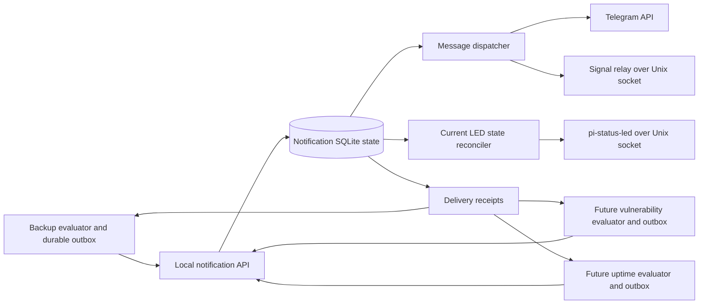

# Implementation plan for the shared notification worker

Reconciliation/rollback update (2026-11-06): the consolidated current work list is
[IMPLEMENTATION_STATUS.md](IMPLEMENTATION_STATUS.md); it is not a measured 90%
completion claim. `backup-worker notification-resolve` now records exact,
audited unsent/retry decisions for held legacy sources. Duplicate-risk
acknowledgement is required for uncertain retries; original rows, attempts and
dispositions remain retained. Independent file/SQL evidence, stale-review checks
and canonical acceptance protect release and coverage.
`notification-rollback` can restore initialized Telegram delivery after shared
revocation and outcome reconciliation, using a new canonical `legacy-active`
generation and separate native sender units. Shared dispatch cannot use that
generation; retained canonical leases protect legacy I/O. Explicit revocation
tombstones it. Capable pinned binaries are required before cutover; uncertain
shared outcomes, missing/compacted required evidence and later generation/helper
migrations remain explicit limitations. The managed startup guard now applies
inactive-producer enforcement to verification mode, allowing admitted delivery
mode to restart with active producer generations. Native restoration pins the
reviewed Telegram credentials and fails closed on canonical identity/recovery
changes. The per-criterion evidence map is [ACCEPTANCE_MATRIX.md](ACCEPTANCE_MATRIX.md).
See [the operational guide](examples/notification-worker/BACKUP_CUTOVER.md).
Recovered Telegram/Signal, command/LED production admission, later recovery epochs
and external qualification remain open. Earlier dated checkpoints below describe
the state before this update.

Managed backup cutover update (2026-11-06): the initialized outbound-only
Telegram profile now has an executable per-producer handoff and report-service
migration. `backup-worker notification-cutover --local --review` prints pinned
legacy evidence; `--apply --spec ABS` applies/resumes the exact reviewed request.
Compatible helper/image probes, exact unit checks and retained setup, notifier,
attempt, gateway operation, installation and worker leases protect the transition.
File/SQL intent anchors retain the legacy fence. Accepted history is preserved;
explicitly reviewed unsent work is exported; ambiguous/incomplete work stays held
and degrades delivery health without starving fresh reports. Credential-free
report service/timer/path installation follows exact generation staging/activation.
`--revoke --spec ABS` drains reports, tombstones the generation and imports receipts,
retaining the legacy fence. This implements fenced rollback; releasing held rows
and restoring a new legacy generation remain separate unfinished reconciliation
work. Signal/recovered gateways and command/LED admission remain unsupported.
See [the operational guide](examples/notification-worker/BACKUP_CUTOVER.md).
Earlier dated checkpoints below describe the state before this update.

Legacy backup delivery evidence update (2026-11-05): durable before-send
reservations, atomic outcome/acceptance commits, crash-to-ambiguity recovery and
an inode-pinned dispatch lease now preserve legacy outbox evidence for a later
producer cutover. `backup-worker delivery-review` is observational and explicitly
does not certify complete older history or authorize migration. Legacy retries
and fallback retain their existing duplicate-risk semantics. Attempted events
are refused as fresh shared exports and excluded from automatic batching.
Generation activation, explicit outcome migration and managed report-service
cutover/rollback remain unfinished; manual provider tests are outside this log.

Delivery lifecycle update (2026-11-04): `activate-delivery --local --root
--manifest-hash --qualification-hash` now journals dispatcher activation for
initialized outbound-only fixed-recipient Telegram workers. Exact fresh
qualification, runtime/helper capabilities, file/SQL ownership, loaded manager
and process/socket pins guard activation. Admission is checked at startup,
periodically and immediately before sending. `deactivate-delivery` restores
verification without requiring live credentials or unexpired qualification;
explicit cancellation can supersede an interrupted activation. Ownership survives
updates, compatible rollback and uninstall. Producer generations stay inactive;
per-producer admission, recovered/Signal runtime handoff, command/LED activation
and legacy backup cutover remain unfinished. Native executable and SIGKILL
fixtures use simulated managers and synthetic credentials, not live qualification.
This supersedes older statements that every production lifecycle transition is
unimplemented. See the [delivery guide](examples/notification-worker/DELIVERY_ACTIVATION.md).

Outgoing Signal profile update (2026-11-04): `migrate-signal-profiles --local
--spec` now journals a proven outgoing transport transition for an already
supervised recovery verification gateway. Canonical configuration and recovery
hashes remain unchanged; a separately frozen effective runtime and profile proof
bind the new socket/inbox pins and affected route revisions. Existing queued
routes and Telegram evidence are retained. Runtime health exposes the profile
hash and periodic audits stop the gateway on proof loss. Capability checks,
interruption/SIGKILL fixtures and native-process tests cover this verification-only
transition. Production activation, Signal runtime handoff, legacy fixed-recipient
conversation enrollment and backup cutover remain unfinished. This supersedes
older checkpoint statements that all outgoing profile migration is unavailable.
See [the profile migration guide](examples/notification-worker/SIGNAL_VERIFICATION.md#outgoing-profile-migration).

Activation admission update (2026-11-04): `activation-review --local --root`
now composes the pinned verification revision, latest qualification, local provider
identity, recovered request seals/cursors and current Telegram handoffs into a
read-only prerequisite inventory. Worker inspection requires an inactive gateway
and exclusive installation/worker leases; it performs no shutdown, polling, repair
or fence changes. Managed Signal verifier health is checked separately from
outbound profile pins; stale/legacy pins require an explicit migration. A saved
review grants no authority. Production activation, command admission, Signal runtime
handoff/profile migration and backup cutover remain unfinished. SQLite inspection
refuses nonempty WAL/journals without checkpointing or ignoring their contents.
See [the admission review guide](examples/notification-worker/QUALIFICATION.md#activation-admission-review).

Managed Signal verifier update (2026-11-04): native service setup, resume,
inspection and uninstall now preserve an immutable endpoint/service binding.
The gateway can adopt a supervised endpoint directly or upgrade its existing
foreground binding with `supervise-signal`; the unit gains explicit dependency
and ordering. Capability, loaded command, process/Unix-peer identity and health
pins constrain startup. Account/intake/command fences remain closed. Local
lifecycle, crash and real-process fixtures cover the implementation, with a
simulated manager; actual user-systemd/ARM64 qualification remains open. Service
binary upgrade/re-enrollment and later recovery epochs still need explicit
transitions. Legacy backup-relay/backup cutover and production admission are not
completed by this step. This supersedes older checkpoint statements below that
endpoint supervision is unimplemented. See the
[service guide](examples/notification-worker/SIGNAL_VERIFICATION.md#managed-endpoint-service).

Managed Signal gateway update (2026-11-03): `adopt-signal --local --spec` now
adopts the staged configuration into an existing recovered gateway verification
service. Exact old/new runtime bytes, publication and endpoint pins constrain the
change; the helper and replacement executable must advertise support. An immutable
adoption intent and independent retained endpoint copy survive lifecycle crashes.
The gateway remains separate from the account-owning verifier, adds no account
mounts, checks endpoint health before serving and periodically, and exits on loss
of that proof. Health reports the endpoint hash and loop observation. Updates,
compatible binary rollback and uninstall retain the binding; existing Telegram
renewals cross only the proven Signal-only change without polling or re-dating.
Tests include SIGKILL, drift, combined Telegram state and two native processes with
a fake manager. Endpoint supervision/user-systemd qualification, legacy backup
relay adoption and production activation remain open. This supersedes older
checkpoint text describing gateway configuration adoption as unfinished.

Signal verification endpoint update (2026-11-03): `signal-verification-prepare`
now enrolls an exact completed account/inbox recovery against the published gateway,
with an immutable endpoint manifest, independent destination receipt and staged
`gateway-next.json`. `signal-verification-serve` runs a separate, health-only Unix
endpoint while retaining account/source/destination leases. It rechecks evidence,
rejects all provider/intake operations and exits on authority loss. The staged
configuration preserves original route labels and other profiles; it is not yet
applied to the managed gateway. SIGKILL, local socket, read-only database and built
executable restart tests cover this step. Managed endpoint/unit/configuration
cutover, legacy backup-relay adoption and production activation remain unfinished.
See [the endpoint guide](examples/notification-worker/SIGNAL_VERIFICATION.md).
This checkpoint supersedes earlier statements that verification startup is absent;
startup is now available as a foreground CLI, not as a managed service transition.

Podman recovery update (2026-11-03): `recovery-signal-podman-handoff --local
--spec` now implements the rootless interactive Quadlet backend. It pins local
image/container IDs, source/generated unit hashes, typed manager commands,
credentials and Podman storage roots. Container isolation/mounts and the actual
process executable, mount inodes and account/inbox flocks are verified before
stop. A descriptor-pinned read-only helper uses the rootless user namespace; the
separate mount-free/network-free image probe verifies both recovery support and
the executable hash. Exact retries permit the original container's removal but
refuse replacement/renaming. The account gate remains closed after installation.
Tests use the real Quadlet generator and a real rootless scratch container in a
private VFS store, with synthetic accounts and fake systemd. This does not adopt
the legacy backup relay or implement endpoint switching/production activation.

Signal account recovery update (2026-11-03): the internal `FenceRecovery`
coordinator now pins service capability/binding, target, account directory/lease
and linking-maintenance history. Intent and an independent fence precede service
stop; the account lease then proves cooperating CLI children have exited.
`InstallSignalRecoveryWithService` composes this with the exact published gateway
and offline inbox installation. Saved results are independently verified on replay,
with no repeat apply; completion keeps account runtime disabled. Ordinary relays,
linking, resolution and service maintenance respect the gate. The read-only CLI
`signal-recovery-status` and a separate recovery-capability probe are available.
Six SIGKILL boundaries, inherited-child leases, identity drift, retained-evidence
loss and native executable refusal tests cover the transition. The native
user-systemd adapter `recovery-signal-handoff --local --spec` now pins loaded unit
properties, typed ExecStartEx arguments, owned file hashes, credentials and the
active process/account/inbox leases. It uses the coordinator to stop and install the
offline inbox, with exact replay after an ambiguous stop. Built-CLI tests use
real disposable processes and fake managers. The rootless Podman backend below
now adds image/container and live mount/lease proofs. Endpoint/configuration
cutover, verification service startup, legacy backup-relay adoption and production
activation remain unfinished; neither command installs a unit.

Interactive extension: [the interactive worker command plan](INTERACTIVE_WORKER_PLAN.md)
defines Signal/Telegram replies, explicit worker addressing, durable command
handoff and worker-owned risk decisions. Its contract implementation is in progress and does
not replace this plan's unfinished production requirements.

Managed Telegram lifecycle update (2026-11-03): `renew-telegram --local --root`
now stops the adopted recovery verification service under the operation lease,
holds the installation/worker leases and freezes its predecessor request before
provider work. Service/unit/configuration/lease drift stops subsequent polling or
ACKs. Independent managed request and receipt records bind the worker archive;
`resume` never re-polls a completed renewal. Only verification mode restarts, with
the renewal ID in health and a full audit under the runtime's retained worker
lease. Update/compatible binary rollback/uninstall preserve the pin. The explicit
`upgrade-helper --local --spec` transition lets older same-schema installations
replace their pinned helper without changing configuration or recovery identity;
old helper artifacts are retained and rollback cannot cross that boundary.
External bot consumers must still be stopped by the operator. This completes the
local Telegram renewal lifecycle, not production cutoff installation/activation or
Signal service handoff. Tests include lifecycle SIGKILL, service drift before a
positive ACK and the built executable with fake provider responses.

Telegram renewal update (2026-11-03): an internal `RenewPublishedTelegramHandoff`
API now records a new drain without rewriting the published cursor or canonical
database. Each request pins its predecessor and has an exact retry identity.
Immutable sanitized pages and a separate root checkpoint precede provider ACKs;
retries start at zero and completed observations are never re-dated. The latest
completion and every ancestor are independently verified by
`recovery-telegram-check --renewal-hash`, including boot, clocks and freshness.
Starting a successor prevents fallback to older proofs. Bounds cover generations,
pages and retained page bytes. Eight SIGKILL cases include lost response after ACK.
The managed Telegram polling CLI and verification restart are now implemented as
described above. Production cutoff installation/activation and Signal service
handoff remain unfinished; renewal grants no execution/intake authority.

Published Telegram handoff update (2026-11-03): `recovery-telegram-check` now
compares retained and live cursor/request evidence under the worker lease and
rechecks current boot, wall/monotonic clocks, expiry and cutoff. It makes no
provider requests, does not renew the original observation and grants no intake
authority. Missing zero-offset rows fail closed. Separately journaled renewal is
implemented as described above; managed production activation remains unfinished.

Signal runtime installation update (2026-11-03): `recovery-signal-install` now
binds a retained relay cursor to the exact completed gateway publication while
holding the gateway and source/destination inbox leases. It installs a schema-5
runtime baseline into a separate private destination, keeps the old source intact
and fenced, and retains an immutable runtime image with independent completion
records at both paths. Exact retries recover interrupted copies/transactions;
sealed corruption and changed destinations are refused. The verification opener
validates retained source evidence and rejects receive/list/ACK operations.
Tests cover surviving/restored sources, inherited baselines, all ten SIGKILL
boundaries, gateway composition, CLI/dry-run and the native executable. Managed
Signal account/service handoff, endpoint cutover and production activation remain
unfinished; this command starts no receiver and makes no provider requests.

Managed recovery verification update (2026-11-03): `adopt-recovery --local --spec`
now connects completed publication to an existing managed verification service.
An exact commit pin and the old/new identities bind the installation transition;
worker intent/completion records admit only verification runtime. The installer
stops/drains its pinned service, retains the installation lease, probes both new
executables, promotes the capable helper, and checks identity/revision/commit in
runtime health. Restarts validate the retained proof and live SQL anchor even after
verification-runtime writes. Update/uninstall preserve the pin; rollback cannot
cross the recovery transition. Tests cover interruption/SIGKILL, altered evidence,
provider/LED retained-state composition and a built native runtime on local sockets.
Production activation, current provider handoffs and repeated recovery remain open.

Canonical publication update (2026-11-03): `recovery-publish` now freezes an exact
ready review and installs its prepared image with an atomic database exchange.
Independent intent/seal/completion records, source/image hashes and retained old
bytes support crash resumption without a missing-state window. Pending durable
stages block publication, with explicit exceptions for fenced absent producers
and proven absence of LED history. Provider activation rechecks remain pending.
The completed transition preserves quarantine and source/command fences. Managed
activation, ancestor-chain integration and subsequent recovery epochs remain open.

Historical image verification update (2026-11-03): `recovery-publication-verify`
checks a completed prepared image and its full retained checkpoint proof without
reading current canonical or mutable recovery state. It requires exact
operation/review/checkpoint/proof/image pins, verifies anchor, logical projection,
bytes and intent/seal/completion records, and repairs nothing. Preparation uses
the same completed-image reader for its final check. This provides independent
evidence for a later canonical transition; publication authority, ancestor-chain
integration and production activation remain unfinished.

Publication image update (2026-11-01): `recovery-publication-prepare` now builds a
sealed private database image from an exact current review/checkpoint/proof. It
adds a fenced historical-proof metadata anchor, checks all remaining logical data
against the reviewed projection, and supports crash-resumable intent/seal/completion
records. The canonical database and current recovery remain unchanged; no pending
stage or delivery/execution fence is cleared. Existing anchors are refused until
ancestor reconciliation exists. Canonical replacement, completed publication
authority, ancestor-chain integration and managed activation remain unfinished.

Historical proof verification update (2026-11-01): the local
`recovery-checkpoint-verify` command validates retained source/candidate/original
and checkpoint databases, their epochs and acknowledgments, archived ownership
history and sealed evidence using exact operation/review/checkpoint pins. It reads
independently of canonical and mutable reconciliation files and returns a stable
proof digest without repair or activation. This supplies a verifier for future
ancestor/publication references; ancestor-chain integration, canonical publication
and activation are still unfinished.

Recovery evidence update (2026-11-01): `recovery-checkpoint` now also retains
byte-for-byte copies of stage JSON, worker identity/recovery records, complete
ownership histories and administrative intent/result files. A bounded inventory,
intent, seal and completion record bind these copies to the reviewed projection.
Retained proofs can be validated independently after canonical heads change;
completed damaged copies are refused. Review additionally verifies the original
administrative audit, its reconciliation acknowledgment and independent file
history without applying pending decisions or recreating result files. Current
epoch evidence capture is implemented; ancestor-chain integration, completed
database publication and production activation remain unfinished.

Recovery checkpoint update (2026-11-01): `recovery-checkpoint` now retains a
review-pinned immutable reconciliation database, including committed WAL pages,
SQLite header values and implicit row IDs. Intent, seal and completion records
support interrupted-copy resume without rebuilding a lost sealed artifact. The
worker and all producer leases span capture and review revalidation. This closes
the projection-copy prerequisite. Current-epoch evidence capture is described
above; completed publication authority, repeated recovery and production
activation remain pending.

Recovery ownership update (2026-11-01): `recovery-fence-producer` now rotates an
absent producer's canonical ownership into the quarantined recovery epoch while
revoking old generations and retaining a durable reconciliation-pending marker.
No completion summary or delivery authority is fabricated. Schema-3 ownership
history supports exact crash recovery and subsequent summary-bound reconciliation;
staging remains prohibited until then. Independent producer recovery is tested.
This closes the ownership prerequisite for absent producers, not final recovered
database publication or production activation.

Status: implementation in progress, not production-ready. Local protocol, durable
queue/dispatch primitives, messenger adapters, a Signal relay, LED client and
aggregate reconciler, and backup producer-ledger primitives now exist. Existing
backup notifications remain the production code path. Production activation is
unavailable until the remaining migration, recovery and qualification work passes.

Current implementation and verification (2026-11-01):

- Local `recovery-status` now inventories the existing offline projection under
  the worker and all producer leases without initializing or completing stages.
  It checks producer ownership/history, delivery evidence, explicit retry/cancel
  applications, command outcomes, request seals/provider cursors and inherited LED
  ownership/epoch/cleanup history. Hashes pin committed SQL contents and independent
  evidence; changed evidence, schema loss and damaged completed proofs are errors.
  Pending stages and retained fences remain explicit. This is an observation for
  the future publication coordinator, not publication/activation authority; provider
  cutoff freshness and receiver shutdown still need revalidation at activation.

- Recovery preparation now checkpoints and seals the original database, including
  committed WAL contents, into a separate private archive. The preservation record
  pins operation, snapshot, both epochs, configuration, schema, size and checksum;
  an independent SQL acknowledgment and completed file state are required for use.
  Interrupted copies resume under the existing worker lease; completed damaged
  copies are refused. LED source/domain readers use the immutable archive, with
  canonical-source drift checks retained until publication. WAL-only commits,
  partial copies, lost/damaged authority, lease replacement and process kills are
  covered. This completes original-source preservation, not final publication or
  the ancestor-proof handling required for a second recovery.

- Local `backup-worker recovery-handoff` now performs summary-pinned producer
  ownership/generation transfer and source delivery commit, plus command recovery,
  identity commit and retained outcome installation when commands are enrolled.
  A single offline gateway session spans every stage. Commands and delivery remain
  fenced; no provider or domain side effect occurs, and no old receipt is relabeled
  or new receipt acknowledged. CLI replay survives partial commits and lost output,
  and exact LED cleanup proof remains usable afterward. Managed service/runtime
  configuration handoff and final publication remain separate unfinished work.

- `recovery-prepare --local --from … --snapshot-id … --database-hash …` prepares or resumes
  offline snapshot quarantine, preserving the original database and pinning the
  verified database hash initially and the full manifest across retries. It refuses a live worker lease, missing
  state and changed evidence. CLI/native tests and SIGKILL at quarantine and preservation
  boundaries cover preparation and resume. The returned operation ID pins the
  new `backup-worker recovery-notifications` CLI, which reconciles the producer
  ledger while keeping active binding/cursor, dispatch and command fences intact.
  Completed summaries replay without a new evaluation. These commands do not
  provide final recovered publication, service orchestration or activation.

- Local backup recovery now exposes `backup-worker recovery-led-evidence` and
  `recovery-led-clear`. They require existing backup producer reconciliation,
  private installed configurations, separate existing state directories and the
  exact reviewed inventory/hash. Cleanup additionally pins the backup binding,
  fault, domain evidence and committed LED epoch handoff. It retains the source
  leases during fresh domain checks and Clear, then imports only completed cleanup.
  Lost output resumes historical results; uncertain attempts never replay or import.
  CLI/dry-run/scope tests, real SIGKILL at the three coordinator handoff boundaries
  and built-native CLI/pinned mock-daemon coverage are included. This does not
  initialize state, create quarantine, reconcile the producer from scratch, change
  services or publish/activate recovery. Other producers, remote orchestration and
  worker aggregate cleanup remain unfinished. See README and `progress.md`.

- `recovery-led-import-cleanup` now imports an exact committed named-binding clear
  receipt after epoch handoff. Only acknowledged or freshly domain-authorized
  observed-absence results qualify; uncertain/not-sent attempts remain unresolved.
  An independent chained journal and atomic SQL acknowledgement/fault-row removal
  preserve exact crash retries. The full old incarnation stays in the epoch
  archive, and other faults stay fenced. Runtime validates imported receipts and
  excludes only proven completed cleanup from inherited fault counts; incomplete
  imports and damaged provenance block output. No daemon request, new proof lease,
  domain resolution or activation is created. Review exposes bounded importable
  receipts and durable imports. Worker aggregate cleanup, managed producer cleanup
  orchestration and final recovered-state publication remain unfinished.

- `recovery-led-handoff` now archives original LED operation/mapping journals and
  the adopted fault union before atomically creating empty histories for the new
  recovery epoch. Exact adoption/configuration/socket/UID and preserved sources
  are required. Independent intent plus SQL acknowledgement support crash resume;
  retries preserve subsequent new-epoch operations. Original and migrated layouts
  retain their full old history; runtime validates both epochs and keeps inherited
  faults fenced. The CLI sends no daemon requests and leaves quarantine intact.
  Worker aggregate reconciliation and final recovered-state publication remain
  unfinished. See `progress.md` for
  focused, process-kill and native mock-daemon validation.

- Runtime primitives now validate inherited LED fault ownership against the exact
  committed adoption, preservation and sealed inventory, with canonical/SQL
  identity, UID and mapping checks. The offline adoption reader still validates
  the complete quarantined projection. Runtime health exposes inherited counts
  and remains critical/unknown; ordinary source updates cannot discharge those
  faults. New fault incarnations use the current epoch; normal Set/Clear and cleanup
  selection exclude inherited IDs. Old operation/mapping journals still block
  output until a proper epoch handoff. Missing/changed provenance, deleted rows
  and legacy relabeling fail closed. This is groundwork for publication, exercised
  on a borrowed fenced candidate in tests:
  runtime-wide reconciliation and final recovered-state publication remain pending.
  No runtime open/activation gate was removed. See `progress.md` for test evidence.

- Explicit local `producer-retire` now previews/applies permanent retirement after
  all generations are revoked and delivery, acknowledgement, command, policy,
  subject and LED obligations are settled. Schema-4 canonical ownership history
  preserves the original actor/reason/evidence across interruptions and recovery
  transitions. New work and activation are refused; retired heartbeats no longer
  degrade unrelated producers. History remains retained and restored ledger
  conflicts fail closed. Tests include actual SIGKILL, native CLI, crash/replay,
  cross-producer isolation and receipt compaction. Configuration removal and
  producer-host decommission orchestration remain separate work. See the
  administration guide and `progress.md` for validation and limitations.

- Managed `migrate-led --local --spec …` now changes only LED bindings on the
  installed verification service. The lifecycle pins old/new configurations,
  identity and inactive ownership, probes runtime/helper capability before stop,
  and uses its exact operation ID for the mapping journal. Interrupted migrations
  resume through the staged helper; completed resume/startup verify the mapping
  without daemon writes. Fault rows on changed bindings still block migration;
  old fault cleanup and recovered ownership are not inferred. Service publication,
  lost daemon replies, eight SIGKILL boundaries and native executable/mock-daemon
  integration are covered. The normal fault-clear loop also checks the current
  caller-owned registry state before rechecking source evidence and issuing Clear.
  See `progress.md` for final validation. UID/socket/other configuration migrations,
  recovered ownership reconciliation and production activation remain unfinished.

- Explicit `migrate-schema --local --spec …` now handles the installed verification
  schema 9 → 10 transition with unchanged identity/configuration/exclusions.
  Migration-capable runtime and helper binaries are pinned before service stop;
  the old helper remains retained, and the new helper has its own immutable release
  path. The worker lease covers WAL checkpoint, verified original DB backup and
  atomic migration/SQL acknowledgement. Independent intent/completion and a state
  gate allow exact crash resume without reapplying the upgrade or recreating state.
  Unfinished migrations cannot be bypassed by uninstall; rollback cannot cross the
  schema/helper change. Seven worker and eight installer SIGKILL boundaries,
  committed-WAL retention, corruption/gating and native helper/process migration
  are covered. Final managed/native tests, the broader worker/install/backup race
  suite, vet and ARM64 cross-build passed. These do not qualify real user-systemd
  or native ARM64 execution. Other schema/config/UID/socket transitions remain pending.

- `recovery-led-adopt --local --inventory … --inventory-hash …
  --preservation-hash …` now applies the preserved fault union to the quarantined
  reconciliation database. A fresh pinned inventory/registry check precedes intent;
  row replacement and acknowledgement commit atomically. Exact retries retain
  IDs/epochs, reset executable cleanup flags, and never reissue daemon writes.
  Original cleanup history remains in immutable evidence. Reviews and domain proofs
  use the retained source view only after verifying every merged ledger row.
  Adoption neither recreates previously cleared states nor authorizes cleanup.
  Tests cover four actual SIGKILL boundaries, corruption/drift, cleanup on either
  side of adoption, the full 2,048-fault merge/reopen/review, and the built CLI with
  the pinned mock daemon. The final LED recovery race suite and broader affected
  worker/installation/backup race suite passed; native ARM64/physical-LED execution
  remains deferred. Normal-runtime acceptance, runtime-wide reconciliation and final publication
  remain unfinished; quarantine and all activation fences remain in place.

- `recovery-led-preserve --local --inventory … --inventory-hash …` now prepares
  a durable, exact union of restored and preserved-original LED fault ownership
  for later publication. It preserves original IDs/epochs and both cleanup flags;
  post-snapshot faults cannot disappear and foreign/unrecognized states remain
  unowned. Matching layouts/UID, current source hashes and a fresh registry check
  are required before intent. A separate immutable file and SQLite acknowledgement
  survive interruption without renewing evidence or repeating registry I/O.
  Review exposes the retained summary and source drift. Three actual SIGKILL
  cases, corruption/expiry/domain-authority tests, and the pinned mock daemon plus
  built executable cover this path. It does not alter source fault ledgers or
  the daemon, adopt runtime ownership, clear faults, publish health or activate
  recovery. Runtime adoption/reconciliation and final publication remain unfinished.

- Signal account linking now runs through a shared fenced entry point rather than
  invoking the CLI directly. Both relays use the same account lease and bounded
  durable link journal. Launch markers precede CLI execution, inherited descriptors
  protect surviving children, and ambiguous linking blocks relay startup until
  explicit account-state review. Exact retries never repeat a possibly executed
  link. Six SIGKILL cases and the actual pinned AMD64 JVM/Podman offline path are
  covered. A common service coordinator now gates auto-start before stopping the
  relay and journals original activity, exact service bindings and link outcome.
  The backup adapter restores prior activity; eleven further SIGKILL cases cover
  coordinator recovery, and native executable review/resume is tested. Uncertain
  linking still needs explicit review; repeating the backup command resumes its
  retained operation, including completed attempts after lost replies. Fresh linking
  uses `--new-link` or an explicit new operation ID. Installation changes share the
  coordinator lock and reject unfinished maintenance. Shared relay installation/account handoff and actual
  user-systemd/live linking qualification remain unfinished. See
  `examples/notification-worker/SIGNAL_MAINTENANCE.md`.

- Local `qualification-template`, `qualify --report …` and `qualification-status`
  now record immutable operator evidence tied to the exact managed revision,
  configuration/routes, credential fingerprints, architecture and UID. Generated
  checks cover each configured provider, route, producer and interactive/LED
  capability. Reports can be partial or failed, expire after 30 days, and never
  grant activation authority. Bounded hash-linked records and an independent head
  preserve interrupted acknowledgements; exact retries cannot refresh evidence.
  Signal image and LED daemon identities are operator attestations, not live
  discovery. See `examples/notification-worker/QUALIFICATION.md`; actual live
  qualification and production lifecycle gates remain unfinished.

- Offline `receipts-compact` now previews/applies bounded acknowledged intermediate
  receipt cleanup. The audit window defaults to 90 days (`receipt_audit_days`,
  minimum 90). Latest outcomes, administrative receipts, acknowledgement endpoints,
  immutable messages/replay fences and chat references are retained. Deletion and
  cumulative per-epoch counters commit together; inspection reports holes without
  issuing a consumer cursor. Startup/snapshot verification rejects contradictory
  summaries. This does not compact final outcomes, messages or administrative audit.
- Managed `rollback --local --root … --from-revision …` re-releases a retained
  executable through the existing update journal, preserving current configuration,
  identity, schema, state and recovery helper. Selected/current manifests and
  artifacts must match, and concurrent installation changes cause refusal. Repeated
  requests for already installed bytes do not restart the service. An unfinished
  update can first be cancelled by uninstall; rollback can then reinstall a retained
  executable in verification mode. Cross-schema/configuration rollback remains
  outside this path; production activation is still fenced.

- Offline `message-review`, `message-decide` and `message-decision-status` now
  implement explicit audited retry/cancel without exposing mutation over the
  producer API. A five-minute wall/monotonic/boot-bound review pins the event,
  configuration, route, ownership, epoch and receipt head. Ambiguous retries need
  duplicate-risk acknowledgement; retries preserve attempts, validity and normal
  grants. Cancellation never proves delivery or resolves domain incidents.
  File intent, atomic SQL mutation/receipt/audit and independent result persistence
  survive interruption. Startup never applies pending intents; committed retries
  return the original result without reopening progressed events. History is
  bounded at 1,024 decisions, without silent eviction. Snapshot quarantine archives
  old decisions; reconciliation preserves later original-database decisions only as
  audit, without issuing new-epoch receipts or replaying actions. See
  `examples/notification-worker/ADMINISTRATION.md`. Retirement, receipt/audit
  compaction and final recovered-state publication remain unfinished.
- Storage schema 10 fences older binaries/recovery helpers that would ignore
  administrative history. Unmanaged staging upgrades compatible older state
  transactionally; managed runtime/administration rejects implicit upgrades.
  Schema-6/7/8/9 snapshots remain readable in quarantine. Other managed schema migration
  and helper replacement remain explicit unfinished requirements.

- Native local verification installation now has `setup`/`update --local --spec`,
  `resume`, `uninstall` and `installation-status`. It atomically publishes prepared
  roots, retains independently pinned recovery helpers and immutable releases,
  journals file/manager transitions, preserves worker identity, fences concurrent
  runtime/installer access and requires exact runtime revision health. Existing
  inactive state is initialized explicitly beforehand. Missing state, old schemas,
  changed configuration/exclusions and foreign units/drop-ins/aliases fail closed.
  Uninstall retains state and all LED fault/cleanup history without issuing clears.
  Uninstall can also cancel an interrupted setup/update without a healthy start;
  its own interruption cannot restart the superseded installation. Thirty-six base
  interruption cases, ten double-interruption cancellation cases and 35 real
  SIGKILL cases cover setup, update, uninstall and cancellation. A built executable/Unix socket integration exercises
  preserved queued reports, update, lost start acknowledgement and uninstall;
  its service manager is a fixture, not a live user-systemd qualification.
- A separate explicit real user-manager sandbox probe now exists. The development
  host fails before process execution at `218/CAPABILITIES` (dropping capabilities
  is not permitted), so its sandbox is not qualified. No host policy was changed
  and no notification service/provider/hardware was used. Unit restrictions remain
  intact, with `PrivateUsers=true` explicit. See the installation guide for the
  opt-in transient-probe command.
- Bounded `queue-inspect` and `receipts-inspect` CLI/API views now exist. Receipt
  inspection does not update consumer listed/acked watermarks or issue ack
  authority. Tests cover pagination, encoded byte limits, producer/epoch scope,
  unexpected mutation/cursor fields and normal consumer import afterward.
  Retirement and final production activation remain separate unfinished work. See `examples/notification-worker/INSTALLATION.md`.

- `serve --local --verification` now provides the staged diagnostic runtime.
  Durable producer admission/status remain available; delivery/reply/command grants,
  chat admission and provider intake are disabled. LED reconciliation only revokes
  healthy leases and maintains unknown baselines, preserving all fault ownership.
  `verification_only` is explicit in status. The mode is process-local and leaves
  canonical ownership unchanged; managed activation still requires its own fence.
- A pure native verification-service renderer now restricts writable state,
  networking, devices and source paths, correctly quotes systemd paths/arguments
  and rejects overlapping runtime/exclusion paths. Actual systemd offline validation
  and temporary Unix API tests pass. This does not install a unit or qualify
  user-manager sandbox behavior; setup/update/removal orchestration remains pending.

- Exact named-binding LED cleanup is now implemented internally through
  `OpenRecoveryLEDCleanupSession`. Each clear pins its reviewed inventory, evidence
  hash, UID, original fault incarnation and socket. Fresh registry observations
  before and after intent persistence and a producer-owned domain guard precede
  the bounded RPC. Unknown/foreign/legacy states and the worker aggregate remain
  ineligible. Source ledgers and recovery/activation fences stay unchanged.
- Cleanup has independent immutable file intents/results plus a bounded linked
  SQLite journal. A restart never dispatches a surviving intent; uncertain attempts
  require a fresh inventory and new producer proof for another attempt. Cancellation
  still records the outcome when possible. Review exposes attempt/unconfirmed counts
  and the last 64 results without asserting physical rendering. Seven SIGKILL
  boundaries, source/registry changes, expiry, lost replies and refreshed attempts
  are tested. Integration passed against the pinned pi-status-led daemon using its
  mock driver, temporary sockets/state and no physical hardware.
- Backup's cleanup adapter retains both source leases and validates the exact local
  acknowledged report, current ownership and a fresh speculative domain evaluation
  before dispatch. The evaluation always rolls back; it cannot publish status,
  create notification exports or advance cursors. Changed incidents, pause/run/
  qualification/probe state and clock evidence block cleanup. Managed orchestration
  and runtime-wide fault adoption/reconciliation remain outstanding.
- A synthetic uptime producer now exercises fresh/expired multi-target probe
  evidence, explicit retirement and independent daily reports. A gateway/LED test
  proves that uptime recovery preserves a scanner's faults. This is an offline
  contract fixture, not a real uptime service.

- Backup now has an internal adapter for `RecoveryLEDEvidenceSession`. It requires
  its completed producer reconciliation and fenced ownership, holds both stable
  source leases across worker calls, and uses the real domain evaluator to freeze
  a fresh full snapshot. Evaluation, status-sequence allocation and the immutable
  report share one local transaction; acknowledgement is recorded separately.
  Neither message sequence/cursor advancement nor provider delivery occurs.
  Lost replies preserve the original report, including after expiry/reboot;
  explicit inventory refresh evaluates current domain state again. Source identity,
  lease or proof changes fail closed. Eight linked reports bound local history.
  Direct integration tests use real archive/producer/quarantined-worker code with
  a fake LED registry, including six SIGKILL cases. This does not qualify hardware
  or enable managed recovery, LED adoption or production activation.
  Selected backup/archive/retirement and notification recovery race tests passed,
  along with delivery-epoch-commit integration, vet and the ARM64 cross-build.

- The internal `OpenRecoveryLEDEvidenceSession` exchange now issues durable
  producer challenges bound to a sealed LED inventory, source ownership and domain
  history, and prior LED recovery reports. Fresh reports must advance status
  sequence and preserve basis/configuration/fault/acceptance identity across both
  source databases, completed producer reconciliation and previous rounds. The
  shared contract lives in `protocol`; specialist workers need no dependency on
  the notification worker implementation.
- `recovery-led-review` now reports per-binding domain resolution proposals with
  exact fault IDs, a pinned evidence hash and bounded expiry. Full selected-subject
  coverage and fresh resolution/retirement are required. Policy faults additionally
  require exact revision transitions and current acceptance support; previous
  dependencies cannot disappear on refresh. Historical cleanup flags grant no
  authority. Wall/monotonic expiry, reboot, source drift, unknown ownership and
  mapping differences block proposals. Worker aggregate cleanup remains blocked
  on runtime reconciliation. Review alone grants no mutation; the separately
  guarded cleanup exchange above is required. No ownership adoption, health output
  or activation is enabled. The backup adapter supplies ordinary domain evidence;
  other producer adapters and managed orchestration remain pending.
- Challenge/report file intents and SQLite evidence survive process death without
  renewing their age; conflicting retries and damaged history fail closed.
  History is bounded by the eight inventory rounds, enrolled producers, payload
  limits and storage reserve. Local race tests cover policy acceptance expiry,
  missing transitions/subjects, refreshed evidence floors, domain changes,
  corruption and six real SIGKILL boundaries using fixtures. Live qualification
  remains separate. The notification race suite passed with the two known
  sandbox-blocked Unix socket tests excluded; final focused evidence tests,
  `go vet ./...` and the ARM64 cross-build also passed.

- `notification-worker recovery-led-review --local --config <runtime>
  --state-dir <state> [--refresh]` now inventories LED ownership in an existing
  quarantine. It compares restored and preserved-original ledgers with read-only
  daemon status/list observations, retaining post-snapshot faults, old epochs,
  cleanup intent differences and mapping revision hashes. Unknown/foreign states
  are preserved; legacy identities cannot acquire exact ownership. Invalid or
  configuration-incompatible sources fail closed. Free-form daemon messages are
  hashed rather than persisted or displayed.
- Recovery inventories are stored in the separate reconciliation projection with
  immutable files and a linked filesystem head. Interrupted captures resume with
  the original observation age, including after reboot. Default reads do not
  contact the daemon again; explicit refresh is bounded to eight inventories and
  storage capacity. Current observations require unchanged sources, the same boot
  and a 30-second wall/monotonic validity window. Network I/O holds no database
  mutex. Corrupted history blocks recovery reopening. This is diagnostic evidence
  only: it cannot prove domain resolution, adopt ownership, clear faults, assert
  health or activate a restored worker. Domain-proof reconciliation and managed
  publication/activation remain unfinished. Local tests cover these contracts,
  schema-6 legacy evidence, distinct mapping revisions and five SIGKILL boundaries.
  The notification race suite passed with the two known sandbox-blocked Unix
  socket tests excluded; vet and the ARM64 cross-build passed. These checks do
  not establish live daemon, physical output or native ARM64 qualification.

- Schema 9 adds `notification-worker led-migrate --local --config <old-runtime>
  --next-config <new-runtime> --state-dir <state>`. Only LED bindings may differ;
  the worker must be stopped and the runtime UID/socket must remain unchanged.
  Changed or removed bindings must first have no fault or cleanup ledger rows.
  Fresh resolution/retirement through the original runtime is the prerequisite;
  configuration changes cannot serve as fault-resolution authority.
- Migration preflights targets, named patterns, namespace occupancy and registry/
  storage capacity. It journals healthy-lease revocation and baseline changes,
  preserves unfamiliar/unchanged faults, and never asserts health. Independent
  file/database fences block normal startup until completion. Resume requires the
  original configs and socket, reuses the operation identity and retains uncertain
  outcomes. Lost baselines rewind only the baseline-set suffix, so an old clear
  cannot erase a remapped baseline. No database mutex is held during daemon I/O.
- Mapping publication atomically archives the prior mapping and bounded operation
  history. Each published layout gets a fresh revision, including a return to an
  earlier config. Startup/snapshot/recovery validate the chain and archived history;
  schema-6/7/8 snapshots remain readable. Migration history is capped at 16 and
  subject to storage budgets; archive compaction remains unfinished. This offline
  CLI does not install or restart services; the managed verification lifecycle now
  wraps it through `migrate-led`. Neither path migrates UIDs/sockets, activates
  restored ownership or qualifies physical output. Local race tests cover interruption, lost replies,
  cancellation, changed configs, faults, quota/preflight failures, corrupt archives,
  schema rollback and eleven real SIGKILL boundaries. The notification race suite
  passed with the two known sandbox-blocked socket tests excluded; final focused
  LED/migration/snapshot tests, vet and the ARM64 cross-build passed as well. Actual
  daemon/hardware and native ARM64 qualification remain separate.

- Schema 8 adds a bounded LED attempt journal, independent of messenger jobs.
  Each mutation commits its identity, binding/mapping digest, exact target and
  source-evidence digest before RPC. Completion records acknowledged, uncertain
  or not-sent outcome; interrupted attempts remain pending. The actual dispatched
  TTL may shorten the persisted upper bound after another evidence check. Healthy
  and pause leases cannot gain validity from time spent committing their intent.
  History is never replayed, including after startup. Exact fault tombstones and
  fresh evidence remain necessary for cleanup. Mutations are serialized across
  reconciler instances without holding the database mutex during daemon I/O.
- The journal retains 64 attempts per binding, a cumulative pruned boundary/count
  of unconfirmed attempts, and the full latest acknowledgement even if its row
  ages out. `system.status` exposes historical acknowledgement diagnostics under
  `led_operations`; these cannot establish current registry or visual health.
  Schema-6/7 snapshots remain readable. Schema-8 snapshot and offline recovery
  validation preserve the original epoch of this history; they cannot relabel an
  old acknowledgement as fresh recovery authority. Transactional upgrade and
  journal-integrity checks fail closed. Managed ownership reconciliation remains
  required before restored LED state can be activated.
  Local race coverage includes lost acknowledgements, evidence changes during
  intent persistence, journal write failures, bounded retention, corrupt history,
  schema rollback and six SIGKILL boundaries across sets/clears. The notification
  race suite passes with the two known sandbox-blocked Unix socket tests excluded;
  actual daemon and physical LED qualification remain separate.

- Staged interactive intake, conversion and reply loops now retry independently
  with bounded backoff and expiring process-local health. Runtime group tests
  cover delivery during an intake outage and cancellation/join on fatal exits.
  LED reconciliation permits successful loop-deadline renewals without extending
  its original evidence lease; state changes, stalls, clock uncertainty and
  producer changes still invalidate prepared work.
- The aggregate LED reconciler now checks per-UID/global registry capacity before
  creating a fault or healthy state, verifies its baseline and exact acknowledged
  state, and cross-checks the selected winner against daemon status. Missing or
  changed states, degraded hardware/storage and inconsistent observations stop
  healthy renewal and attempt to clear the lease; an unconfirmed clear still relies
  on bounded expiry. Other applications' states are preserved. Optional `health.led`
  diagnostics distinguish registry acceptance and suppression from physical
  rendering; they expire after at most 30 seconds and never imply qualification.
  Listing has one total RPC budget and rejects incomplete, reordered or duplicated
  pages. Local race tests cover these paths with in-memory protocol transport and
  injected registry faults. The pinned real mock-daemon rerun was blocked by
  sandbox Unix socket restrictions; physical LED testing remains deferred to the
  user. Required-output activation policy and recovery-safe ownership
  reconciliation remain unfinished.
- Schema 7 adds staged configurable LED bindings (up to 32 bindings and 512 total
  exact/wildcard selector entries). Each binding selects one enrolled producer and
  exact subjects or a sole `*`, reports contributing keys with explicit omission
  counts, and has separate
  baseline/healthy IDs and fault incarnations. Green is the default example; red
  requires explicit `allow_power` and an already enabled daemon target. Named
  patterns are preflighted and configurable priorities remain in severity bands.
  Mapping/UID pins and complete fault-identity records prevent silent remapping
  or cross-binding cleanup. A bounded pass advances through independent outputs;
  unavailable patterns on one binding do not stop the others. Pause indications
  expire with their evidence. Fresh retirement clears exact faults without a
  healthy lease; unknown/paused state cannot replay old cleanup tombstones.
  Legacy fault IDs are retained in an explicit migration inventory. Schema-6
  snapshots remain readable, while schema-7 snapshots preserve binding ownership
  in quarantine; restored records never acquire a fresh recovery epoch implicitly.
  Local race tests cover isolation, restart, lost clear acknowledgements, mapping/
  UID drift, corrupt ownership, maximum binding count and schema compatibility.
  Direct configuration edits to an initialized mapping remain refused. The local
  schema-9 migration path above handles explicit binding changes; managed service
  migration, restored ownership reconciliation and production activation remain required.

- `internal/notification/{protocol,client,worker,provider,relay,led,install}` contains
  the initial implementation. `notification-worker init/serve/status --local`
  provides explicitly staged local diagnostics; `notify-test --local` is an
  explicit provider send, not a qualification result.
- Schema 5 adds journaled canonical delivery-generation transitions. Each producer
  has a stable lock, an independently durable transition intent, immutable linked
  history outside SQLite and a versioned current owner. Staging, activation,
  draining and revocation publish intent before changing authority. Read-only
  observations and attempt grants reject incomplete transitions; exclusive startup
  recovery completes only the exact recorded transition.
  Startup checks the full history, including records newer than the current head,
  so restoring an old owner/head pair cannot hide a retained later revocation.
  Missing owner/lock/journal files, conflicting history and mismatched identities
  fail closed. Ordinary opens never recreate a missing instance lock, and
  initialization refuses existing database/identity files before claiming a lock.
  A schema-1–4 upgrade records existing ownership as an explicit
  incomplete baseline, preserving authority and never inventing prior send history.
  Missing legacy ownership is not silently initialized. Older binaries reject the
  upgraded schema; no downgrade or production lifecycle command is provided.
  Real SIGKILL tests cover all three publication boundaries for stage, activate,
  drain, revoke and legacy adoption, plus damaged history, old owner/head pairs,
  lost acknowledgements, low-space rejection and per-producer isolation.
  This journal is a prerequisite for migration/recovery evidence; it does not yet
  reconcile restored message queues, prove individual events unsent, rotate recovery
  epochs or implement backup ownership handoff.
- Schema 6 adds independent filesystem and database recovery fences. Offline
  `notification-worker snapshot --local --config ... --state-dir ... --to ...`
  creates a new private, standalone SQLite artifact using `VACUUM INTO`, with a
  manifest published only after validation and durability checks.
  `snapshot-verify --local --config ... --from ...` verifies its digest, size,
  schema, identity, enrollment and exact worker configuration without opening a
  worker. A live worker's instance lease blocks the offline capture command.
  Incomplete artifacts, sidecars, symlinks and configuration drift are rejected.
- An internal restore-quarantine primitive now copies a verified source, journals
  intent, publishes a new recovery epoch and atomically binds a separate restored
  candidate. Every nonterminal restored message becomes ambiguous, even a queued
  snapshot of a message accepted later. Old receipts and cursor checkpoints remain
  explicitly old-epoch audit evidence; they are not issued under the new identity.
  Restored command grants/confirmations are closed, pending commands become
  outcome-unknown, and provider inbox records are quarantined. LED ownership rows
  remain intact; no service or LED loop can open a fenced installation.
  Seven SIGKILL cases cover intent/epoch publication, both sides of the candidate
  transaction and completion. Resume retains the chosen epoch and uses the owned
  source copy. Tests also cover post-snapshot acceptance, all message dispositions,
  receipt provenance, commands, source/candidate corruption and foreign snapshots.
  **Restore is not exposed through the CLI/API.** This stage currently requires a
  readable existing installation, preserves its live database and canonical owner
  histories, and leaves the candidate quarantined. Producer/command reconciliation,
  ownership migration orchestration, candidate installation and service/relay lifecycle
  recovery are still required before a usable `recover` command can be enabled.
- Internal producer reconciliation now works on a separately journaled copy of
  the quarantined candidate. Per-producer challenges bind the recovery operation,
  new epoch, nonce, host boot and a ten-minute wall/monotonic lease. A sealed
  producer manifest declares issued/acknowledged submissions, a compacted outcome
  floor/checkpoint and the imported old-epoch receipt cursor. Bounded atomic pages
  preserve immutable payload hashes and exact retained receipt provenance.
  Retained acceptance suppresses an older queued copy; missing payloads are
  reconstructed as ambiguous. Matching pending records never prove no send.
  Conflicts reject the whole page, and replay after a lost acknowledgement is
  idempotent. Completing a producer requires every uncompacted sequence and a
  fresh challenged snapshot whose counters cover restored and retained evidence.
  Missing compacted history becomes an explicit unknown range without fabricated
  events or outcomes. Other producers remain incomplete until independently
  reconciled. Old receipts do not enter the new receipt stream, and supplied
  snapshots are retained as reconciliation evidence without publishing health.
  Five initialization and two page-transaction SIGKILL cases pass, together with
  conflict, expiry/reboot, watermark, compaction and per-producer isolation tests.
  This remains internal: managed producer commit handshakes, command/LED
  reconciliation, managed disposition application, ownership migration orchestration and final
  installation/activation are unfinished. Completion never enables dispatch.
- Backup now retains full receipt provenance atomically with domain effects and
  the imported cursor, before acknowledgement. Changed retained receipt replays
  are rejected; historical acceptance text is not upgraded into invented proof.
  Its internal recovery exporter takes the notifier lease, atomically fences
  delivery and captures immutable payload/terminal-receipt pages with issued and
  acknowledged sequence floors. It stages the target recovery identity separately:
  the active identity, old receipt cursor, obligations and cancellation intents
  remain intact. Export pages use the reconciler's shared record types, with a
  128-record/128-KiB request bound and a 32-MiB capture limit; larger captures fail
  without committing a partial fence. Missing payload history is rejected because
  backup export compaction is not implemented. Missing legacy terminal proof is
  counted explicitly, leaving classification to the reconciler.
  Nonce renewal preserves the captured evidence; binding changes, clock rollback,
  corrupt pages and lost export rows fail closed. Two real SIGKILL cases cover
  both sides of the capture/fence commit, alongside real local gateway receipts,
  replay, legacy evidence, lease exclusion, bounded paging and cursor atomicity.
  This export is now connected to the internal delivery recovery coordinator
  described below, but no recovery CLI is enabled. Managed producer recovery,
  command/LED reconciliation, managed generation handoff and installation/activation
  remain unfinished. The internal ownership epoch transition is described below.
- The internal backup recovery coordinator now exchanges real retained pages with
  the offline quarantined worker and evaluates a fresh challenged status without
  exporting new notifications. Domain changes remain durable pending source events.
  A local finish intent commits before the worker's finish call; the matching
  completion is then recorded locally. Lost begin/import responses replay retained
  evidence, while a lost finish response retrieves the exact committed summary
  without renewing its health claims. Unavailable summaries are not treated as
  incomplete exchanges; changed summaries, missing local intent, altered delivery
  counters and a lost previously recorded worker completion fail closed.
  Four real SIGKILL cases cover both sides of the finish-intent and local-summary
  commits. End-to-end tests use the actual backup/worker SQLite databases and real
  worker-generated receipts, with provider acceptance simulated. They verify that
  post-snapshot acceptance suppresses the queued copy, reconstructed messages stay
  ambiguous, and no new receipt stream, published status or delivery authority
  appears. These tests also exposed and fixed two integration defects: challenge
  issuance now uses one wall-clock sample, and unguarded alert receipts are accepted
  with their real zero status/basis counters rather than requiring a status lease.
  This remains an internal offline evidence exchange. Command/LED reconciliation,
  managed producer commits, managed disposition application, managed generation handoff and
  managed candidate installation/activation still precede a usable restore command.
- Specialist command ledgers now have a separate internal recovery exchange.
  Capture atomically pins the recovery operation, fences all normal ledger writes
  and retains original command/request identities, ordered results, old result
  receipts, acknowledgements and non-admission proofs. Existing compatible handles
  honor the fence; the changed pin encoding makes older helpers refuse normal
  reopen. Pages have ordered digests, a 128-record/128-KiB bound, and a 32-MiB
  capture limit. Missing/corrupt history is not silently rebuilt.
  The quarantined gateway imports this evidence under an independent per-producer
  challenge, reconstructs original request mappings and records terminal versus
  uncertain outcomes in separate audit tables. Running jobs, unconfirmed commands,
  conflicts and missing restored records do not acquire execution authority.
  No old result becomes a new-epoch receipt, and no confirmation or reply is revived.
  Two specialist-capture and two gateway-import SIGKILL cases pass alongside real
  specialist/gateway database exchange, lost responses, digest/gap conflicts,
  retained receipt provenance and already-open-handle fencing tests.
  This is retained command-history reconciliation, not full interactive restore:
  complete provider replay history, unresolved domain-job outcomes, final result/epoch
  mappings and managed lifecycle integration remain required. The managed lifecycle
  must drain older command consumers before capture; no production recovery CLI or
  activation is enabled.
- Signal now has an internal offline retained-history exchange. An exclusive relay
  lease permits a sealed export of acknowledged events that ordinary list/ACK
  cannot replay to a restored gateway. The export binds the account/relay identity,
  original raw-event hashes, normalized requests, rejection tombstones and original
  high-water/ACK/listed positions. Ordered evidence digests, 128-record/128-KiB pages,
  a 65,536-event bound and database/disk reserves constrain the exchange. Missing
  history, altered events and incomplete recovery schemas fail closed.
  The quarantined gateway preserves provable original request mappings, including
  redacted rejections, and records unmapped replay as uncertain evidence. Even a
  recent event whose command succeeded after the snapshot receives no fresh
  command, confirmation, target or deadline. Completion changes neither relay ACKs
  nor operational import cursors and leaves intake blocked.
  Tests cover real relay/gateway SQLite histories, reads beyond the ACK boundary,
  lost responses, restart replay, identity/digest/gap conflicts, expired/rebooted
  gateway leases and four additional SIGKILL boundaries. Relay lock deletion now
  also fences existing handles; ordinary opens cannot recreate a missing lock.
  This is an internal Go API, not a restore command. Provider recovery cutoffs,
  relay epoch cutover, unresolved request mappings, final cursor
  and epoch commits, LED reconciliation and managed activation remain pending.
- Telegram retained gateway history now has an internal offline import through
  `ReconcileTelegramHistory`. It accepts a separately retained, checksum-verified
  gateway snapshot bound to the original identity/configuration. The restored
  cursor and every restored event must be covered without conflicting hashes or
  normalized bodies. The original request mappings, confirmation aliases, command
  bodies/deadlines, gateway queries and redacted rejections survive in the
  quarantined projection. Newly recovered commands are `outcome_unknown`; retained
  gateway outcomes alone create no execution grant, confirmation, result receipt
  or reply. Pending requests with no mapping stay quarantined.
  Capture is bounded to 65,536 records/32 MiB and imports use ordered digests and
  128-record/128-KiB pages. The artifact and manifest remain pinned across retries.
  Completion records both old and retained offsets without changing the operational
  cursor. It explicitly reports `HistoryComplete=false` and `IntakeEnabled=false`:
  native update-ID gaps and even an empty snapshot cannot establish complete
  provider history. No Telegram polling or ACK is performed.
  Tests cover actual snapshots/SQLite history, a successful post-snapshot confirmed
  command, confirmation aliases, minimal rejections, missing mappings, changed
  artifacts, empty/multi-page history, lost responses and four additional SIGKILL
  cases around import/completion commits. Shared recovery quota checks now include
  uncheckpointed SQLite pages. Managed provider drain/cutoff integration, absent historical
  evidence, relay epoch cutover, final identity/cursor commits, LED reconciliation and
  managed recovery activation remain unfinished; there is still no restore CLI.
- Telegram recovery now has a separate internal `DrainTelegramRecovery` polling
  loop after retained-history reconciliation. It holds the offline worker lease,
  checks webhook/account identity, and uses recovery-bound destination routing.
  Every invocation starts at offset zero; only a committed, independently journaled
  page permits a higher offset. This follows Telegram's
  [offset acknowledgement contract](https://core.telegram.org/bots/api#getupdates)
  without assuming a retained high offset is safe after an interruption.
  Returned input stays quarantined. Existing mappings are checked without creating
  commands or renewing authorization; unauthorized new text is reduced to rejection
  evidence. A hash chain and separate atomic progress file detect missing pages,
  database rollback and lost inbox evidence before further provider access.
  A database commit one page ahead of its file can finish publication after restart.
  An empty response records an immutable, dated observation with boot/uptime and
  `HistoryComplete=false`/`IntakeEnabled=false`; normal import cursors stay unchanged.
  Runs are bounded to five minutes and 4,096 retained pages per account/recovery.
  Tests use the real adapter with an in-memory HTTP transport and an independent
  fake provider acknowledgement record. Seven SIGKILL cases include lost responses,
  database/file publication, positive provider ACKs and completion publication.
  Lower native IDs after interruption, preflight conflicts, redaction, changed
  payloads and damaged progress also have regression coverage. No live bot was
  contacted. Stopping other receivers, final cutoff/freshness checks, epoch/cursor
  installation and activation remain managed-lifecycle work; no CLI invokes this API.
- Signal relay database recovery now has internal `SnapshotInbox`,
  `VerifyInboxSnapshot`, `PrepareInboxRestore` and `ResumeInboxRestore` APIs.
  Snapshots require the exclusive relay lease and publish a standalone, private
  database plus a manifest bound to the account, identity, schema, byte digest,
  ordered event digest and high-water/ACK/listed positions. Legacy snapshots use
  32-MiB/65,536-event evidence limits; baseline snapshots allow 33 MiB for embedded
  proof and at most 65,536 retained events, independent of reserved positions.
  Incomplete artifacts, sidecars, identity
  conflicts, event gaps and unsafe file aliases are rejected.
  Restore keeps an immutable source and a separate quarantined candidate, publishes
  a new relay epoch and durable recovery-operation pin, and preserves the live
  database and its sidecars without opening or replacing them. It also supports a
  missing or corrupt live database when the original private identity and stable
  lock survive. Old watermarks and prior export data remain audit evidence; the
  candidate receives no inherited ACK authority. Both history completeness and
  intake-enabled flags remain false.
  Normal startup, existing compatible handles and interactive send/reply paths
  honor the fence. A lost restore journal cannot bypass the pinned operation.
  Resume keeps the same epoch and works from the retained source if the original
  backup mount disappears. SQLite recovers an interrupted candidate transaction;
  completed candidates and immutable artifacts reject unbound sidecars.
  Five new SIGKILL cases cover journal preparation, epoch publication, candidate
  transaction/commit and completion. Tests also cover corrupt/missing live state,
  lost commit responses, schema-1/2 artifacts, empty history, aliases, unsafe sources,
  changed epochs and damaged journals/candidates. This is quarantine, not relay
  activation: unresolved event/request evidence, gateway pin/cursor handoff,
  draining all account consumers (including orphaned Signal CLI children), final
  cutoff/LED reconciliation and managed installation
  remain required. The inbox lease alone does not prove that those consumers have
  stopped. No production restore CLI is enabled.
- A quarantined relay now exposes old-epoch evidence through the internal
  `OpenRestoredRecoveryInbox`/`ReconcileSignal` exchange. Its manifest binds the
  original account/identity, snapshot ID/checksum, relay restore operation and
  staged new identity. An older relay snapshot can be reconciled with a newer
  gateway snapshot without pretending the lost relay positions still exist.
  The gateway records its pre-import high-water mark and the known missing relay
  suffix. It preserves gateway rows and original command mappings outside the
  artifact; it neither fabricates relay events nor creates fresh command authority.
  Unknown history beyond the observed watermark remains unknown, including when
  no missing suffix can be established. Summaries always keep
  `HistoryComplete=false` and `IntakeEnabled=false`.
  The original operational cursor and old/new relay pins are not switched by
  this exchange. Source and candidate checksums remain unchanged. A separate
  atomic export journal and root operation/completion markers bind one gateway recovery;
  missing export evidence, changed epochs, renewed stale pages and conflicting
  completion summaries fail closed. A retained root completion digest also rejects
  an export file rolled back to its pre-completion state. A crash between export-file and marker
  publication resumes the same binding. Completed summaries survive expiry and
  restart without acquiring fresh lease authority.
  Seven new SIGKILL cases cover export publication, completion publication and
  gateway page commits. Tests include empty/older/equal/newer relay snapshots,
  post-snapshot command execution, multi-page bounds, nonce renewal, lost responses,
  corrupt/deleted evidence, lock replacement and missing-history conflicts.
  Managed lock opens now reject FIFO substitutions without blocking.
  Runtime relay/gateway activation, provider drain/cutoff, missing
  request dispositions, LED reconciliation and activation remain unfinished.
- Ambiguous delivery choices now have an internal offline
  `OpenRecoveryDispositionSession` API. Each retry/cancel instruction binds the
  recovery operation/new epoch, enrolled producer, immutable message hash and
  completed producer-reconciliation summary. It records an operator identity,
  bounded reason and explicit duplicate-delivery consent for retry. Only exact
  ambiguous payloads covered by retained producer evidence are eligible; terminal
  receipt evidence, missing payloads and incomplete/changed summaries are rejected.
  An immutable per-message file intent commits before the SQLite projection.
  An interrupted projection can replay only that exact instruction, preserving
  its original audit timestamp. Different request IDs, actions or actors cannot
  replace the choice; request IDs are scoped to the producer/message. A committed
  database row without its matching file journal fails closed.
  Three new SIGKILL cases cover file intent, SQL transaction and committed response.
  Tests also cover conflicts, missing/corrupt evidence, terminal acceptance,
  restart, epoch drift and explicit consent. Every reconciliation transaction now
  rechecks the held lock inode and installation/recovery/manifest bindings before
  work and before commit; existing stale handles cannot keep writing.
  These are staged lifecycle instructions, not send/cancel receipts or command
  authorization. Messages remain ambiguous, delivery remains disabled and existing
  reconciliation summaries stay unchanged. A separate internal application step
  is described below; final retry generation/validity/status checks, resolution
  of missing compacted history and managed activation remain unfinished.
- Local staging now includes `recovery-review` and `recovery-decide` commands.
  Review exposes the immutable message, producer-summary/epoch bindings and
  an explicit `none`/`intent`/`recorded` decision state. Its request ID survives
  an interrupted decision and is reused on retry. Inspection does not project an
  unfinished intent or record a choice; opening the session can initialize local
  reconciliation metadata.
  Decision submission consumes a bounded, owner-private 0600 review file, rejects
  symlinks/hardlinks and altered/stale evidence, and records the effective OS UID
  rather than accepting a caller-supplied actor. Both commands require `--local`,
  explicit paths and the offline recovery lease. Retry requires the explicit
  duplicate-risk flag; cancellation does not create a delivery receipt.
  Dry-run reads configuration/review inputs but never opens or mutates worker
  state, and reports that current recovery state has not been checked.
  Real temporary worker databases exercise review, decision replay, pending intent
  inspection, stale/edited evidence, actor spoofing, unsafe files, lease exclusion
  and dry-run. The three existing disposition SIGKILL tests now inspect the exact
  intent before resuming it. Full restore, managed decision application, identity/cursor
  cutover and managed activation remain unavailable; these commands neither
  contact providers nor enable chat mutation handling.
- Canonical producer ownership now has an internal offline recovery transition.
  It binds the completed producer summary to the exact recovery operation and
  new epoch, preserves the entire immutable ownership history, clears active
  ownership and revokes every old generation. An unfinished old lifecycle intent
  is completed before appending the recovery transition; retry resumes that exact
  transition without choosing another epoch. Missing or conflicting history,
  rollback evidence, changed bindings and replaced producer locks fail closed.
  Three real SIGKILL cases cover intent, history and owner publication. Tests also
  cover histories spanning multiple recovery epochs, schema-1 hash compatibility,
  pending lifecycle intents and unchanged message/receipt/disposition evidence.
  This returns preparation evidence, never activation proof: candidate installation
  and managed activation remain unfinished. The internal backup delivery commit
  and the separate command identity/result checkpoint are described below.
  Internal generation staging and retry binding are described below.
  Old generations cannot be restaged, and no CLI exposes this transition yet.
- Backup now coordinates that ownership transition with a durable local intent
  and completion record, using a shared protocol contract. It requires identical
  completed reconciliation summaries on both sides before requesting migration.
  The original producer binding, cursor, retained receipts, outstanding obligations
  and delivery fence remain unchanged. No database transaction spans a worker call.
  Both source leases and local recovery authority are checked again before recording
  the proof. Lost responses replay the exact migration; changed proofs, missing
  intents, conflicting completions and unavailable worker summaries fail closed.
  Five real SIGKILL tests cover both local commits and the intervening worker
  migration. Integration tests use real backup/worker databases and a local gateway,
  including lock replacement/contention, cancellation and source changes during
  the handoff. This is preparation for the final producer identity/cursor commit,
  not that commit or managed activation. No public recovery command is enabled.
- Reviewed decisions can now be applied through an internal offline
  `OpenRecoveryApplicationSession`, after canonical ownership migration. It
  revalidates the exact recorded decision, immutable payload, producer summary
  and revoked ownership history. A file intent precedes an atomic transaction
  that updates the quarantined message, records application evidence and appends
  one new-epoch outcome receipt. Cancellation becomes `cancelled`; retry becomes
  `fenced` under its existing revoked generation, awaiting an explicit generation
  handoff and current validity/status checks. Neither outcome grants delivery or
  fabricates provider acceptance. Original decisions, message bodies, retained
  receipt provenance and reconciliation summaries remain unchanged.
  Receipt positions are allocated in the transaction, so pending intents can
  resume in either order. Six real SIGKILL cases cover both actions at file intent,
  transaction and committed response. Tests also cover missing/changed evidence,
  partial rollback, lease/identity loss, cancellation, message-ID isolation between
  producers and normal startup remaining fenced after the offline lease is released.
  Review exposes pending/applied application evidence without projecting it; saved
  older reviews still replay the original decision. CLI integration exercises both.
  Application remains internal: no CLI applies choices, no candidate is installed,
  and managed recovery orchestration and activation remain pending.
- Internal `OpenRecoveryGenerationSession` now stages one fresh generation per
  reconciled producer and explicitly binds applied retry decisions to it. File
  intents, canonical ownership history and database evidence preserve the same
  generation and binding across lost responses. All previous generations stay
  revoked; the new generation stays staged and messages stay fenced. The binding
  changes only operational ownership, preserving the original message body/hash,
  sequence, attempts and application receipt. Reports and incident revision floors
  are rebuilt from retained messages without lowering surviving floors.
  Runtime grants validate the complete retry proof before using its generation,
  then enforce ordinary activation, route, validity, status and revision guards.
  In-flight retries reserve and drain the new generation. Seven real SIGKILL cases
  cover intent, ownership publication and binding commits; corruption, replay,
  lease loss, cancellation and obsolete-revision tests cover refusal and resume
  paths. CLI review exposes
  pending/bound evidence while older saved decisions and backup's original handoff
  proof remain replayable. No CLI stages or binds retries, and this does not commit
  the producer's new binding/cursor, install the candidate or enable activation.
- Backup now has an internal atomic delivery-ledger commit after ownership
  preparation. It records intent before requesting a staged generation and a
  worker proof bound to the exact reconciliation summary, ownership history,
  submission floor and zero new-epoch receipt cursor. If commands are installed,
  both sides must retain the same completed command reconciliation and intact
  evidence; absence on only one side is rejected. The local transaction changes
  delivery identity, generation, ownership binding and cursor together with the
  durable recovery mapping. The original journal/cursor, immutable envelopes,
  historical acceptance, receipt provenance and obligations remain intact.
  Reconciled submissions are marked transferred without resending their old
  envelopes; pending cancellations are replayable against the new epoch. No
  recovery receipt is skipped or acknowledged. Source notifier/coordinator leases
  span worker calls and the local commit; no database transaction spans those calls.
  Five real SIGKILL cases cover both local commits and the worker preparation gap.
  Tests cover lost responses, partial rollback, payload and command-history
  corruption, cancellation, replaced leases and a retry binding with an unread
  outcome receipt. Older ownership preparation remains replayable afterward.
  This is delivery-only: command identity/result cursors, provider/relay cutovers,
  managed installation and activation remain pending. Both source and worker stay
  fenced, and no public command invokes the commit.
- Specialist command ledgers now have a separate internal identity/result
  checkpoint commit. The offline gateway verifies the completed command summary,
  retained history, original request mappings and closed admission gates before
  returning a proof over the per-command result revision floors. A source intent
  precedes gateway calls; one local transaction then stores the new identity,
  proof and floors and fences every historical command. Commands with no result
  and uncertain running jobs are included. Original results, receipts and ACK flags
  remain audit evidence; no old receipt becomes a new-epoch acknowledgement.
  Pending result reads now enforce the recovery fence before the runner can send.
  Five process-kill tests cover intent, gateway response and local commit gaps;
  tests also cover lost responses, live-ledger/history corruption, partial rollback,
  changed epochs and replay through handles opened under the new identity. Real
  gateway tests preserve executed outcomes and refuse old preparations/job execution.
  Backup delivery and command commits replay in either order without enabling
  either service. Gateway outcome installation is described below; unresolved
  request mappings, provider/relay cutovers and managed activation remain pending.
  No CLI invokes this commit and no execution fence is released.
- Internal `InstallCommandRecovery` now installs gateway command outcomes only
  after a completed specialist checkpoint. It validates the source before and
  after the gateway call without spanning that call with a database transaction.
  The gateway independently derives outcomes from retained records and the original
  snapshot, journals an immutable intent, and commits all known command heads and
  its completion record together. Verified terminal outcomes and non-admission
  decisions become visible; uncertain or conflicting work remains `outcome_unknown`,
  preserving higher surviving revision floors. Original requests, results, receipts,
  ACK flags and quarantined replies are unchanged; no new receipt, grant,
  confirmation or reply is created. Historical command IDs remain excluded from
  ordinary execution, result submission and acknowledgement protocols, including
  after a future activation. Three real SIGKILL tests cover intent, transaction and
  committed response. Tests also cover lost responses, evidence/receipt corruption,
  partial rollback, source changes during the call, capacity, lease replacement,
  cancellation, historical queue fairness and replay with backup's delivery commit.
  Missing specialist mappings remain quarantined. This has no CLI entry point and
  does not resolve those mappings, complete provider/relay handoffs, install the
  managed candidate or activate services.
- Internal `OpenRequestRecoverySession` / `SealRecoveryRequests` now freeze the
  recovered request inventory after available provider and command mappings have
  been imported. Known command, confirmation and query mappings remain unchanged;
  normalized unmapped requests and opaque Telegram IDs receive quarantine fences
  without creating command/query identities, deadlines, grants or replies. Signal
  native identities must agree with completed retained relay evidence, including
  redacted gateway rows whose spool position alone cannot identify the request.
  A file intent precedes the atomic fence/completion transaction. Every subsequent
  offline recovery transaction checks the inventory, so late imports cannot change
  its identities; installing command outcomes remains compatible. Runtime admission
  refuses incomplete/damaged seals, preserves known mappings and quietly blocks
  unmapped replay. The historical command guard also covers commands reconstructed
  only from gateway history. Three real SIGKILL tests, lost responses, corruption,
  lease loss, cancellation, database capacity, empty inventory and Telegram/Signal
  replay tests cover this step. A seal records available evidence only: unavailable
  history still requires provider coverage/cutoff policy, and missing specialist
  outcomes remain uncertain. Provider handoffs, LED reconciliation, managed candidate
  installation and activation remain unfinished; no CLI invokes sealing.
- Internal `OpenTelegramRecoveryCursorSession` now commits Telegram's candidate
  cursor and immutable handoff proof together, after validating the retained history,
  completed drain/page journal and sealed request inventory. An independent file
  intent supports crash and response-loss replay. The operational offset starts at
  zero rather than inheriting a positive provider acknowledgement; historical inbox
  data and original mappings remain unchanged. New/unmapped Telegram input must be
  strictly newer than the drain observation plus the existing five-second skew
  allowance. Provider persistence redacts rejected old input, and direct command,
  query and rejection paths cannot turn it into new identities or replies.
  Fresh commit requires the same boot, consistent wall/monotonic time and an
  observation younger than ten minutes, rechecked immediately before SQL commit.
  `ValidateTelegramRecoveryHandoff` additionally requires the cutoff to have passed;
  it cannot create a missing commit. Completed replay remains available for audit
  after expiry, without renewing the cutoff or granting activation authority.
  Three SIGKILL cases cover intent, SQL transaction and committed response. Tests
  cover partial rollback, lost responses, damaged prerequisites, unknown accounts,
  old lower-ID input, fresh input, clock changes, expiry at the final commit boundary,
  replaced leases and cancellation. No live bot is used. This does not prove complete
  provider history or that other receivers stopped. Managed shutdown, fresh/stale
  handoff orchestration, Signal runtime handoff, LED reconciliation and
  managed activation remain unfinished; there is no production CLI for this step.
- Signal now has an internal, durable handoff preparation protocol shared by the
  gateway and retained/restored relays. `PrepareSignalRecoveryHandoff` requires
  completed reconciliation and a sealed request inventory, binds the original
  gateway cursor and intended relay identity, and reserves a future stream baseline
  at `max(relay_highest, gateway_highest)`. This avoids reusing gateway inbox positions
  after relay rollback. Missing history stays explicitly missing; the baseline is
  not a synthetic ACK. Immutable file intents and SQL/root-journal completions
  support replay of the same checkpoint. Both sides validate their retained evidence;
  a retained relay that advanced its sequence, ACK or listed watermark must not use
  the old checkpoint. Eight SIGKILL tests cover gateway intent/transaction/commit,
  retained-relay intent/transaction/commit and restored-relay intent/journal commit.
  Tests also cover lost responses, restart, corrupted/missing evidence and intents,
  invalid pins/floors, replaced leases and cancellation. Preparation leaves all
  operational cursors, sequences and ACKs unchanged. Candidate pin/cursor installation
  validates both checkpoints again under leases; runtime activation must implement
  the reserved baseline before intake can resume. Managed shutdown, freshness checks and live
  qualification remain unfinished; no production CLI invokes this preparation.
- Internal `InstallSignalRecoveryCursor` now stages a private, standalone relay
  cursor database and installs its matching pin and baseline atomically into the
  gateway reconciliation database. The source completion binds the candidate's
  digest/size and exact handoff. Historical event keys and payloads are retained;
  the handoff preserves original ACK/listed evidence. Candidate ACK/listed counters start at
  zero without claiming a historical ACK, while the reserved sequence prevents
  positions missing from an older relay snapshot from being reused. Source live
  cursors and original snapshot/quarantine artifacts remain unchanged. The gateway
  checks the sealed inventory, completed handoff and original cursor before commit;
  replay requires the same artifact and installed cursor. Thirteen SIGKILL cases
  cover source intent, candidate SQL transaction/commit, artifact manifest and
  source completion for both relay paths, plus gateway intent/transaction/commit.
  Tests also exercise restart, lost responses, missing/corrupted artifacts and
  prerequisites, empty history, next-event position reservation and authority loss.
  Both services remain inactive: the root quarantine is retained and normal relay
  startup rejects the staged schema. Managed publication, receiver shutdown and
  activation/freshness validation remain pending.
- Relay runtime schema 5 now supports the recovered Signal baseline, separately
  from inert candidate schema 4. Runtime startup requires matching file/SQL proof
  and a baseline-bound identity pin. Runtime readers are implemented; a managed
  publisher remains unfinished, and only test fixtures construct the runtime layout.
  Historical positions are excluded from pending capacity, pre-baseline cursors
  are refused, and acknowledging an empty baseline leaves ACK/listed counters at
  zero. New positions remain contiguous beyond the reserved range. Startup validates
  the retained historical digest and complete stream; live transactions check
  identity/schema/proof and watermark consistency, and listing validates events
  before advancing its watermark. Gateway polling/persistence require the installed
  proof, matching request seal and a non-regressed cursor. Fresh Signal admissions
  require exact persisted input beyond that baseline; old mapped requests stay
  read-only. Tests cover queue capacity, replay/restart, corrupt evidence, lost
  authority and three SIGKILL cases after enqueue/list/ACK commits.
- Version-2 relay snapshots now support runtime schema 5. Their manifests bind
  the baseline proof, reserved position range, historical prefix, retained event
  count, full event digest and original ACK/listed evidence. Verification streams
  event hashes and is independent of live runtime files. Restore preserves the
  live inbox and stages a distinct schema-6 quarantine with the old proof and a
  new fenced identity; restart uses the retained immutable source copy. Tests
  cover empty histories, large reserved gaps, fresh tails, changed proof/events/
  watermarks, lost responses and SIGKILL at all five restore boundaries. Version 3
  additionally records historical event counts for repeated recoveries. Normal
  intake continues to refuse this quarantine.
- Baseline-aware Signal recovery exchange and subsequent cursor staging now carry
  canonical retained ranges through the relay, gateway and candidate. Counts and
  page ordinals are distinct from actual stream positions; old gaps survive later
  recovery and new suffix loss. At most 32 ranges and 65,536 retained events are
  admitted, with unchanged legacy manifest serialization. Missing gateway rows
  require exact immutable-snapshot evidence; opaque inputs stay explicitly missing
  and acquire no invented request key. Tests cover repeated relay recoveries,
  multi-gap snapshots, both source types, response loss, snapshot corruption,
  request sealing, cursor installation and ten additional source SIGKILL cases.
  Managed publication, receiver shutdown, provider cutoffs and activation remain
  required before deployment.
- `internal/backup/notification_export.go` implements the additive producer ledger,
  immutable batch membership, receipt import, obligation disposition and catch-up
  replacement primitives. These are not yet wired into the production notifier.
- The private backup pipeline now maps real outbox events into frozen shared
  envelopes, publishes the supplied snapshot before submission, and imports/acks
  receipts over the local client. Source context is captured at event creation,
  separately from the legacy outbox JSON. Snapshot and report identity, message
  membership, submission sequence and cancellation intent are durable. The client
  rejects a conflicting caller identity before connecting.
- Reminder decisions, resolution and retirement now persist shared cancellation
  intent atomically with their domain changes when the pipeline is installed.
  Cancellation before submission consumes the assigned sequence with a tombstone.
  Mixed batches retain unrelated obligations; resolution also invalidates a batch
  containing only an initial failure. An in-flight batch still reserves its
  incidents until its attempt settles. Ineligible late acceptance grants no coverage.
- Daily coalescing retains earlier periods as open obligations. A later daily
  acceptance covers only its own period; eligible catch-up acceptance can cover
  the explicitly frozen older periods. A pending source row or open alert blocks
  catch-up. Replacement revisions preserve report/outage identity, and historical
  members remain explicitly unsent. Larger histories now split before sequence
  assignment: intermediate pages cover at most 128 daily periods, while the final
  page reserves a membership slot for the outage. Intermediate acceptance cannot
  mark the source catch-up delivered or settle its outage obligation. Replacement
  pages retain the unresolved periods and immutable prior membership.
- A private shared-delivery monitor publisher now requires exact eligible receipt
  coverage for the current daily period and active outage, no open obligations,
  no pending source events and no recorded clock uncertainty. Heartbeat I/O occurs
  outside database transactions; completion rechecks authority, outage identity
  and coverage before atomically recording the period and clearing that outage.
  A durable failure-intent latch permits same-day recovery after an uncertain
  failure heartbeat. This publisher remains separate from backup-health checks
  and is connected to the gated report-service entry point below.
- Real backup SQLite/local-gateway tests cover lost enqueue responses across
  reopen, lost receipt pages and post-commit acknowledgements, cancellation before
  handoff and after grant, partial batch acceptance, retirement, resolution,
  original reply context, bounded-backlog progress, daily/catch-up replacements,
  authority mismatch and transaction rollback. Additional cases cover histories
  of 0/127/128/255/256/300 periods, partial-page restart and late acceptance,
  same-day monitor recovery, corrupt state, clock uncertainty and stale heartbeat
  completion. Gateway acceptance and heartbeat transports are simulated; these
  tests contact no provider or external monitor.
- The bounded `backup-worker __report` entry point now connects evaluation,
  status/submission/receipt handoff and independent backup/delivery monitoring.
  It holds the notifier lease, reserves time for monitoring on API failure,
  preserves outage identity and retains local work while disconnected. Automatic
  batching excludes sources that already have shared representatives.
- A local `notification_owner` record fences compatible legacy notifier,
  test-send, linking and legacy activation paths. The report service requires its
  exact shared binding and a read-only canonical `producer.ownership` observation
  showing that generation active. Queries cannot stage, activate or revoke.
  **No production CLI or installer writes this ownership record yet.** Tests
  synthesize a completed handoff. Journaled migration, old-helper exclusion,
  rollback and reconciliation remain prerequisites for enabling it.
- Compatible backup setup/update and recovery now reject the local ownership fence
  before replacing helpers/configuration or restoring legacy unit activity.
  Missing enrolled state also blocks lifecycle recovery. A real SIGKILL regression
  confirms that a stale setup journal cannot override the fence: candidate helper,
  configuration, trust, pending gate and recovery evidence remain unchanged, and
  no service-manager call occurs. This conservatively blocks legacy lifecycle work;
  it does not implement shared-mode updates or retrofit already-installed old
  recovery helpers. Migration must hold the backup setup coordinator lock and
  install compatible normal/recovery helpers before committing ownership.
- Native report service/timer/path rendering now uses distinct names and excludes
  configured messenger/SSH/Signal-state credentials. Offline `systemd-analyze
  --user verify` covers the generated units, including paths with spaces and
  percent signs. It caught and corrected `PathChanged` quoting in both report
  and legacy notifier units. Rendering does not install or enable them.
  Shared host probes inspect report units and fresh matching report/API evidence;
  delivery-only failures retain a delivery outage without inventing backup faults.
- The lower-level pipeline APIs require the ownership/notifier leases. The backup evaluator
  reads catalogue identities, latest-publication intent, verification outcomes,
  freshness, run state, pause/catch-up state, qualification and the independent
  host probe in the snapshot/export transaction. Incident creation, recovery,
  retirement, cancellation, semantic revisions and frozen messages commit together.
  Its entry point reads the host clock before beginning that transaction.
- Healthy validity is bounded by the original host-probe wall/monotonic lease,
  snapshot freshness and an active run's deadline. A heartbeat-only evaluation
  increments sequence without changing semantic basis or extending stored evidence.
  Missing evidence cannot establish health, unrelated unresolved incidents remain
  visible, expired pauses await admission, and retirement produces explicit
  tombstones. Clock discontinuity is sticky across reopen until reconciled.
- Evaluator tests use a real temporary SQLite backup archive and local gateway:
  current reports replace historical text, healthy status changes after new domain
  failure, stale probes and missing/corrupt captures withdraw health, and evaluation
  rollback leaves no partial incident/context/export/revision. Other cases cover
  qualification, run deadlines, retirement, host-clock acquisition, clock rollback,
  capacity limits and revision/authority mismatch. Tests supply qualification and
  host-probe fixtures; they do not qualify live hosts.
  Report-pass tests additionally cover offline recovery, retained outage IDs,
  rejected/revoked ownership, lease exclusion, sender fences, separate monitors,
  evaluation failure/recovery, shared unit inspection and stale API evidence.
  Managed migration, versioned installation and production scheduling remain open.
- The interactive extension now includes the worker command ledger and pull runner,
  staged read-only Telegram and Signal intake/reply plumbing, native/opaque reference
  routing, scoped discovery/help/result queries and pagination, real backup read
  handlers, locally tested reminder mutations, immutable typed contexts and the
  policy-health protocol. Full current snapshots carry up to 128 acceptance-support
  records; independent `fault-transition.enqueue` batches carry up to 32 transitions
  within the wire limit. Durable receipts retain exact transition IDs/hashes and
  gateway identity. Support expiry, pending proofs and unrelated fault revisions
  are covered by local tests. See the interactive plan's implementation status for
  the remaining integration and qualification work.
- A synthetic vulnerability specialist now exercises risk preparation/confirmation,
  immutable decisions, expiry, scoped reads, coalesced rescan jobs and independent
  support/transition publication through the shared interfaces. It lives under
  `internal/testutil/vulnerabilityfixture` and is not imported by the production
  CLI. Real vulnerability inventory, scanning and scheduling are still future work.
- Focused tests cover queue/status ordering, identity fencing, incident/batch
  reservations, generation drain/revocation, restart ambiguity, acceptance-time
  receipts, provider transport failures, TTL clamping, Unix transport, inherited
  account leases and producer-ledger replacements. An earlier AMD64 checkpoint
  recorded a passing pinned pi-status-led mock-daemon Unix-socket
  set/list/status/clear/expiry test.
- Earlier checkpoint notes record complete local unit/race/vet checks, the dedicated
  notification target, CLI staging smoke tests and a Linux ARM64 cross-build.
  Those historical results do not validate subsequent changes. Current results and
  sandbox restrictions are recorded in `progress.md`. The latest full-project
  race run passed outside the Unix-socket restriction, with additional focused
  startup/backup and native executable checks after final refinements. No local
  check establishes VM power-loss
  durability, production migration or live qualification.
- Still required: production snapshot restore completion and producer recovery integration,
  final-outcome/message and administrative-audit compaction, recovery-safe LED
  ownership reconciliation, inventory/native-systemd/Quadlet
  production installation and cross-schema/configuration update/rollback, linking maintenance, backup report-service
  installation/scheduling and migration, remaining producer integration, and the full crash/live
  qualification gates. Local child-descriptor inheritance does not qualify the
  actual Signal CLI/JVM/container tree. No native ARM64 or live provider/hardware
  qualification is claimed.

The interactive implementation subsequently added an offline rootless-Podman
Signal JVM check (`scripts/test-signal-cli-offline.sh`). It verifies version,
JSON-RPC readiness against an empty temporary account store, inherited lock
exclusion after the parent closes its descriptor, and release after JVM exit.
The pinned upstream AMD64 image and executable are recorded in
`packaging/notification-worker/signal-cli.lock.json`; the upstream package is
[AsamK/signal-cli](https://github.com/AsamK/signal-cli/pkgs/container/signal-cli).
It has no qualified ARM64 entry. Live receive identities and account operations
remain unqualified. Pull the exact recorded image explicitly before running this
offline fixture; it uses `--pull=never`, no network and no real account mounts.

Local staging uses the explicit JSON fixture in
`examples/notification-worker/runtime.json`; copy it to a private mode-0600 runtime
file first. Create a new state directory with
`deploy notification-worker init --local --config /absolute/runtime.json
--state-dir /absolute/new-state`; serve it with the same options plus
`--socket /absolute/private-runtime/api.sock`. The socket parent must already be
owned by the current UID with mode 0700. This path neither enables a service nor
transfers backup delivery authority. All enrolled generations remain staged.

`make test-notification-worker-isolated` requires `DEPLOY_LED_FIXTURE` to name a
clean offline checkout of the pinned upstream commit. It uses temporary mock
state and Unix sockets, never the real LED socket or messenger credentials.

The preimplementation review findings are incorporated below as required
contracts and explicit acceptance scenarios, including the limits of LED API v1.

## 1. Objective and initial scope

Introduce a reusable notification worker for the backup worker, a future daily
OS/container vulnerability scanner, and a future uptime monitor. Support Signal,
Telegram, and pi-status-led as first-class outputs. Message delivery and LED status
publishing have different semantics and must have independent execution paths.

The first deployment runs on the same Linux management host and under the same
trusted Unix account as the backup worker. Use a local Unix socket and a separate
SQLite database. Run the notification worker as an unprivileged native systemd
user service; retain the Signal relay as a separate rootless container. This
avoids passing the LED socket through a container UID mapping and gives the LED
daemon a stable host UID for state ownership. The existing deploy CLI can install
and administer the service over its normal SSH connection.

Required in the first release:

- Durable message submission, delivery receipts, retries, primary/fallback routing,
  cancellation, and restart recovery.
- Signal and Telegram adapters with transport-level tests and live qualification.
- Current-status snapshots, freshness checks, and a pi-status-led reconciler.
- Backup integration without losing existing incidents, queued messages, daily
  report coverage, pause semantics, or external monitoring guarantees.
- Independent worker health, bounded resource use, observable failures, and
  recoverable setup, update, migration, and uninstall operations.
- Synthetic vulnerability and uptime producers exercising the public contract.

Actual vulnerability scanning and uptime polling are separate projects. Also defer
a remote producer API, message broker, web dashboard, multi-host clustering,
arbitrary webhooks, and multiple Signal account/recipient profiles. The first
release supports one Signal profile and one Telegram profile, usable by multiple
named routes and producers. LED-only installations are allowed, but LED success
cannot satisfy a producer's requirement for messenger delivery.

The optional interactive extension retains these alert routes but separates account
credentials from enrolled reply conversations. It may use multiple explicitly
enrolled conversations under the same Signal account or Telegram bot. This requires
the destination and relay changes in the interactive plan; existing fixed-recipient
adapters are not sufficient for arbitrary originating-conversation replies.

## 2. Existing implementation and extraction boundaries

| Current location | Treatment |
| --- | --- |
| `internal/backup/notification/delivery.go` | Extract provider transport and secret reading into shared adapters; introduce injectable HTTP and Unix-socket transports. |
| `internal/backup/notification/signal.go` | Retain the separate relay; remove backup-specific command/configuration dependencies and test its lifecycle. |
| `internal/backup/notification/envelope.go` | Share bounded message formatting, preserving valid UTF-8 and provider limits. |
| `internal/backup/notification/monitoring.go` | Extract reusable endpoint validation only; keep domain monitoring decisions with their producers. |
| `internal/backup/notifications.go` | Keep incident creation, reminders, recovery policy, daily report generation, and backup health evaluation in backup. Replace direct delivery with durable submission and receipt import in shared mode. |
| `internal/backup/notification_backlog.go` | Keep backup-specific batching, report coverage, and delivery catch-up decisions in backup. |
| `internal/backup/state.go` | Remains the backup database. Add producer export/import records through a versioned migration; do not give the shared worker access to it. |
| `internal/backup/worker_units.go` | Add shared-mode backup report/export units; migrate the legacy notifier and relay ownership explicitly. |
| `internal/config/worker_config.go` | Separate producer alert policy from shared destination credentials and delivery configuration. |
| `internal/backup/worker_qualification.go` | Preserve backup acceptance gates and bind notification qualification to the shared installation and route revision. |

The shared worker must not import `internal/backup`, read the backup database or
archive, possess source SSH keys, run scans, decide whether a backup is fresh, or
interpret vulnerability severity. Producers make those decisions and publish
bounded messages and status observations.

## 3. Responsibilities and process layout



| Responsibility | Owner |
| --- | --- |
| Findings, incidents, reminders, report periods, suppression and recovery decisions | Producer |
| Frozen submission until its terminal result is durably imported; retained outcome checkpoints after compaction | Producer outbox |
| Destination credentials, provider attempts, fallback and delivery receipts | Notification worker |
| Producer liveness and expiration of published observations | Notification worker, using an enrolled policy and producer evidence |
| Status-to-pattern mapping and reconciliation | Notification worker |
| LED priority arbitration, persistence, animation and sysfs access | pi-status-led |
| Backup coverage and daily-report coverage monitoring decisions | Backup evaluator |

Use one long-running notification process with a single instance lease, a bounded
API server, and separately scheduled message and LED dispatchers. A hung LED socket
must not occupy a messenger execution slot; a slow messenger must not prevent
status ingestion, expiry, receipt reads, or LED refresh.

Local paths, relative to the enrolled account:

```text
~/.local/lib/deploy/notification-worker/deploy
~/.config/deploy/notification-worker/runtime.json
~/.local/state/deploy/notification-worker/state/state.db
~/.local/state/deploy/notification-worker/setup.json
~/.local/share/deploy/notification-worker/signal/
$XDG_RUNTIME_DIR/deploy-notification-worker/api.sock
$XDG_RUNTIME_DIR/deploy-notification-worker/signal/signal.sock
```

Runtime directories are private. Do not create or replace a socket at an arbitrary
caller-controlled path, follow symlinks, or unlink a socket owned by a live process.
Clients reconnect for each request, so a daemon restart or socket replacement does
not leave a permanently bound stale endpoint.

## 4. Local protocol and producer identity

Define a versioned JSON protocol over `AF_UNIX/SOCK_STREAM`, one newline-terminated
request and response per connection. Start with explicit operations:

| Operation | Meaning |
| --- | --- |
| `system.ping` | Process responsiveness and protocol version only. |
| `producer.ownership` | Read the enrolled producer epoch's exact generation state and whether it is active; cannot change ownership. |
| `message.enqueue` | Durably accept an immutable message and its resolved delivery plan; atomically supersede explicitly identified older revisions where allowed. |
| `message.get` | Read delivery state for one submitted event. |
| `message.cancel` | Cancel work that has not started, or consume an unsubmitted sequence with a cancellation tombstone; report in-flight or accepted work accurately. |
| `receipt.list` | Read a bounded, cursor-based stream of delivery transitions, including failed attempts and terminal outcomes. |
| `receipt.ack` | Producer confirms it durably imported outcomes through a cursor. |
| `status.replace` | Atomically replace a producer's complete current-status snapshot. |
| `fault-transition.enqueue` | With the policy-health capability enrolled, durably admit a bounded batch of immutable fault transitions independently of current-status replacement. |
| `producer.reconcile` | Exchange retained submissions, receipts and watermarks for an enrolled producer during a worker recovery session; cannot activate delivery by itself. |
| `system.status` | Bounded health and queue summary without credentials. |

Installation, producer enrollment, credential changes, route changes, retirement,
and administrative retries belong to the managed CLI/configuration path. They are
not unrestricted producer API operations.

Validate duplicate keys, unknown fields, UTF-8, schema versions, enum values,
lengths, request counts, and time bounds. Proposed starting limits: 128 KiB per
request including newline, 256 KiB per response, 32 active connections, two-second
local request deadlines, and at most 128 subjects in one complete status snapshot.
Reject an oversized snapshot atomically; never truncate it and implicitly clear
the missing subjects. Larger installations must use explicitly enrolled producer
partitions or a later protocol extension.

Use socket mode `0600` and verify `SO_PEERCRED` matches the enrolled service UID.
Producer IDs identify enrolled logical applications; they are not an isolation
boundary between processes sharing that UID. All processes under the account are
trusted. Supporting mutually untrusted producers requires separate Unix accounts
and explicit per-UID enrollment in a later release.

Each producer has a stable UUID and an installation epoch. The epoch is enrolled,
not accepted merely because a request supplies a new value. Restoring or replacing
a producer with lost sequence state requires an explicit recovery operation.

Every reply and receipt cursor carries the worker UUID and recovery epoch. Every
mutation after discovery names that expected pair; mismatches are rejected without
changing state. Producers durably pin the pair and never adopt a changed epoch
merely because a socket became reachable again. A delivery job also carries the
producer's migration generation, distinct from either installation epoch; its
attempts require the active ownership fence defined in section 12.

### Message envelope

The typed envelope contains:

- Protocol version, producer UUID/epoch, strictly increasing submission sequence,
  stable event ID, and immutable payload hash.
- Subject key, event kind (`failure`, `reminder`, `recovery`, `report`, `catchup`,
  or `test`), severity, observation time, and bounded plain-text message.
- A configured route name. Producers cannot submit destination addresses,
  credential paths, shell commands, HTTP endpoints, or LED parameters.
- Logical report/incident references and revision/order fields where applicable.
  Reports, catch-ups and recovery messages carry their required `basis_revision`;
  delivery-outage catch-ups also name the producer's stable `outage_id`.
  Backlog reports carry the bounded `incident_refs` defined below.
  Reports, catch-ups, reminders and recovery messages require an explicit expiry;
  original failure events may remain as dated historical alerts. The worker
  enforces these generic guards without inferring domain recovery or coverage.
- When the interactive capability is negotiated, an optional `interaction_context`
  with schema version, producer-scoped context ID/revision, single/summary kind and
  bounded typed targets. Each target names an enrolled subject, target kind/ID,
  occurrence, evidence revision and decision revision. The containing producer
  identity is authoritative; context cannot supply destinations or permissions.
  The [interactive context contract](INTERACTIVE_WORKER_PLAN.md#typed-notification-context)
  specifies validation, selection and retention. Context is part of the frozen
  event hash, never inferred from message text. Without it, delivery still works
  but a reply cannot implicitly select a domain target.

Freeze the serialized envelope in the producer outbox before its first submission.
Retries use the same ID, sequence and payload. Existing backup reports currently
refresh their text before sending; shared mode may refresh only before freezing.
Later observations use a distinct immutable event revision and the mandatory
supersession workflow below.

The first successful acknowledgement means **queued durably**, not delivered.
Replaying the same identity and payload returns the original receipt. Reusing an
identity with different content is a conflict. Out-of-order new submission
sequences are rejected with the expected sequence; producers submit in order,
while delivery itself can prioritize urgent messages.

Once a producer assigns a submission sequence, it cannot silently discard that
record while coalescing a backlog. If a frozen event is superseded before server
admission, submit a cancellation tombstone for that next sequence, event ID and
payload hash. This consumes the sequence without sending the message. Cancellation
of an existing queued event uses its existing identity. An in-flight request may
already have reached the provider; cancellation must expose that uncertainty.

### Report validity and causal ordering

Separate a logical `report_key` (producer, report type and reporting period or
group) from its delivery `event_id`. Each refreshed report has a higher
`report_revision`, a new event ID, a `basis_revision`, an observation timestamp and
`expires_at`. The
producer persists a semantic basis revision in its status snapshot and advances it
when facts or qualification relevant to the report change; an unchanged liveness
refresh alone does not advance it. Backup period coverage must refer to the logical
report key and eligible accepted revisions, replacing fixed-ID-only lookups.

Persist the evaluated snapshot and its frozen outgoing messages in one producer
transaction. Normally publish and acknowledge `status.replace` before exporting
messages that reference that basis. Separate connections and lost acknowledgements
must still be safe: a message may arrive before its referenced snapshot. Basis
revisions are monotonic within the enrolled producer epoch; a newer status sequence
cannot decrease the basis revision. A liveness-only update may retain it.

Set an enrolled maximum report/catch-up/recovery validity window, initially five
minutes, and additionally bound positive claims by the evidence they depend on.
For those message kinds, apply these guards before each primary or fallback
attempt, atomically with the durable attempt grant and without holding the
transaction during external I/O:

- If the required basis is ahead of the worker's snapshot, or no fresh snapshot
  is available, retain the admitted job as `waiting_status`. It consumes ordinary
  queue capacity but makes no provider attempt and consumes no retry budget.
  A status update wakes it for reevaluation; waiting and duplicate submissions
  never extend its immutable expiry or renew snapshot freshness.
- If a newer basis or applicable report/incident revision has already superseded
  the job, mark it superseded. A future basis is not evidence of obsolescence.
- Require matching current basis, fresh observation, no superseding revision,
  and enough remaining validity for the complete bounded provider attempt before
  granting it. Expire even a waiting job once insufficient validity remains;
  cancellation, supersession and ownership fences still apply while it waits.

An expired or superseded job emits a receipt so the producer can evaluate a new
report through the exporter loop. It must not relabel old content with a new
timestamp. Reports about stale or failed backups remain possible: their current
evaluation must be fresh even though the failed backup evidence is old.

`message.enqueue` admits a replacement and marks older unsent revisions of that
report key superseded in one transaction. It preserves their attempt history and
submission sequence records. An older in-flight attempt may already have reached
the provider; record that uncertainty and prevent further retries/fallback of the
obsolete revision. No new variant may reuse the old event ID with different text.

Record acceptance-time eligibility separately from the fact of provider acceptance.
Commit the attempt ID, applicable report/incident references, basis revision,
validating status sequence, effective validity deadline, and
`acceptance_observed_at` with the outcome and receipt. The observation time means
when the worker received a successful provider response, not an invented remote
delivery timestamp. Persist
the dispatch guard result and the eligibility verdict/reason at acceptance: the
observation must be within validity, with fresh matching status and no already
committed supersession. A late response, intervening invalidation or uncertain
clock preserves acceptance as audit evidence without claiming eligible coverage.
Use boot/monotonic timing where available; a lost response cannot manufacture a
successful acceptance-time verdict. Retain this evidence through receipt import
and the existing audit/compaction rules.

At receipt import, preserve actual acceptance and evaluate the producer's period
and supersession policy as of that acceptance observation, using persisted report
history. Import time is not the expiry reference. Expiry or a newer revision after
an eligible acceptance does not retroactively invalidate delivery for that logical
period, even if its receipt arrives much later. Only the matching reporting period
can receive that coverage; importing yesterday's report cannot cover today.

Decide current outage resolution separately from historical report coverage.
Every producer delivery outage has a durable ID; an eligible catch-up must name
the currently unresolved ID and a producer-authorized covering report revision.
A report accepted before a later outage, or a catch-up for an older outage, cannot
clear that newer outage. A revision already obsolete or expired at acceptance
cannot clear it either. If retained timing/history is insufficient to establish
eligibility, record coverage as unknown and require a fresh report/catch-up; do
not infer success from import time. Every report names its observation time and
reporting period, because a provider may display an already accepted message after
local cancellation or expiry. The system cannot recall or guarantee the arrival
time of such messages.

For incident traffic, persist `(subject, incident_id, transition_revision)` and
serialize attempts within that incident. On resolution or retirement, the producer
explicitly supersedes pending failure/reminder attempts before admitting recovery.
Recovery of an incident with no confirmed delivered failure is worded as a dated
resolution with prior delivery unknown, rather than implying receipt of an alert.
Newer episodes do not erase the old audit history; obsolete unsent recovery messages
are superseded, and in-flight messages remain explicitly dated. Cross-producer
priority scheduling must not bypass these per-incident transition guards.

### Backup batch export and member coverage

Map legacy backup `daily` events to `report`, `delivery-catchup` to `catchup`, and
`batch` to `report` with `report_type=backlog`; do not introduce an unrecognized
wire kind or pass legacy envelopes through unchanged. For a backlog report, the
report key's period/group component is its stable producer-assigned batch ID.
Rebuilding that group increments `report_revision` and uses a new event ID. It
requires the same basis, freshness, expiry and supersession guards as other reports.
A backlog report alone cannot satisfy daily-report or delivery-outage catch-up
coverage. The producer owns its summary text and membership decisions.

Persist an immutable membership map for each batch revision, with at most 128
member event IDs and their logical delivery obligations. Its envelope carries a
bounded `incident_refs` list of `(subject, incident_id, transition_revision)` for
the represented incidents, with one current guard per incident and at most 128
entries. Validate duplicates, conflicting revisions and total request size; split
oversized groups before assigning submission sequences, never truncate membership.
These references extend the existing incident guards to reports: the dispatcher
atomically grants an attempt for all referenced incidents or none, using a stable
key order, and leaves no partial reservation on a failed grant. No incident can
have a concurrent individual or batch attempt; no locks are held across provider
I/O. The worker enforces references without interpreting backup incident content.

Only events not yet submitted, or confirmed unsent after cancellation, may enter a
new batch. Consume any previously assigned unsubmitted sequences with tombstones.
Leave accepted, in-flight or ambiguous individual attempts out of automatic
batching. Record planned representation separately from verified coverage and
suppress individual export while a live batch represents that obligation.

Resolution or retirement invalidates any queued batch containing that incident's
obsolete transition. Durably supersede/cancel the old batch before admitting the
new recovery; rebuild a fresh revision for still-required members, or return them
to individual delivery through new successor event IDs. Do not mutate a frozen
batch or lose unrelated members. The shared incident reservations also prevent
recovery from overtaking an already-running batch attempt; uncertain completion
and late acceptance retain the existing dated-message/audit semantics.

Import an eligible batch acceptance and its exact revision's membership coverage
in one producer transaction. Only the batch event is provider-accepted; members
remain explicitly unsent with evidence of coverage by that accepted revision.
Duplicate receipts cannot cover a different revision's members. Without eligible
acceptance, failure, expiry, cancellation or supersession grants no coverage;
preserve remaining obligations for replacement or an explicit producer policy
disposition below. Acceptance before later supersession retains section 4's
acceptance-time treatment even when imported late.

### Current-status envelope

Use a separate strictly increasing status sequence, plus evaluated time, producer
configuration revision, semantic report basis revision, and a complete set of
subjects. Each subject has a stable key, condition (`ok`, `warning`, `critical`,
`unknown`, `paused`, `retired`), a bounded explanation, and the evidence's validity
deadline.

Separate publisher liveness from evidence validity. A vulnerability producer may
publish every minute while its latest completed daily scan is valid for a day plus
an agreed grace period. A fresh publication cannot extend the validity of an old
scan or backup. Producers determine the evidence deadline; enrollment bounds
allowable horizons and permitted subjects or subject namespaces.
For health based on a temporary policy decision, positive validity also ends at
the earliest supporting decision expiry. Validate/clamp this from explicit active
acceptance support; liveness updates cannot extend the decision. The base service can
therefore expire healthy without waiting for a producer to publish the reversal.

An identical replay returns the prior acknowledgement without refreshing liveness
or evidence deadlines. A lower sequence cannot overwrite newer state. On process
restart, require a fresh producer snapshot before displaying aggregate healthy;
retain unresolved failure evidence in the meantime. Clock discontinuities make
time-sensitive success uncertain until reconciled, using host boot/monotonic
evidence where available.

Omitted previously active subjects become unknown pending explicit retirement;
absence does not mean recovery. Retirement requires a newer explicit tombstone and
the producer's policy decision, with an audit record. Healthy observations clear
only states belonging to the same subject/binding and an accepted newer revision.
Keep last-known unresolved faults separately from observation freshness: an
`unknown` snapshot or missing subject cannot erase a previously critical finding.
An explicit newer resolution or retirement clears that latched fault. The optional
policy-health extension below can discharge its actionable indication without
claiming detection resolution; ordinary acknowledgement/snoozing cannot do so.

### Policy dispositions for actionable health

Negotiate this status extension before enabling interactive risk decisions. Enrolled
producers using it publish a monotonic per-subject `fault_revision`, advanced for a
new fault episode or materially changed contributing faults, not for a heartbeat.
Retain it after discharge so later decisions cannot address an ambiguous old fault.
Separate two records: `acceptance_support` contains current decision ID/revision,
kind `risk_accepted`, finding occurrence, accepted assumptions revision and absolute
expiry; `fault_transition` contains an immutable transition ID, the exact prior
subject fault revision, cause (`policy_accepted`, `resolved` or `retired`), supporting
decision/evidence references and resulting status/basis revision. Active support
never authorizes a clear by itself and does not name a fault being discharged.
It can remain valid while another finding changes the current fault revision.
Reject conflicting contents under one decision or transition identity/revision.

Apply current support, subject condition and status/basis revision atomically.
Consume a fault transition only against its matching retained latch/incarnation,
with fresh evidence, and preserve its consumed-ID tombstone. The producer evaluates
all contributors before lowering severity. Establish any remaining adverse indication
before clearing the previous incarnation. Accepting finding A cannot clear B; B's
resolution requires its own evidence. Retain the fault and decision history, without
claiming a detection fix or messenger delivery coverage for an acceptance.

Initial full snapshots with fresh evidence and support may establish current health
when no historical latch/owned fault exists, even if earlier snapshots were skipped.
A nonmatching historical transition is recorded as non-applicable; it neither clears
an existing fault nor invalidates otherwise valid current support. If a retained
latch or restored owned fault needs clearing, require a transition for that exact
revision. Acceptance support alone never substitutes for missing resolution history.

Transport current state and transition history independently. `status.replace`
replaces the complete subject set and active acceptance support (at most 128 subjects
and 128 support records, within existing snapshot byte limits). It carries no fault
transitions and neither acknowledges nor deletes transition history. A transition
backlog cannot make an otherwise valid status snapshot oversized.

`fault-transition.enqueue` admits at most 32 transitions per batch within the
128 KiB request limit. Its request pins notification identity/recovery epoch and
producer UUID/epoch. Validate the whole batch, then atomically persist every ID/hash
and immutable record before returning an identity-bound receipt listing those
IDs/hashes. An identical ID/hash is an idempotent replay; a conflicting payload rejects
the batch without partial admission. This receipt proves durable recording, not
application to a latch or physical LED clearance. Persist pending clear intent until
daemon acknowledgement. Omitted transitions remain untouched; there is no implicit
replacement, removal or acknowledgement of records outside the batch.

Producers retain unacknowledged transitions in a separate durable outbox when
coalescing snapshots and send successive bounded batches. Import batch receipts
transactionally before marking records acknowledged; lost replies replay the same
records. Keep acknowledged identity/hash and required transition evidence under the
existing recovery/retention rules. Admission has independent per-producer quotas and
reserved capacity for current-status updates. On transition pressure, reject only
the transition batch and leave it in the producer outbox; continue status publication
and schedule batches fairly. Physical storage failure still reports degraded health.

Either stream may arrive first. An admitted transition whose resulting status/basis
is not yet observed waits durably; it cannot clear a latch. A newer snapshot does not
discard pending transitions. Apply only after fresh current evidence validates the
exact fault and any required acceptance support; never infer clearance from batch
admission or treat an unmet status dependency as proof of non-applicability. Retain
existing faults while evidence or transitions are pending. Recovery reconciles
retained fault references, producer transition history and fresh evidence; missing
history preserves the fault for explicit reconciliation. Old-epoch receipts cannot
acknowledge the restored stream without the recovery mapping.

Positive subject validity is bounded by the minimum of evidence validity and all
supporting decision deadlines. Keep active support in subsequent full snapshots;
missing/expired support invalidates the positive claim. At expiry, stop healthy
publication and expose unknown unless current evidence supports an actionable fault.
Fresh producer evaluation supplies actual severity. A heartbeat cannot renew acceptance.
The producer retains actor, reason and originating command; the shared service does
not evaluate domain risk. Unsupported protocol versions fail capability enrollment;
never strip support/transition metadata and silently accept the remaining `ok` claim.
During restore, require fresh evidence and matching transition authorization before
clearing the exact owned incarnation. See the
[interactive health contract](INTERACTIVE_WORKER_PLAN.md#policy-dispositions-and-validity-deadlines).

## 5. Persistence and acknowledgement semantics

Use the repository's SQLite driver and safe filesystem helpers. Plan versioned
tables for worker identity/configuration, enrolled producers, messages, delivery
jobs, bounded attempt history, receipt cursors, status snapshots, LED desired and
observed state, and lifecycle/migration journals.

Important uniqueness constraints include producer/epoch/submission sequence,
producer/epoch/event ID, destination job identity, and producer/epoch/status
sequence. Persist accepted payload hashes and resolved route revisions.

Before replying `queued`, atomically persist the message, delivery jobs, and
submission high-water mark with verified SQLite durability settings. Before
calling a provider, commit an attempt ID and in-flight lease. Commit the outcome
before returning a terminal receipt. Never hold a SQLite transaction or global
scheduler mutex during network, subprocess, or LED I/O.

Possible message outcomes include `queued`, `waiting_status`, `sending`, `retry_wait`,
`provider_accepted`, `cancelled`, `superseded`, `expired`, `fenced`, `blocked`, and
`ambiguous`. Acceptance means Telegram acknowledged the API request or the Signal
relay confirmed a successful send invocation. It never means a person read the
message.

If a provider accepted a message but the worker died before recording that result,
the outcome is ambiguous. Retrying may duplicate it. Include a compact event
reference in delivered messages; do not promise exactly-once provider delivery.
A producer crash after enqueue acknowledgement is handled by idempotent resubmission
and receipt import, without assuming that the message was delivered.
The producer retains the frozen payload and submission mapping until a terminal
result has been imported transactionally, not merely until `queued` is returned.
After compaction it retains acknowledged outcome/checkpoint floors so recovery can
detect a worker claiming older history, even when individual payloads are gone.

Terminal receipts may be compacted only after durable producer acknowledgement and
the configured audit retention window. Preserve sequence high-water/floor records
per producer epoch indefinitely until explicit retirement. Replays below a
compacted floor return an explicit retired/unknown-outcome response and are never
treated as new work or fabricated delivery success. A restored producer that lost
acknowledged history enters reconciliation; it cannot silently reset its sequence.

Set queue, attempt-history, database/WAL, and disk-headroom budgets. Initial defaults
to validate under load: 10,000 outstanding messages, 64 MiB of outstanding payload,
512 MiB database/WAL budget, and 128 MiB free-space reserve, with per-producer
quotas and capacity reserved for state/receipt operations. On pressure, reject new
message admission explicitly; the producer retains its outgoing record. Unaccepted
messages are never silently evicted. Physical storage failure is a degraded state,
not a successful enqueue. Test the limits before making them release defaults.

### Worker database restore and recovery epochs

Distinguish an ordinary crash restart from restoration of an older database.
Provide a journaled `notification-worker recover --from <snapshot>` operation.
It stops and fences dispatch, acquires the worker installation lease, records a
new random recovery epoch in independently durable installation identity, restores
the snapshot, and binds the database to that epoch in recovery-only mode. Epoch
publication and database binding have explicit journal stages; interruption or
identity/database disagreement cannot start a dispatcher. Preserve the prior
identity/epoch for reconciliation and audit rather than inventing an empty worker.

Direct replacement of `state.db`, its WAL or an entire installation with old files
is not a supported restore procedure. A rollback of every local identity copy
cannot always be detected locally. Producer-pinned epochs and watermarks provide
an additional detection path: contradictions fence the affected producer and
require recovery rather than treating an unknown ID as a fresh submission. Do not
claim the recovery epoch alone detects an unannounced whole-host rollback.

Before recovery activation, reconcile each producer through a fresh challenge tied
to the recovery epoch. Compare its highest acknowledged submission, imported
receipt/outcome checkpoints, retained immutable payloads and latest full status
with the restored worker's data. Keep every producer's delivery generation fenced
until its reconciliation is durably complete; an absent producer remains fenced
and unhealthy, without preventing independent reconciled producers from operating.

Apply these rules to the reconciled records:

- A producer's retained valid terminal acceptance evidence prevents resending a
  restored queued copy. Preserve its original provenance, timestamp and report
  eligibility; importing it does not create a new current monitoring success.
- A queued submission absent from the restored worker is recovered from the
  producer's retained frozen payload. Recovering its payload does not grant
  permission to dispatch it.
- Apply ambiguity classification to **every restored or reconstructed nonterminal
  job**, including jobs already present as `queued`, `waiting_status`, `sending`
  or `retry_wait`. A queued snapshot may predate an externally accepted attempt
  whose receipt never reached the producer. Matching sequence floors, matching
  pending records on both sides, and absence of attempts in the restored database
  do not prove that no send occurred after the snapshot.
- Without valid retained acceptance evidence, automatic dispatch requires positive
  proof that no external attempt occurred for that event across its destinations
  and delivery generations. Such proof must survive the restored database, for
  example an independent ownership journal proving the event was bound only to
  generations that never authorized attempts. Proof covering only its latest
  generation, an old lease or an empty attempt table is insufficient.
  If this proof is unavailable or contradictory, persist an `ambiguous` outcome
  and require an explicit journaled retry/cancel disposition, acknowledging the
  duplicate-delivery risk of retry. Producer reconciliation or activation alone
  must not turn such jobs back into runnable work. Proven-unsent jobs still pass
  current validity, status and ownership guards before dispatch.
- A restored worker behind a producer's compacted acknowledgement floor must not
  manufacture individual outcomes or recreate historical jobs. Mark unrecoverable
  history unknown, retain the floor, and record the recovery disposition.
- Receipt cursors from the previous epoch cannot acknowledge, skip, or compact the
  new receipt stream. Producers explicitly commit the new identity and reconciled
  cursor in the same local transaction as their recovery mapping.

Keep automatic LED clears disabled during recovery until current producer evidence
and the exact state ownership mapping have been reconciled. A cleanup tombstone
restored from an old snapshot is evidence to inspect, not authority to erase a
newer fault. Require fresh resolution/retirement evidence, or a matching policy
fault transition backed by unexpired acceptance support, for that exact state incarnation;
preserve unknown states for explicit ownership reconciliation.
Ordinary process restart also revokes prior healthy leases and awaits fresh status,
but does not rotate recovery epoch or invalidate valid message receipts.

## 6. Message delivery and provider adapters

Routes specify one primary provider and an optional fallback. Signal and Telegram
can each be primary, and either can be used alone. The LED adapter is configured
independently and does not participate in the messenger fallback chain.

Persist route revision and destination identity at enqueue time. Credential
rotation for the same identity may resume retries after validation. A recipient,
chat, or account change must not silently redirect an old queued message; block
the affected jobs until an explicit audited rebind/cancel decision. Reject duplicate
primary/fallback identities and unavailable provider configurations.

Interactive command results use a separate typed reply-send path and queue namespace.
Freeze the enrolled account, conversation ID/generation, native recipient/chat/thread
and fingerprint at intake; no worker may supply arbitrary recipients. Account
credentials may be shared with alert routes, but a result never inherits their
default destination or fallback. Recheck disclosure and exact destination identity
at each attempt. Changed/removed enrollment blocks queued results; an in-flight send
may already have occurred. The Signal relay must resolve enrolled destination IDs
and reject fingerprint mismatches, and Telegram must use the frozen reply destination
instead of its alert chat file. Implement and qualify these changes before enabling
multiple interactive conversations. See the
[account and destination contract](INTERACTIVE_WORKER_PLAN.md#account-credentials-and-conversation-destinations).

Use separate bounded execution slots, per-destination serialization where required,
fairness between producers, exponential backoff with jitter, and capped retries
per scheduling pass. Honor a bounded Telegram `retry_after` response. Distinguish
invalid credentials/configuration from transient failures and uncertain outcomes.
Do not put raw URLs, tokens, account credentials, or provider response bodies in
logs or durable error records.

Telegram implementation tasks:

- Move the actual HTTP adapter behind an injected transport/client interface.
- Validate HTTP status and the response's `ok` value; handle malformed, oversized,
  truncated, redirecting, rate-limited, timed-out, and ambiguous responses.
- Keep network timeouts and message-size/UTF-8 handling explicit.
- Store only the receipt fields needed for audit and reconciliation.

Signal implementation tasks:

- Keep an isolated relay image pinned by digest, with persistent account state,
  a private Unix socket, and no backup archive or source credentials.
- Separate the relay command from the backup CLI namespace. Retain explicit
  device linking and bounded receive maintenance without logging incoming content.
- Parameterize the relay socket for tests and configuration; do not hard-code a
  test-host `/relay` directory into shared client code.
- Serialize send and receive operations, bound JVM/process resources, and propagate
  uncertain CLI outcomes accurately. Receiving must not permanently starve sends.
- Enforce the account-scoped lease below for relay operation, linking, migration
  and account-state maintenance, independently of upstream CLI locking.
- Verify the selected signal-cli version's arguments and ARM64 runtime during
  qualification. A successful Go cross-build does not qualify the relay image.

### Signal account ownership lease

Use one persistent lock inode, for example `deploy-account.lock`, inside the
canonical Signal account-state directory. Every old/new relay and linking helper
must lock that same inode exclusively, even when socket directories, container
names or installation paths change. Never unlink/recreate the lock or replace the
account directory while an owner or child can still be alive. Do not rely on the
existing relay-socket lock as the account ownership boundary.

The relay holds the account lease for its lifetime and serializes its send/receive
children. Arrange descriptor inheritance so a child still accessing account state
retains the lease if its relay parent is killed; closing the parent's descriptor
must not explicitly unlock the shared open-file description. Test this property
with the actual container runtime and JVM/CLI child tree. If a runtime cannot
preserve the required descriptor lifetime, that path is not qualified for use.

`signal-link` records a bounded maintenance operation, prevents relay auto-start,
drains/stops the relay, and invokes a container entry point that obtains the same
account lease before launching signal-cli. The linking entry point and its children
retain the lease independently of the SSH/Podman coordinator. On completion, restore
the previous relay service state through the lifecycle journal. A busy lease fails
or waits within a stated bound; it never permits a second account owner. Receive,
send, linking and migration all use this path, including compatibility commands.

Before migrating an installation, upgrade both legacy relay and linking entry
points to understand this common lease. Stop and verify termination of any older
unfenced processes before admitting the first new owner. Upstream signal-cli locks
may add protection, but their behavior is not a substitute for this tested contract.

Service health reports provider failures without recursively creating an unlimited
stream of notifications about notification failures. Use stable internal incidents,
bounded reminders, LED state, and the external monitoring path.

## 7. pi-status-led integration contract

Target API v1 from pi-status-led v0.1.0, reviewed at commit
`fbe71f9f6edd108beceb01d568a0b17b5a6eb85c`:

- [Local API](https://github.com/dryaf/pi-status-led/blob/fbe71f9f6edd108beceb01d568a0b17b5a6eb85c/docs/api.md)
- [Security and UID ownership](https://github.com/dryaf/pi-status-led/blob/fbe71f9f6edd108beceb01d568a0b17b5a6eb85c/docs/security.md)
- [Patterns](https://github.com/dryaf/pi-status-led/blob/fbe71f9f6edd108beceb01d568a0b17b5a6eb85c/docs/patterns.md)
- [Hardware acceptance](https://github.com/dryaf/pi-status-led/blob/fbe71f9f6edd108beceb01d568a0b17b5a6eb85c/docs/hardware-test.md)

Use newline-delimited JSON directly over the configured Unix socket, normally
`/run/pi-status-led.sock`. Open one connection per operation. Implement typed
`system.ping`, `status.get`, `state.list`, `state.set`, and `state.clear` calls.
Respect the daemon's 4096-byte request limit including newline, 128 KiB response
limit, 64-character state IDs, and 256-Unicode-scalar message limit. The adapter
uses a shorter bounded deadline than the daemon's five-second connection timeout.

The daemon derives ownership from the peer UID. Run under a stable enrolled UID
with explicit `pi-status-led` group access; never send `owner_uid`, require root
for ordinary updates, or grant the notification process direct sysfs access.
Changing the worker's Unix UID requires a documented LED-state migration because
the new UID cannot clear the previous UID's durable states.

Keep the daemon separately installed and managed. Setup checks socket access and
capabilities and reports missing prerequisites. It must not install a privileged
daemon, alter group memberships, edit LED mappings, or enable PWR as an incidental
effect of notification-worker setup.

### Bindings and state ownership

Bindings select an enrolled producer and exact subjects or a bounded configured
aggregate, then map conditions to an enabled LED and named patterns. Each binding
has a stable logical ID and a deterministic daemon-state namespace. Fault states
also have a distinct incarnation for each new fault episode, including the worker
recovery epoch; a cleared incarnation is never reused for a later fault. Include
these identities in a stored collision-checked hash and emit a valid ID no longer
than 64 characters. Never use unbounded service names directly as IDs. Reserve
separate deterministic IDs for the worker's baseline and healthy leases; these IDs
are never used for fault states.

An aggregate displays the worst current condition among its selected subjects.
Recovering one subject cannot clear another subject's active fault. Unresolved
critical conditions outrank stale/unknown status; unknown outranks an ordinary
warning; paused is visible and is not healthy. Report the contributing subjects in
worker status, even when the LED can show only one winner.

Start with at most 32 configured bindings plus a small reserved set of worker
states. Preflight the daemon's per-UID/global quotas (128/1024 in this API version),
including states belonging to other applications under the same UID. Never evict
another application's states to make room. Namespace separation is an ownership
convention within a shared UID, not protection from another process using that UID.

### Initial visual policy

Use only ACT/green by default. Example configurable priorities and patterns:

| State | Priority | ACT pattern | Lifetime |
| --- | --- | --- | --- |
| Critical domain failure | 90 | `blink-fast` | Persistent until explicit newer resolution, retirement or a matching qualified policy fault transition |
| Notification delivery outage | 85 | `blink-4` | Persistent until verified delivery recovery |
| Missing/stale producer evidence | 80 | `blink-slow` | Reconciled until fresh evidence arrives |
| Domain warning | 60 | `blink-2` | Persistent until newer resolution or a matching qualified policy fault transition |
| Planned pause | 40 | `blink-1` | Bounded by fresh producer observation |
| All required producers fresh and healthy | 10 | `heartbeat` | At most 90 seconds, clamped to evidence/liveness deadlines; refresh normally every 20 seconds |
| Notification worker not refreshing | 5 | `blink-slow` | Persistent baseline |

These are patterns on a green physical LED, not red/amber/green severity colors.
PWR/red requires explicit daemon configuration and operator opt-in because it
replaces the normal power/undervoltage indication. Never enable it automatically.

Install/verify the unknown baseline before asserting aggregate health. Healthy
leases require current producer evidence, healthy required output components,
and successful current reconciliation. Do not renew them during worker database
errors, clock uncertainty, or missing required producer observations. Expiry reveals
the unknown baseline or a higher-priority unresolved fault.

Calculate each healthy TTL immediately before its RPC from the earliest required
producer liveness deadline and the earliest deadline of the positive evidence being
displayed, including every supporting policy-acceptance expiry. Convert remaining
validity to monotonic time at the current evaluation;
subtract the full qualified LED RPC budget plus a rounding/scheduling margin, then
round down to integer seconds and cap at 90 seconds. If the result is below the
daemon's minimum one-second TTL, assert unknown and clear the healthy state instead.
Schedule shorter renewals when needed; never round a TTL up or renew past a basis
deadline just because the previous lease has not expired.

On every process startup or recovery, establish the baseline and explicitly clear
the reserved previous healthy-lease IDs before waiting for fresh producer snapshots.
Do not consider startup reconciliation complete until the daemon acknowledges those
clears. If it is unreachable, do not renew health; the previous bounded lease must
expire while persistent faults remain. Clear acknowledgements for healthy-only IDs
never authorize clearing a fault incarnation.

The TTL bound assumes the LED daemon processes the RPC within its qualified latency
budget. API v1 starts a relative TTL when it processes `state.set`; it cannot enforce
an absolute evidence deadline on a request delayed inside a stalled daemon. Treat
a timed-out set as uncertain, stop healthy refresh and reconcile unknown/clear on
reconnection. Strict guarantees against arbitrarily delayed daemon requests would
require an upstream deadline/fencing extension; this plan does not claim them.

The daemon's existing default ACT `solid` is not an application-health signal.
The runbook must explain the chosen baseline and require a recognizable unknown
default, such as `off`, for the interval before the baseline is recreated after
lost LED state. Report configuration mismatch; do not edit the daemon configuration
silently. The notification process cannot reliably detect its own frozen kernel
or a frozen LED daemon; visual output supplements independent external monitoring.

### Reconciliation rather than replay

Persist desired current state, mapping revision, and last acknowledged LED operation
separately from messenger jobs. Coalesce superseded LED updates. Before each RPC,
read the current desired revision; never dispatch an already superseded queued
healthy/recovery operation merely because it survived a restart.

The staged schema-8 implementation records up to 64 recent attempt intents/outcomes
per binding and separately retains the latest acknowledged operation. History
compaction explicitly reports the discarded revision range and count of discarded
unconfirmed attempts. It is an audit record, never a source of replay authority.
A pending record means the process may have sent the RPC; an uncertain record
means it did not receive a reliable acknowledgement. Neither means "not applied".
Acknowledgements only record past RPC acceptance. Snapshot copies remain old-epoch
history until the separate ownership/recovery protocol is completed.

Serialize LED mutations, establish new adverse indications before clearing old
ones, and re-evaluate after every acknowledgement or uncertain timeout. If the
desired revision changed while an RPC was in flight, immediately reconcile the
newest revision. The LED API has no compare-and-set transaction: document bounded
in-flight staleness rather than claiming atomic display updates across revisions.

On startup/reconnection, inspect daemon status and page through owned states within
bounded limits. Reassert current failures and the baseline, then clear only known
obsolete owned states using persisted tombstones. Never clear an unfamiliar state
solely because its ID resembles a prefix. Preserve a tombstone until its clear is
acknowledged so deletion survives loss of the clear acknowledgement.
Tombstones name the exact fault incarnation, not just the reusable logical binding.
A later episode uses a different state ID, so replaying an old clear cannot remove
it. During worker-state recovery, the additional fresh-evidence and ownership checks
in section 5 apply even to a tombstone whose ID was known in the restored snapshot.

A `state.set` acknowledgement proves registry acceptance, not visible rendering.
Check `status.get` for degraded storage/hardware, enabled/available LED, and expected
state presence. Another application's higher-priority winner is reported as
suppression, not removed. Separate transport acceptance, effective arbitration,
daemon health, and human visual qualification in status output.

## 8. Freshness and monitoring ownership

Enroll expected producers explicitly. A missing producer cannot disappear from
health because it stopped sending snapshots. Proposed default publisher interval
is 60 seconds with a 150-second silence threshold; each producer also supplies
bounded evidence validity appropriate to its workload. Validate these values with
the service scheduling and retry budgets.

The shared worker may report the generic fact that an expected producer is stale;
domain-specific failure/reminder/report rules remain in that producer. Give generic
staleness incidents stable IDs to avoid duplicates across every watchdog tick.

Preserve two existing backup monitoring meanings:

1. Coverage succeeds only from a fresh, complete, qualifying backup evaluation.
2. Daily delivery succeeds only from eligible imported provider acceptance for the
   correct logical report period/revision, or an eligible accepted catch-up that
   the backup producer explicitly records as covering it. Eligibility uses the
   acceptance observation, not receipt-import time. Reports already expired or
   superseded at acceptance remain audit evidence without clearing outage state;
   valid delayed receipts retain their period coverage but cannot clear a later
   outage without an eligible catch-up for that outage ID.

Neither queue admission, LED success, an unrelated producer's delivery, nor a
service liveness heartbeat may clear these checks. Keep the backup coverage and
daily-delivery publishers in the backup host evaluator initially. Retain the
existing pause/resume ordering and bounded scheduler waits around coverage
publication; do not move a precomputed green heartbeat into an asynchronous shared
queue where it could be sent after a pause or newer failed evaluation.

Import unsuccessful delivery transitions as well as terminal receipts. In
particular, primary-and-fallback failure enters the producer's delivery-outage
state while the shared message is still waiting for retry. A bounded receipt poll
and fresh per-route worker status must preserve prompt failure reporting; waiting
for eventual expiry or acceptance would hide an ongoing delivery outage.

Provider credentials move to the shared service. Domain monitoring secrets stay
with the domain publisher. An optional independent notification-service heartbeat
uses its own check identity and establishes only service health. Its success
conditions include functioning ingestion, dispatch loops, storage, and required
adapters; provider delivery claims still require actual accepted events. No
historical success is replayed to refresh a current monitoring period.

## 9. Configuration and CLI

Add `notification_worker` to the existing server inventory model. Keep producer
alert policy separate from destination and adapter configuration. The following
is proposed syntax, not configuration currently accepted by deploy:

```yaml
notification_worker:
  runtime: host
  providers:
    signal:
      relay_image: registry.example/signal-relay@sha256:REPLACE_WITH_VERIFIED_DIGEST
      account_file: /home/backup/.config/deploy/secrets/signal-account
      recipient_file: /home/backup/.config/deploy/secrets/signal-recipient
    telegram:
      token_file: /home/backup/.config/deploy/secrets/telegram-token
      chat_id_file: /home/backup/.config/deploy/secrets/telegram-chat
  routes:
    operations:
      primary: signal
      fallback: telegram
  producers:
    backups:
      kind: backup
      required: true
      max_silence: 150s
      routes: [operations]
  led:
    enabled: true
    required: true
    socket: /run/pi-status-led.sock
    bindings:
      backup-status:
        producer: backups
        subjects: ["*"]
        aggregate: worst
        led: green
        profile: standard
```

Future vulnerability/uptime entries use the same enrollment contract. Do not mark
them required in a real installation until their producers exist and publish.
Producer UUIDs/epochs and worker identities are generated and persisted by setup;
inventory names are human aliases and cannot silently create a new identity.

Proposed backup integration:

```yaml
backup_worker:
  # Existing capture, storage, retention and monitoring settings remain.
  notifications:
    mode: shared
    worker: local
    producer: backups
    route: operations
    failure: immediate
    repeat_after: 6h
    recovery: true
    daily_at: "08:00"
```

Preserve absent `mode` as the legacy behavior during migration. Shared mode must
reject embedded provider secrets and conflicting legacy primary/fallback settings.
The backup exporter resolves its enrolled local endpoint; it does not establish a
remote socket from arbitrary inventory text. Optional LED failure remains visible
but does not block messenger delivery; `required: true` additionally prevents
claiming the overall notification installation is qualified/healthy while LED
checks fail. Neither setting makes LED availability a backup-capture prerequisite.

Planned administration commands, following existing argument ordering:

```text
deploy notification-worker setup <server>
deploy notification-worker status --json <server>
deploy notification-worker logs <server>
deploy notification-worker signal-link <server>
deploy notification-worker notify-test --channel telegram <server>
deploy notification-worker notify-test --channel signal <server>
deploy notification-worker led-test <server>
deploy notification-worker qualify --report <file> <server>
deploy notification-worker activate <server>
deploy notification-worker update <server>
deploy notification-worker recover --from <snapshot> <server>
deploy notification-worker uninstall <server>
deploy backup-worker migrate-notifications --worker local <server>
```

Also provide bounded queue/receipt inspection, explicit blocked-job retry/cancel,
producer retirement, and migration recovery/status commands. Dry-run performs local
validation and prints intended managed changes; it sends no messages, changes no
LEDs, links no device, and starts no service. Message tests require explicit command
invocation. LED tests use temporary names and TTLs, preserve other states, report
suppression, and never opt into PWR.

## 10. Packages and dependency direction

Keep one Go module and the existing `cmd/deploy` entry point. Proposed layout:

```text
internal/notification/
  protocol/       Typed public envelopes, replies, validation and bounds
  client/         Unix API client; no direct database access
  provider/       Telegram and Signal delivery adapters and shared result types
  led/            pi-status-led v1 client and bounded capability validation
  worker/         Store, admission, receipts, dispatch, status reconciliation
  relay/          Signal relay lifecycle and bounded CLI invocation
  install/        Managed units, configuration, identity and lifecycle journals
internal/backup/
  notification_export.go       Producer queue export and receipt import
  notification_status.go       Backup-specific current-status evaluation
  notification_migration.go    Legacy-to-shared handoff and recovery
examples/notification-worker/
  server.yaml
  qualification.template.json
  README.md
```

Use descriptive feature files within packages rather than one large worker file or
one package per helper. Protocol/client/provider packages must not depend on backup
types. `internal/config` owns inventory configuration, while adapters accept only
their narrow runtime options. Keep SQLite transactions, queue leasing, and recovery
in one worker package so ownership rules are visible together.

Share existing generic `safefs`, `process`, transport, and systemd/Quadlet helpers
where suitable. Extract lifecycle primitives only when both installers need them;
avoid a repository-wide installer rewrite as a prerequisite.
Preserve compatibility entry points for the existing backup notifier and Signal
relay while extracting their adapters. Moving packages must not break an installed
legacy unit before its explicit migration.

## 11. Service lifecycle and installation safety

Create a native `deploy-notification-worker.service` with automatic restart,
resource limits, a private umask, and a systemd sandbox compatible with its Unix
sockets, TLS trust store, database and provider secrets. It needs AF_UNIX/INET/INET6
and no hardware devices, archive access, container-control socket, or source keys.
Validate hardening using the real user manager; do not assume every system-level
systemd restriction is effective in a user service.

Install the Signal relay as `deploy-notification-signal.container` only when
configured. The worker's administration commands manage the relay; the running
message dispatcher does not execute arbitrary `podman` or `systemctl` commands.
Retain account state across update and uninstall by default.

Setup stages managed files, validates binaries/images/schema and socket access,
records before-images, and starts a verification mode that accepts durable
submissions and diagnostic operations but does not dispatch pending messages or
publish healthy LED states. Explicit test commands may send their named tests.
Activation follows the installation's qualification policy. A backup producer is
switched only through the migration state machine below.

Use an independently installed recovery helper and installation/schema leases as
needed, preserving the existing crash-safe installer pattern. An interrupted update
must not silently initialize an empty database, fork the worker identity, start two
dispatchers, or roll back to a binary unable to read the new schema. Prefer additive
schema changes and explicitly record the oldest supported rollback version.

On state loss or database restoration, fail closed, stop healthy indications,
retain persistent LED faults, and use the recovery-epoch procedure in section 5.
Producers retain unimported receipts/submissions and acknowledged floors; do not
pretend their queues are empty. Preserve notification state, credentials, and Signal
identity for inspection during uninstall unless removal is separately requested.
Uninstall refuses active required producers until they are explicitly migrated or
retired. Cleanup removes only owned units, socket paths and exact LED state IDs;
if the LED daemon is unavailable, retain/report cleanup tombstones for completion.

## 12. Backup migration without lost or duplicate ownership

Migration is a durable state machine, not a configuration toggle. The backup
capture service can continue; coordinate notification evaluation/dispatch with the
existing notifier and scheduler locks. Never hold archive writer locks while
waiting for providers or the new service.

### Per-producer delivery ownership fence

Use a canonical per-producer ownership record and stable lock inode shared by the
legacy sender, new dispatcher and lifecycle tools. The record names producer
identity, worker recovery epoch, and at most one `active_generation`. Each generation
has a target owner (`legacy` or `shared`) and state (`staged`, `active`, `draining`,
or `revoked`). An active legacy generation can coexist with a staged shared
generation, but only the one named by `active_generation` may grant attempts.
Journal every transition. Staging does not transfer delivery authority: imported
jobs remain nondispatchable until their exact shared generation becomes active.
Keep revoked generations as tombstones. Missing, inconsistent, or unexpected
enrolled ownership records fail closed.

Every imported/new job is bound to its migration generation. Global worker
activation cannot enable a staged, revoked, or mismatched generation. Before each
external attempt, including fallback, check the canonical ownership record and
durably grant a bounded in-flight attempt under that generation. Serialize grant
creation against fence changes with the per-producer lock; do not hold a database
transaction or global mutex during external I/O.

Revocation first records `draining`, preventing further grants. It then waits for
all granted attempts to finish or be stopped and recorded ambiguous, including
owned relay children, before durably acknowledging `revoked`. A revocation ack
means no process may initiate another attempt under that generation; it cannot
recall a request already accepted by an external provider. Recovery resumes an
interrupted drain and does not assume a missing acknowledgement means success.

Rollback, even before initial shared activation, must revoke the staged generation
and receive a durable acknowledgement before restoring legacy delivery. Old imported
jobs then remain fenced if the shared service is later activated for another
producer. If the previous legacy generation was already revoked, restoring the
legacy owner issues a new legacy generation; a revoked generation is never
reactivated. A retry uses a new shared generation and reconciles legacy outcomes.
Preserve event idempotency across generations: explicitly rebind only proven-unsent
jobs through the migration journal; import accepted outcomes and preserve ambiguous
ones instead of blindly copying every old event into a fresh generation.

An unreachable worker cannot supply a revocation acknowledgement. A local recovery
helper may perform the same durable revoke only after acquiring the service/attempt
leases and proving old dispatcher and relay work has stopped. If that proof is
unavailable, rollback stays blocked and reports the uncertainty. Revoking one
producer must not reset other producers' delivery gates or queues.

### Handoff sequence

1. **Inventory and stage.** Record old units, active/enabled states, configuration,
   route identities, producer/worker UUIDs, and database schema versions. Stage the
   new worker and create a staged generation for this producer with dispatch
   disabled. Existing active producers continue under their own gates. Refuse an
   unresolved previous lifecycle transaction.
2. **Quiesce legacy sending.** Stop the legacy notifier timer/path/service and
   acquire its lease. Wait for an active provider attempt to finish within its
   deadline. A killed or unacknowledged attempt is explicitly ambiguous. Record a
   durable mode fence that an old notifier checks before sending.
3. **Transfer relay ownership.** Stop the old Signal relay before starting the new
   one. Preserve the existing account state and recipient identity under one owner;
   obtain the account-scoped lease described in section 6 before the new relay can
   use it. Never run two independent account owners against that directory. Prefer
   retaining the existing owned data path during the first migration instead of
   copying live identity data.
4. **Export delivery evidence.** Keep original backup event/incident/report IDs,
   provider attempts, accepted timestamps, report membership and `covered_by`
   relationships. Accepted historical rows become receipt evidence and are not
   resent. Submit only live uncovered pending rows under the staged generation.
   Reevaluate and version pending reports under section 4's validity rules; retain
   their original logical period and historical IDs in the migration mapping.
   Map submitted envelopes to new monotonic producer sequences in a durable table.
   Freeze content before submission and resume lost acknowledgements idempotently.
5. **Preserve source semantics.** Keep batching, retirement, daily period coverage,
   and delivery-outage catch-up records in backup. Imported shared acceptance may
   mark the corresponding producer event accepted; queued/cancelled/expired/fenced
   work may not. Historical covered events remain explicitly unsent, with coverage
   attributable only to an eligible accepted covering report revision.
   Apply section 4's batch mapping and the terminal-disposition rules below;
   distinguish legacy `covered_by` links to pending batches from actual accepted
   coverage when importing the existing outbox.
6. **Install the report/export path.** Use distinct host units such as
   `deploy-backup-report.service`, `.timer`, and `.path`, avoiding collisions with
   generated legacy Quadlet units. The host evaluator reads only backup state and
   its existing host evidence, persists evaluated snapshots and their events
   transactionally, publishes status before dependent messages, imports receipts
   with acceptance-time evidence, and publishes domain monitoring. It has no
   messenger credentials. Preserve report eligibility history and outage IDs
   across restart so delayed receipt import follows section 4's rules.
7. **Commit shared ownership.** After the legacy owner is durably fenced and no
   legacy attempt can start, publish shared mode and activate this producer's exact
   generation in the canonical ownership record. Enable its report schedule and
   dispatch. A partial commit has at most one authorized sender and is completed
   through the journal. Update backup health inspection to require the new report
   units and fresh shared-worker evidence instead of the removed legacy notifier
   units. Commit cleanup only after receipt and status flow is verified.

At every phase, a restart must identify which component is authorized to send.
Install a minimum compatible backup helper that understands the migration fence
before beginning the handoff. Backup update and recovery must consult the shared
ownership journal and refuse to restore an older unfenced sender or reenable its
units while shared dispatch owns delivery. Test interruption of both the backup
installer and notification installer during this transition, not just the migration
command itself.

Before shared dispatch is enabled, automatic rollback may restore the old owner
only after the staged generation's durable revocation. After it is enabled,
rollback must drain and revoke that generation, import all available receipts,
and reconcile ambiguous attempts before restoring legacy authority. Do not
automatically reenable a legacy sender from a stale before-image. A disconnected or
uncertain shared worker is a reason to preserve the journal and require reconciliation.

Backups continue when the notification API is unavailable, provided their own
storage/state operations remain healthy. The producer's outbox retains pending
work and its health evaluator reports degraded delivery. Physical exhaustion of
the producer database is still a real failure; a logical queue limit must not be
hidden as successful delivery or cause silent event loss.

Add a regression for every existing backup notification guarantee during
migration, including pause versus coverage heartbeat, accepted catch-up receipts,
retired incidents, mixed batches, missing state, and source qualification changes.

### Producer terminal dispositions and catch-up replacement

Separate a transport event's outcome from its logical delivery obligation. Persist
the obligation's disposition, current representative/successor links, and verified
acceptance/coverage evidence in the backup database. A terminal transport event is
an audit record, not necessarily a satisfied obligation. Use these shared-mode
rules in receipt import, batching, catch-up generation and monitoring:

| Transport outcome | Producer disposition |
| --- | --- |
| Queued, waiting, sending or retrying | Keep the obligation outstanding, represented by its live event or batch; do not export members independently. |
| Eligible provider acceptance | Satisfy only the event's authorized obligations and exact batch membership, preserving the acceptance-time evidence. |
| Acceptance ineligible for required coverage | Keep actual acceptance in the audit; the unsatisfied report/catch-up obligation still needs a fresh eligible successor. |
| Expired or superseded | Retire this transport revision. Keep its required obligation outstanding with a successor or durable reevaluation intent; expiry itself is not delivery. |
| Cancelled | Close the obligation only with an explicit audited producer policy decision, such as retirement or an operator waiver; otherwise retain it for replacement. Cancellation is never acceptance. |
| Fenced, blocked or ambiguous | Keep the unresolved obligation visible. Require ownership repair, configuration repair or the prescribed explicit ambiguity disposition; do not silently treat it as drained. |

Import the receipt, obligation disposition, successor/reevaluation intent and
receipt cursor atomically before acknowledging the worker. New successors use
new event IDs and sequences, link back to their predecessors, and undergo a fresh
evaluation before freezing. Replayed receipts or restarts cannot revive a retired
revision, duplicate its successor or erase an unsatisfied obligation. Planned
representation and verified `covered_by` evidence must remain distinct; only
eligible acceptance creates the latter. Waiving delivery does not resolve the
underlying domain fault or establish monitoring success.
An evaluated incident resolution may explicitly retire obsolete failure/reminder
obligations; any required recovery message remains a separate outstanding obligation.

Replace the legacy shared-mode predicates based only on
`accepted IS NULL AND covered_by IS NULL` with obligation-aware queries. Count each
unresolved obligation once, even when it has several historical revisions or is
represented by a batch. Retired transport rows do not independently block draining;
their unsatisfied obligations still do. Preserve the legacy-mode queries separately.

Treat catch-up delivery as one logical obligation per `outage_id`, with versioned
transport attempts and an explicit current representative. Exclude that outage's
own catch-up obligation from the prerequisite count for creating/replacing its
catch-up; other unresolved obligations still prevent declaring delivery recovery.
Historical daily periods may be reconciled in bounded intermediate catch-up pages
when all non-history prerequisites are settled. Each intermediate page contains
only its exact daily-period membership, explicitly says the outage remains open,
and does not represent or satisfy the outage obligation. Freeze at most one live
page for that source. After eligible acceptance, select the next unresolved page;
expiry, supersession or ineligible acceptance instead requires a fresh replacement
for the still-open periods. Keep the outage ID and increasing report revisions
throughout. The final page contains at most 127 daily periods plus the outage
obligation; only its eligible acceptance can mark the source catch-up delivered.
An empty final page still carries the outage obligation and freshly evaluated report.
Cancelling a catch-up attempt does not waive the recovery obligation while that
outage remains active; its replacement still uses the same outage ID.
An existing `CatchupID` must not short-circuit reevaluation of an expired,
superseded or ineligible revision. Atomically retire that revision, advance the
representative to a freshly evaluated successor (or persist the reevaluation
intent), and retain the same outage ID. Never reuse its frozen event ID or create
a new outage solely because a catch-up expired. Only eligible acceptance for that
outage plus satisfied or explicitly disposed other obligations can permit the
existing monitoring publisher to clear it. An old revision's late receipt cannot
clear a later outage or be attributed to its replacement.

The shared delivery-monitor publisher must use the obligation ledger and exact
accepted membership, including source rows not yet exported. A provider-accepted
intermediate page or a policy waiver is insufficient for a success heartbeat.
Persist failure intent before attempting a failure heartbeat, so an uncertain
failure can be followed by success even within an already acknowledged daily
period. Keep this recovery latch across restart. After successful heartbeat I/O,
revalidate the same authority/outage and complete coverage, then atomically record
the daily acknowledgement, clear that outage and reset the latch. A stale
completion must not acknowledge a newer outage or newly incomplete coverage.

## 13. Future vulnerability and uptime producers

The vulnerability worker owns inventory, scan scheduling, tool invocation, finding
normalization, exemptions, severity thresholds, and comparison with the previous
completed scan. It reports newly actionable findings and resolutions, produces its
own daily summary, and publishes evidence validity. A failed or partial scan cannot
clear previous findings or publish a clean result. OS and container-image findings
can be separate subjects within its status snapshot.

The uptime worker owns probe locations, intervals, retries, outage confirmation,
flapping suppression, maintenance windows, and recovery rules. It publishes fresh
status and incidents through the same contract. An uptime monitor on the same Pi
does not independently prove the Pi or its network is alive; retain a genuinely
external missed-heartbeat path for that failure domain.

Implement synthetic producers before either real worker. Demonstrate concurrent
backup, vulnerability, and uptime states; a vulnerability recovery must not clear
a backup failure, and a successful backup message must not satisfy the vulnerability
producer's report-delivery period.

## 14. Implementation milestones

Each milestone includes code, focused tests, and updated runbook/configuration
examples. Keep legacy backup delivery functional until the explicit migration.

| Milestone | Deliverable | Completion evidence |
| --- | --- | --- |
| 1. Contracts and configuration | Typed API, identities, sequences, route and status schema, basis dependencies, batch incident references, acceptance evidence, outage IDs, limits, proposed CLI validation | Protocol fixtures, invalid-input tests, inventory compatibility tests |
| 2. Adapter extraction | Shared Telegram/Signal interfaces with injected transports; no backup behavior change | Existing notification tests pass plus adapter response/timeout tests |
| 3. Durable worker core | SQLite migrations, enqueue deduplication, leases, receipts, recovery epochs, backpressure, queue inspection | Crash/lost-ack tests, producer rollback and worker restore reconciliation including uncertain jobs already present in the snapshot |
| 4. Dispatcher | Provider routing, generation fences, waiting for status dependencies, report validity/supersession, individual/batch incident ordering, fallback and bounded attempts | Fake-provider tests for errors, ambiguity, reordered status/message arrival, overlapping batch reservations, stale reports, revocation and starvation |
| 5. Status engine | Complete snapshots, sequence fences, evidence freshness, retirement and aggregate conditions | Fake-clock/boot tests, stale replay and cross-producer isolation tests |
| 6. LED adapter and reconciliation | API client, fault incarnations, deadline-clamped healthy leases, startup revocation and cleanup tombstones | Pinned mock-daemon tests for restored state, evidence expiry, restart and uncertain RPCs |
| 7. Service and lifecycle | Native user service, relay units, account-scoped Signal leases, diagnostic mode and lifecycle recovery | Real user-systemd/container tests, including linking and surviving child contention |
| 8. Backup producer integration | Outbox export, batch/member mapping, terminal dispositions, catch-up replacement, acceptance-time receipt import, versioned reports, current-status publication and preserved monitoring | Both legacy and shared-mode backup regression suites, including mixed batch resolution, expired catch-up replacement and delayed receipts across outage changes |
| 9. Migration | Per-producer generation gates, relay handoff, interrupted cutover and acknowledged revocation on rollback | SIGKILL at each transition; later global activation cannot revive rolled-back jobs |
| 10. Future-producer fixtures | Synthetic daily scanner and uptime producer | Multiple concurrent subjects, independent reports and LED arbitration |
| 11. Release gates and documentation | Dedicated test target, qualification report and operational runbook | Full test/race/vet, integration and applicable VM crash gates |
| 12. Live qualification | Actual Signal, Telegram, Pi LEDs and independent monitoring | Dated evidence tied to installation/configuration, binaries and image digests |

The smallest useful intermediate result is milestones 1–7 with synthetic producers.
It is not a completed backup migration. The requested feature is complete only
after milestones 8–12 meet their applicable acceptance gates.

When implementing the interactive extension, extend milestone 1 with negotiated
typed contexts, acceptance support and fault transitions, milestone 2 with enrolled conversation reply
destinations, and milestones 5–6 with policy-expiry bounds on healthy state. Ordinary
alert behavior remains compatible; interactive activation additionally requires its
own lifecycle, replay, authorization and qualification gates.

## 15. Automated test matrix

When the interactive extension is enabled, also require its intake/execution identity,
typed context, conversation routing, policy-health and ordered-result tests. In
particular, test reply context after receipt compaction, private/group/thread reply
isolation without alert fallback, and acceptance expiry with the producer stopped.
Require filtering before subject-scoped summaries, acknowledgement of obsolete
preparation after terminal expiry, and acceptance support surviving unrelated fault
revisions without granting new clear authority. Exercise initial/skipped snapshots
both with and without a retained latch, plus consumed-transition replay.
Fill snapshots to the acceptance-support limit while draining more than 128 pending
transitions through independent batches. Verify continued fresh status, durable
batch replay, retained omissions, quota isolation and status/batch arrival ordering.
These are additions to the base matrix, not evidence that the extension is implemented.

| Area | Required cases |
| --- | --- |
| Protocol | Framing, duplicate/unknown fields, Unicode, oversized input/output, peer UID, unsupported versions, quotas and bounded connections |
| Enqueue | Same ID/same payload, conflicting payload, out-of-order sequence, lost enqueue acknowledgement, concurrent duplicate requests |
| Storage | Disk-full, read-only state, corrupt/missing DB, WAL recovery, failed schema migration, unknown schema, process death before/after commit |
| Worker restore | Present and missing nonterminal jobs, acceptance after snapshot without producer receipt, surviving never-sent proof, ambiguity preserved through activation and restart |
| Status dependencies | Both status/message arrival orders, lost acknowledgements, missing/future/stale basis, decreasing basis rejection, expiry and supersession while waiting, fallback reevaluation |
| Provider attempts | Death before send, acceptance followed by lost local commit, timeout with uncertain outcome, exhausted retry budget, permanent rejection |
| Telegram | Fake HTTPS transport; 2xx with `ok:false`, malformed/truncated body, oversized reply, redirect, 429/retry_after, 5xx and timeout |
| Signal | Fake CLI behind the real relay socket; send/receive serialization, busy reply, process timeout and child cleanup, account-state ownership, relay restart |
| Routing | Primary accepted, fallback accepted, both fail, credential rotation, recipient drift, fair processing across producers |
| Receipts | Crash during import/ack, pagination, compaction floor replay, restored old producer state, accepted versus queued versus expired distinction, persisted acceptance-time eligibility and delayed import |
| Backup batches | Legacy kind mapping, immutable membership, oversized group splitting, overlapping incident reservations, member resolution/retirement, queued versus in-flight supersession, exact-revision coverage, delayed and duplicate receipts |
| Producer dispositions | All outcome-to-obligation mappings, successor creation/replay, pending versus accepted batch coverage, historical-row exclusion, unresolved blocked/ambiguous work, cancelled obligation with and without policy waiver |
| Catch-up replacement | Expired/superseded/ineligible revision replacement under the same outage ID, own-obligation exclusion, other-obligation blocking, old receipt after replacement, receipt/import/successor crash windows |
| Status | Old/duplicate sequence, duplicate without freshness renewal, stale evidence with fresh publisher, omissions, retirement, clock jump, restart |
| LED API | Actual pinned mock daemon; disabled LED, unknown pattern, invalid ID/message bounds, permission denied, capacity and degraded persistence |
| LED reconciliation | Conflicting producers, aggregation, recovery scoped to one subject, expiry to unknown, lost set/clear acknowledgements, daemon restart and socket replacement |
| LED ownership | Foreign UID/state preservation, stable identity across update, worker UID change refusal, removal tombstones, higher-priority suppression |
| Isolation | Slow LED cannot block messages; slow providers cannot block status ingestion/expiry; no DB transaction held during external I/O |
| Monitoring | LED/queue acceptance cannot renew daily delivery; wrong report/producer cannot clear outage; delayed valid receipts preserve only their period coverage; old acceptance/catch-up cannot clear a newer outage; pause/new failure cannot receive queued old green coverage |
| Migration | All pending/accepted/covered/ambiguous row combinations; SIGKILL at every journal transition; relay handoff; schema-compatible rollback |
| Lifecycle | Existing state preserved, absent state not initialized, second worker excluded, repeated setup/update/uninstall, unavailable daemon during cleanup |

### Required acceptance scenarios for review findings

These are implementation gates, not tests already executed for this document.

1. **Rolled-back staged jobs cannot send later.** Import a pending backup event
   into generation G with shared dispatch disabled. Roll back, verify durable G
   revocation, and let legacy delivery accept the event. Then restart/activate the
   shared service and activate a different producer: it must make zero provider
   attempts for G. Retry backup migration as G+1, importing legacy acceptance,
   and verify no duplicate attempt. Kill the coordinator before/after every drain,
   revocation acknowledgement and legacy restore; unconfirmed revocation must
   prevent legacy reactivation. Repeat with a granted in-flight request and prove
   no new attempt starts under the revoked generation.
2. **Queued reports cannot silently retain old health claims.** Queue a healthy
   report while the provider is unavailable, then publish a newer failed basis
   and revised report. On reconnection, only the eligible newer revision may start
   a send; the old one has a superseded/expired receipt. Repeat with unchanged
   status but elapsed validity, and with expiry between primary and fallback.
   Delay an already-started old request through supersession: record any eventual
   acceptance as historical and do not let it clear the current catch-up/outage.
   Resolve an incident during failure backoff and verify old reminders cannot
   overtake recovery; test new-episode versus delayed old recovery as well.
3. **Restoring an old worker database cannot resume stale authority.** Snapshot
   the DB, acknowledge additional submissions/receipts, create a newer persistent
   LED fault, and restore the snapshot through the recovery command. Verify the
   recovery epoch changes, previous cursors cannot ack new history, dispatch
   remains fenced until per-producer reconciliation, retained accepted outcomes
   are not resent, and queued-but-missing payloads are recovered or marked
   ambiguous. Also snapshot an admitted queued job, let a provider accept it
   afterward without importing its receipt, then restore: both sides may still
   agree it is pending, but it must become ambiguous with zero automatic attempts.
   Repeat with restored `waiting_status`, `sending` and `retry_wait` jobs and lost
   provider responses. Matching watermarks and an empty restored attempt table
   must not bypass this rule. Show that independent never-authorized generation
   evidence permits a proven-unsent job to proceed through normal guards, while
   an ambiguous job requires an explicit retry/cancel disposition that survives
   another crash. Test a producer with only a compacted floor and an absent producer;
   neither may fabricate success. Replay an old cleanup tombstone and confirm
   the newer fault incarnation survives. Crash at each identity/restore/binding
   journal transition and verify disagreement never starts delivery.
4. **Healthy LED expiry follows evidence, not a fixed refresh period.** With the
   mock daemon responsive within the qualified RPC budget, publish evidence with
   five seconds of validity remaining, assert the clamped healthy lease, and stop
   the notification process. Allow only the stated measurement margin when checking
   that healthy ends by the evidence deadline. Repeat for the producer silence
   deadline, sub-one-second remaining validity, clock uncertainty and worker restart
   while an older healthy lease still exists. A timed-out or deliberately stalled
   daemon set is uncertain, disables refresh and exercises reconnection cleanup;
   it must not be counted as proof of an absolute-expiry guarantee API v1 lacks.
5. **One Signal account has one owner across every entry point.** Run the old
   relay, new relay and linking wrapper against the same account directory using
   different socket paths. Only one may hold the common lease or launch account
   operations. Kill its relay/link coordinator while a fake CLI or JVM child is
   still alive and verify the competing owner remains excluded until that child
   exits. Exercise interrupted linking and migration with service auto-restart,
   and verify owned service state is restored only after safe lease handoff.
6. **Status/message ordering cannot discard a valid future-basis report.** Publish
   basis 10, enqueue a report requiring basis 11, and delay its snapshot. Verify
   durable `waiting_status`, zero attempts, unchanged expiry and no consumed retry
   budget. Publish fresh basis 11 and verify normal dispatch. Reverse the arrival
   order and lose each acknowledgement in turn; idempotent retries must neither
   duplicate delivery jobs nor renew status freshness. Also test no initial
   snapshot, stale matching status, a dependency that never arrives, basis 12
   overtaking the queued report, and explicit cancellation while waiting. Recheck
   dependencies before fallback; no missing dependency may bypass expiry or an
   ownership fence, and one waiting producer must not block another.
7. **Delayed receipt import preserves valid delivery without clearing later
   outages.** Accept a five-minute report after ten seconds, stop the exporter,
   and import its receipt after ten minutes within the same reporting period.
   Its persisted acceptance-time evidence must still grant that period's coverage.
   Repeat after a later basis/report revision: later supersession alone must not
   revoke the earlier valid coverage. Repeat with a new delivery outage created
   after acceptance: historical coverage survives, but that outage remains open
   until its own eligible catch-up is accepted. An old outage's catch-up cannot
   resolve the new ID. Repeat across a period boundary, with a response observed
   after expiry, supersession before acceptance, and uncertain clock/history;
   none may fabricate current coverage. Crash between outcome commit, receipt
   import and acknowledgement, then replay; evidence and outage decisions must
   remain idempotent and cannot acquire a new acceptance timestamp.
8. **Mixed batches preserve incident ordering and exact member coverage.** Seed
   at least eight pending events across incidents A and B so legacy batching would
   run. Export a backlog report and verify its type mapping, immutable member map
   and incident guards. Resolve A before dispatch: the old batch must make zero
   new attempts, A's recovery must not be followed by its queued obsolete failure,
   and B's remaining obligations must survive in a fresh batch or individual
   successors. Repeat with retirement and with the old batch already in flight;
   recovery waits for its local attempt to settle, and uncertain/late results
   retain their audit meaning without fabricated coverage. Try overlapping batches
   with reversed incident-reference order; verify no concurrent attempt for a
   shared incident, deadlock or partial reservation. Accept the replacement and
   replay its receipt: cover only its member map once, never mark the unsent
   members provider-accepted, and never grant daily or outage catch-up coverage.
   Delay an eligible old acceptance until after supersession and verify its
   original acceptance-time membership evidence is preserved. Test payload/member
   bounds and crash during batch replacement and receipt import; unrelated members
   and assigned submission sequences must survive without gaps or duplicate jobs.
9. **Terminal revisions cannot permanently block catch-up recovery.** Create outage
   O with its other delivery obligations satisfied, enqueue catch-up C1, and let
   C1 expire without acceptance. Import expiry, restart both processes, and verify
   fresh C2 has a new event ID/revision, the same outage ID, and a durable successor
   link. C1 remains explicitly undelivered in history but does not independently
   block C2. Eligible C2 acceptance permits the existing monitoring publisher to
   clear O; a replayed C1 expiry or ineligible late acceptance cannot reverse that
   result or satisfy a newer outage. Repeat for supersession and acceptance that
   is ineligible for coverage. Crash before/after receipt import, reevaluation
   intent, successor creation and receipt acknowledgement; at most one live
   representative and every unsatisfied obligation must survive, with durable
   reevaluation intent whenever a successor has not yet been created. Add another
   unresolved blocked/ambiguous obligation and verify it still prevents recovery.
   Exercise cancellation of a non-catch-up obligation both without a waiver
   (replacement remains required) and with an audited waiver (no acceptance or
   domain recovery is fabricated). Cancel the catch-up itself and verify that its
   recovery obligation persists for replacement under O. A fresh eligible catch-up
   is still required to clear the delivery outage. Migrate
   legacy members whose `covered_by` points to a pending batch and verify they
   remain outstanding until eligible coverage or explicit policy disposition.

Use fake transports for fast deterministic tests, then real Unix sockets and the
pi-status-led mock daemon for protocol integration. Pin the upstream source/wheel
and verify its identity; tests must not depend on a developer's sibling checkout or
download moving branches. Supply an explicit offline fixture/cache path. Missing
integration prerequisites must fail the dedicated release target rather than
silently skipping its required tests.

Add `make test-notification-worker-isolated` and include it in `release-check`.
Use disposable generated credentials and private Podman storage; default tests
never contact real messengers or the host's actual LED socket. No test alters
production LEDs or existing containers. Add VM power-cut cases around durable
admission, receipt acknowledgement, migration ownership commits and installer
publication. Process SIGKILL and container restarts do not prove power-loss durability.

## 16. Live qualification and rollout

Qualification records worker/producer identity, configuration and route fingerprints,
binary digest, Signal image digest, architecture, LED daemon version/configuration,
test time, and observed results. Requalify affected adapters and routes when those
identities change. Do not inherit a generic “notifications qualified” flag across
different recipients, a changed LED UID/mapping, or a different Signal image.

Required live checks for configured outputs:

- Confirm actual receipt of a Telegram test and a Signal test at their configured
  destinations, including recognizable event references.
- Exercise primary failure and fallback receipt, and both-provider failure followed
  by delivery recovery and the correct daily/catch-up monitoring result.
- Run the Signal relay and receive maintenance on native ARM64 when ARM64 is the
  target. Verify restart/reboot and account-state continuity.
- Observe ACT patterns on the actual Pi under representative load. Enable PWR
  tests only after separate explicit opt-in.
- Freeze the notification process while pi-status-led remains running; confirm
  healthy TTL expiry reveals unknown or an unresolved higher-priority fault.
- Stop/restart the LED daemon, disconnect its socket, simulate persistence failure,
  and verify that messenger delivery continues while LED health is degraded.
- Reboot and restore service state without briefly asserting healthy from old
  status snapshots. Verify persistent faults and owned-state cleanup behavior.
- Stop the Pi or its network and verify the independent external missed-heartbeat
  alert reaches its intended destination.

Roll out on a disposable installation first, then one real backup producer with a
reversible, journaled cutover. Keep backup capture schedules and archive ownership
unchanged. Validate actual queued/accepted/catch-up behavior through an outage and
recovery window before enrolling additional producers. Rollback after shared
dispatch requires receipt reconciliation as described above.

## 17. Completion criteria

- Signal, Telegram and pi-status-led work through independently tested adapters.
- Producers remain independent of messenger credentials and LED hardware details.
- Queued acknowledgement is durable; provider acceptance is tracked separately;
  ambiguous delivery is visible and never represented as exactly-once success.
- Failed or unavailable notification outputs do not become prerequisites for
  otherwise healthy backup capture or future scan execution.
- Freshness, explicit retirement, and per-subject ownership prevent unrelated
  recovery or replayed status from clearing a current fault.
- Report revisions and expiry prevent queued old health claims from acquiring
  current delivery/coverage meaning; in-flight late messages remain dated and
  their acceptance is recorded without pretending they can be recalled.
- Messages referencing future status wait within their original validity budget;
  publication order or lost acknowledgements cannot falsely supersede them.
- Acceptance-time evidence preserves valid period coverage through delayed receipt
  import; current outage resolution requires the appropriate outage ID and never
  follows merely from importing older acceptance.
- Healthy LED leases are bounded by evidence/liveness deadlines and expire to
  unknown when refresh stops, within the qualified LED daemon latency assumptions.
- Worker database restore rotates recovery epoch and reconciles producer evidence
  before dispatch or destructive LED cleanup; old cursors and state incarnations
  cannot silently regain authority. Every uncertain restored nonterminal job,
  whether present or reconstructed, requires an explicit disposition before retry.
- Signal linking, relay operation and migration share one account ownership lease,
  including the lifetime of children surviving a killed coordinator.
- The backup migration preserves existing incident/report and monitoring semantics
  and survives interrupted ownership transfer without two active senders. Revoked
  staged generations remain fenced across later service activation.
- Batch revisions preserve member obligations and incident ordering; only eligible
  acceptance of the exact covering revision establishes member coverage.
- Terminal transport rows cannot strand catch-up replacement or erase outstanding
  delivery obligations. Replacement preserves outage identity and monitoring still
  requires eligible acceptance plus disposition of other outstanding obligations.
- Full local checks, required integration/crash gates, and configured live output
  qualification have recorded evidence. Deferred native hardware/provider checks
  remain visibly unqualified rather than being counted as passed.
- Runbooks cover installation, route rotation, queue pressure, ambiguous delivery,
  missing producer/state, LED suppression, UID changes, recovery and uninstall.

This plan extends [the backup worker plan](BACKUP_WORKER_PLAN.md). It does not
supersede archive, capture, source authorization, retention, or restore guarantees.
