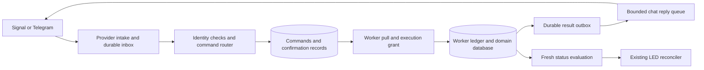

# Interactive command design

This is the retained technical contract for the original implementation, not an
active implementation plan or a beginner setup guide. Original section numbers
are retained for acceptance references. Software completion and live qualification
are separate; see the [roadmap](../roadmap.md) for current work and
[validation](../development/validation.md) for the evidence boundary.

## 1. User interaction and addressing

Give each enrolled worker instance a unique, administrator-configured alias:

| Alias | Meaning |
| --- | --- |
| `backup/storage` | Backup worker responsible for storage backups |
| `vuln/pi-storage` | Vulnerability worker responsible for that host and its images |
| `uptime/public` | Monitor responsible for the public services |

Aliases identify worker instances, not necessarily deployment hosts. One worker
may manage multiple hosts or services. Persist the mapping to its producer UUID,
installation epoch and command enrollment generation. Aliases are presentation;
queued commands always retain the resolved immutable identity. Renaming an alias
cannot redirect existing work. Retired aliases are reserved until an explicit
administrative reassignment; old notification references never follow reassignment.

Use these interactions:

```text
workers
help
vuln/pi-storage help
vuln/pi-storage status
vuln/pi-storage rescan
vuln/pi-storage details finding=F-42
backup/storage retry incident=B-17
command C-184
```

In Telegram, offer `/worker@DeployBot vuln/pi-storage status` as the explicit
group-chat form. Normalize it to the same command as the plain text form. Direct
messages and supported replies may use the shorter syntax. Qualify actual group
delivery with the bot's configured privacy settings; ordinary group text is not
guaranteed to arrive. Telegram documents which commands and replies privacy-mode
bots receive in its [bot FAQ](https://core.telegram.org/bots/faq#what-messages-will-my-bot-get).

A vulnerability notification might read:

```text
[vuln/pi-storage] F-42: vulnerable build dependency
Present in frontend-builder; not present in the deployed runtime image.
Reply: details | why | rescan | accept-risk 90d reason="..."
Reference: N-7KM4...
```

Replying `details` uses that notification's stored context. Replying
`accept-risk 90d reason="Build-only dependency; absent from runtime image"`
prepares a narrowly scoped decision and returns its exact scope for confirmation.
The example describes established evidence, not an inference from a package's
development-dependency label.

Routing rules are deterministic:

1. Authenticate the sender and conversation before revealing workers or context.
2. Resolve a native reply through a stored provider-message mapping. Verify the
   account, conversation, thread where applicable, and original sending identity.
3. Otherwise require an explicit worker alias; accept an opaque `ref=N-...` when
   native reply metadata is unavailable. References are lookup keys, not authority.
4. If explicit addressing and reply context disagree, reject without execution.
5. Require a specific incident/finding for commands whose descriptor requires it.
   A summary of multiple findings cannot silently select the first or all of them.
6. Reject ambiguity with authorized choices. Never infer a target from the last
   message, a conversational session, a display name, quoted text or an LLM.

`workers`, `help`, `command <id>` and `confirm <token>` are gateway commands.
They reveal only information the sender may access. There is no persistent
"selected worker" in version one, and no wildcard mutation or broadcast command.

Use a small explicit grammar: one command per message, bounded quoted arguments,
durations, enums and named identifiers. No shell expansion, chained commands,
arbitrary URLs, filesystem paths or natural-language execution. Unsupported
syntax returns a contextual example rather than guessing.

### Typed notification context

Negotiate an optional `interaction_context` extension to the producer message
envelope. The producer freezes it with the event before enqueue; it participates
in the immutable payload hash. Its fields are `schema_version`, producer-scoped
`context_id`, `context_revision`, `kind` (`single` or `summary`), and `targets`.
Each target contains its enrolled subject key, target kind (for example `finding`
or `incident`), stable target ID, occurrence ID, evidence revision and decision
revision. IDs are bounded protocol tokens; revisions are positive monotonic values.
The containing message supplies the producer UUID/epoch, which cannot be overridden.

A single context has exactly one target. A summary has 1–128 distinct targets and
always requires explicit selection for a target mutation, even when only one target
remains. Split larger summaries into separate bounded events; never truncate a
target list. Reject context identity/revision reuse with different contents. The
router validates the generic schema and enrolled target kinds without parsing
notification text or interpreting vulnerability evidence. Allowed commands still
come from the approved manifest and current actor/subject policy, not the context.

The public `N-...` reference and every native provider reference map to this exact
context revision. Workers validate both evidence and decision revisions before a
mutation. Old references never resolve to a replacement occurrence. Messages without
this extension remain valid outbound notifications, but cannot supply an implicit
target; return explicit addressing instructions instead of guessing.

Retain the compact typed context, event mapping and necessary worker target history
for the advertised reply window (initially 90 days after the last known provider
acceptance). Context compaction is separate from delivery-receipt compaction. An
active command or confirmation pins its context through its terminal reconciliation.
If required history is unavailable, mark the reference expired/historical and reject
mutations; do not reconstruct targets from prose. Shorter configured retention must
shorten the advertised window. Preserve a retired-context tombstone against reuse.

## 2. Command ownership and extensibility

Each worker advertises a versioned, bounded command manifest over the existing
local trusted-UID transport. Configuration must enroll the worker and approve its
capabilities before they are available in chat. Self-registration cannot grant
permissions, choose a new executable, or change the recipient of results.

Each descriptor contains a namespaced command ID, contract version, argument
types and bounds, required target kind, required permission, effect class,
confirmation policy, admission deadline, execution timeout and help text. Use a
small built-in schema vocabulary rather than executable plugins or arbitrary
schema evaluation. Limit each manifest to 32 commands and 16 arguments per command;
validate unique names and reserve the gateway names.

| Shared verb | Owner and meaning |
| --- | --- |
| `status` | Worker returns current evaluation, evidence age and running work |
| `details`, `why` | Worker returns bounded evidence and decision history |
| `ack` | Worker records the actor and pauses this incident's reminders for a configured duration |
| `snooze 2h` | Worker pauses this incident's reminders until a recorded deadline |
| `unsnooze` | Worker ends this incident's reminder suppression without changing its health |
| `check`, `rescan` | Worker schedules its supported evaluation and reports the resulting job |
| `retry` | Worker validates and schedules a retry of a specific failed operation |
| `accept-risk`, `revoke-acceptance` | Vulnerability worker changes a scoped risk decision |

Workers expose only supported verbs. Do not map an unsupported `retry` to
`rescan`, or give every worker every verb. Common verbs have consistent semantics;
worker-specific options and additional commands come from the manifest. The
gateway must not import backup, vulnerability or uptime domain packages.

The first release implements the generic contract, backup read/ack/snooze handlers
where its domain model supports them, and a synthetic vulnerability worker for
contract tests. The real scanner, package detection and inventory acquisition need
a separate implementation plan. Do not present synthetic findings as scan evidence.

## 3. Authentication and authorization

Inbound chat access is a separate, disabled-by-default enrollment from outbound
notification destinations. A destination receiving alerts grants no command rights.
Require an enrolled provider account, conversation and actor for every command.

Use Telegram numeric user/chat identifiers and a qualified stable Signal account
identifier from the received envelope. Never authorize by usernames, display
names, supplied phone-number text, forwarded authors or quoted content. Missing or
unsupported identity fields fail closed. Reject anonymous group senders, channel
posts, other bots, own-message sync copies, edits, reactions and attachments as
commands in version one. A message edit neither changes nor cancels an admitted
command. Link the same human's Signal and Telegram identities only through explicit
local configuration.

Permissions are scoped to worker and, where configured, subjects. Start with
`read`, `incident.manage`, `job.request` and `risk.accept`. Enforce the conversation's
disclosure policy as well as the actor's permissions: permission to read in a
private chat does not permit posting the result into a group. Unauthorized input
gets no domain details and no unbounded error-response stream.

### Subject scope for queries and replies

For every worker command, the gateway freezes an `authorized_scope`: either an
explicit set of at most 128 enrolled subject IDs, or `whole_worker` when both the
actor and conversation have that permission. Include the scope and its policy
revision in the command hash, execution grant and result metadata. Subject-scoped
permission never implicitly becomes whole-worker access for `status`, `help`,
`details`, command history or a summary. An empty scope returns no domain data.

Workers intersect that scope with their current local policy before querying data.
Filter inputs before calculating counts, severity, lists or pagination; do not
render a worker-wide report and remove a few lines afterward. Results must not
include names, counts, global totals, snippets, error text or pagination offsets
derived from excluded subjects. Describe summaries as covering the authorized
scope without revealing how many subjects were excluded. A worker manifest declares
whether each read/summary command supports scope filtering; an unsupported command
requires whole-worker permission and otherwise fails without running the query.

Return the exact effective scope and policy revision with each result. The gateway
checks them against the immutable command and current actor/conversation permissions
before each send. If rights have narrowed, suppress the frozen reply and invalidate
its pagination tokens; a fresh query may produce a newly filtered result. Expanded
rights never broaden an existing command or cached result. Pagination and cached
results bind the scope hash, actor, conversation/thread, worker and result snapshot.
Apply the same rules to preparation previews and mutation outcomes that contain
domain details. Sender authorization alone is not approval of a result's contents.

Check authorization at intake, confirmation, execution grant and result delivery.
Pin the policy revision on prepared actions. A changed policy invalidates pending
confirmation. Workers check their local execution policy and current domain state
before committing changes. The notification service remains in the same trusted
Unix-account boundary as the base plan; UUIDs are not protection against a malicious
local process sharing that account.

A grant authorizes one exact command to begin within 10 seconds, bounded by its
overall deadline. Revocation prevents new grants; it cannot undo an already
committed action or guarantee cancellation of an operation that already began.
Disabling chat control closes new grants immediately and reports in-progress work
explicitly. Clock uncertainty disables mutations and expires confirmations.

## 4. Provider intake and reply correlation

### Telegram

Start with one long-poll receiver per enrolled bot account. An existing webhook
or another known receiver is a setup conflict, not permission to silently replace
it. Persist each accepted update or minimal rejection record before advancing the
poll offset. Telegram confirms updates when a later offset is requested and keeps
unreceived updates for at most 24 hours; intake therefore cannot promise recovery
after an arbitrary outage. See the [Bot API update contract](https://core.telegram.org/bots/api#getupdates).

Persist outgoing Telegram message IDs and conversation/thread identity along with
the event reference. Native same-chat replies use this mapping. The
[message schema](https://core.telegram.org/bots/api#message) distinguishes ordinary
replies from external reply information; external replies must not import authority
from another chat. Start with text commands; buttons are a later adapter feature
using the same command and confirmation contracts.

### Signal

Extend the existing relay rather than starting a second account owner. Its current
receive maintenance discards output. Replace that path, when interactive intake is
enabled, with parsed, bounded structured events and a durable relay inbox. Keep the
canonical account lease across send, receive, linking and all child processes.

Qualify the pinned signal-cli image's receive identities, quote references,
timestamps and send references. Upstream documents structured receive events and
manual subscription in its [JSON-RPC manual](https://github.com/AsamK/signal-cli/blob/master/man/signal-cli-jsonrpc.5.adoc).
That documentation does not establish a transactional acknowledgement boundary
between Signal receipt and our SQLite commit. Fault-inject that boundary; document
possible loss before durable relay admission. Never claim exactly-once reception.

Expose private `inbound.list` and `inbound.ack` relay operations with an independent
inbox identity and ordered cursor. Ack only after notification-worker persistence;
lost acknowledgements replay the same relay event IDs. Persist native event identity
when available; otherwise use the qualified account/sender/device/conversation/
timestamp tuple with a payload digest, detecting conflicting payloads explicitly.
Native reply routing is enabled only when its author and reference fields have
been qualified. The explicit worker and opaque reference forms remain available.

### Shared transport requirements

Persist every known outbound provider reference, including primary and fallback
attempts, against one logical notification context. An ambiguous send may lack a
native reference; it must not invent one. Replace the current short hash footer
with a collision-checked opaque reference scoped to worker recovery identity,
producer identity, event and context revision. It grants no permissions.

Inbound deduplication keys include provider account and native event identity.
Conflicting content under one key is rejected and audited. Cross-provider copies
are not automatically the same command; worker job coalescing and revision checks
provide an additional safeguard against two intentional requests.

### Stable request and execution identity

Define `request_key` as the canonical tuple of provider kind, immutable enrolled
account identity, and native inbound event identity. Signal uses the qualified
tuple described above, independently of relay cursor IDs. Store the normalized
input digest separately: changing a payload under the same key is a conflict, not
a new request. Neither the notification recovery epoch, worker alias, receipt time
nor input text participates in this identity. Account identity survives supported
restore; replacement accounts require explicit enrollment and an intake cutoff.

Derive the command UUID deterministically from `request_key` using a versioned,
domain-separated cryptographic derivation, and retain the full key to detect a
collision. Pin its derivation version to the immutable account enrollment across
upgrades and restore. Enforce uniqueness of both the key and command UUID for
original requests, with confirmation aliases handled explicitly below. In one notification
database transaction, bind the inbox record to that UUID, freeze the resolved worker,
context, payload hash and original deadlines, create the command and receipt-outbox
intent, and mark the inbox record converted. Before this commit nothing is visible
to worker pulls; afterward replay returns the same command. Persisting raw intake
and acknowledging the provider may happen earlier, provided the durable inbox can
resume conversion. Never generate another command UUID during retry or recovery.

Workers retain the request key, frozen command envelope/hash and outcome with their
execution ledger. Enforce a second uniqueness constraint on the request key as well
as command UUID, so an inconsistent UUID cannot bypass deduplication. Recovery imports
the original mapping and deadlines from retained evidence; it does not re-resolve an
old request through today's aliases or manifests. Missing or conflicting evidence
quarantines the request and requires a new explicit user request after reconciliation.

A confirmation is another inbound request, but its conversion atomically consumes
the token, maps that request to the original command UUID, and records one execution
authorization for that command. It does not create a fresh domain command. Concurrent
confirmations and replays resolve to the same authorization and outcome. The generic
request-to-command relation therefore permits these explicit confirmation aliases,
but never two commands for one request. Worker uniqueness uses the original request key.

### Account credentials and conversation destinations

For interactive mode, separate the provider account profile (bot/account identity
and credentials) from an administrator-enrolled conversation destination. Keep one
Signal account and one Telegram bot initially, with up to 32 enrolled conversations
per account. Preserve the base alert routes' fixed destinations and existing
fingerprints through migration; do not reinterpret their recipient configuration
as permission to answer arbitrary chats.

Each conversation enrollment has an immutable ID/generation, provider account ID,
native chat or Signal recipient/group ID, Telegram thread ID where applicable,
disclosure policy and destination fingerprint. Freeze that tuple on command intake
and every result-outbox item. Bind confirmation and pagination tokens to the same
tuple, including thread. A result can use only this enrolled destination, through
a typed reply-send path; workers supply no recipient addresses. Unknown conversations
are rejected. Never fall back to the account's default alert recipient or another
thread when the original destination is unavailable.

Extend the Signal relay with an enrolled destination-ID lookup and expected
fingerprint check; retain its legacy fixed-recipient send path for ordinary alerts.
Extend Telegram sending to accept the gateway-resolved enrolled destination rather
than always reading the alert chat file. These are required adapter changes before
multi-conversation commands are enabled. Adapter outcomes retain provider message
references with their account/conversation/thread identity.

Before every attempt, validate current actor disclosure rights and the exact enrolled
destination generation/fingerprint. Removing or changing a conversation blocks its
queued replies; account credential rotation for the same identity does not redirect
them. Persist provider attempt outcomes even if authorization changes while sending;
an already in-flight message cannot be recalled by this contract. No automatic rebind
of queued command results is allowed.

Receive, command processing, sending and LED reconciliation have separate bounded
budgets. Receiving must not starve sends; a busy chat cannot block health snapshots.
Raw conversations, credentials and provider payloads do not enter logs. Persist only
the normalized command, necessary identities, context and audit data.

## 5. Durable handoff and execution

Use a worker-pull protocol on the existing local Unix API. The notification worker
does not dial arbitrary worker-provided endpoints or execute worker shell commands.
Workers remain free to schedule domain tasks using their existing runtime.



Add separately versioned `command.manifest`, `command.list`, `command.import-ack`,
`command.grant`, `command.result`, and `command.result-ack` contracts, with
identity-fenced cursors.
`command.list` transfers proposals for durable import; it does not authorize side
effects. The worker returns its retained execution outcome for a duplicate command
before requesting any new grant; a prepared-only record follows the confirmation
rules below. Capability negotiation must leave existing outbound-only
clients working and reject unknown command versions without reinterpretation.

An immutable command envelope contains command UUID, inbound identity, actor and
conversation identities, policy revision, worker UUID/epoch/enrollment generation,
contract version, typed arguments, context ID, target revision, issue/deadline times,
authorized subject scope and canonical payload hash. A grant additionally binds
its attempt, expiry and notification recovery identity. A worker may receive only
its enrolled queue.
Keep command enrollment generations separate from the base plan's outbound
delivery ownership generations: disabling command authority must not revoke alert
delivery. Both generations remain subject to their own recovery fences.

Use these observable stages:

| Stage | Meaning |
| --- | --- |
| `received` | The request is durably recorded; no action promised |
| `needs_confirmation` | The worker prepared a specific proposed change |
| `queued` | Authorized for worker consideration before its deadline |
| `running` | Worker durably admitted the action/job |
| `succeeded`, `failed`, `rejected`, `expired` | Explicit terminal outcome |
| `outcome_unknown` | Execution may have happened; reconciliation required |

### State transitions and result ordering

Use the following rules for applying lifecycle changes; all unlisted transitions
are rejected. Recording and acknowledging a valid late result is a separate action,
defined below. Repeated identical transitions cannot reset deadlines.

| Current stage | Allowed next stage and condition |
| --- | --- |
| `received` | `queued` for execution or read work, `needs_confirmation` after durable side-effect-free preparation, or `rejected`/`expired` before any execution grant |
| `needs_confirmation` | `queued` after atomic confirmation, or `rejected`/`expired` while no execution grant exists |
| `queued` | `running` from durable worker admission; `succeeded`/`failed` for a durably recorded immediate outcome; `rejected`/`expired` only with proof of no admission; `outcome_unknown` when a grant may have been used |
| `running` | `succeeded`/`failed` from the worker's durable outcome, or `outcome_unknown` when job state cannot be reconciled |
| `outcome_unknown` | `running` or a terminal outcome only from retained worker/job evidence; `expired`/`rejected` requires durable proof that admission never occurred |
| Terminal | No lifecycle change; identical outcome replay or audit-only recording of a late result under the rules below |

Preparation is a distinct non-executing phase recorded under the original command
UUID. Its result contains the prepared-action hash and exact preconditions, but is
not a successful domain mutation. Execution of a confirmed command uses that same
UUID plus the frozen preparation record; the worker ledger distinguishes preparation
from execution rather than treating the prepared response as a terminal dedup hit.

Workers append immutable result records with strictly increasing, contiguous
`result_revision` per command, beginning at 1. Records include command/request identity,
input hash, worker epoch, phase, stage, job ID where applicable, prepared-action hash
where applicable, effective authorized scope, and bounded outcome/evidence. The gateway
stores each record, its application disposition and any permitted result-reply intent
atomically. Same revision and hash is a replay; different
content is a conflict. A gap returns the next expected revision without advancing
state or acknowledgements. A delayed earlier revision cannot regress terminal state.
Gateway intake, confirmation and timeout decisions are serialized in its own audit
log; they do not manufacture worker result revisions.

For a valid next-contiguous result, persist one application disposition: `applied`,
`superseded_no_effect`, or `execution_conflict`. A late preparation or pre-admission
rejection received after a proven non-executed command was expired/rejected is
`superseded_no_effect`: advance the result cursor and acknowledge its hash without
changing the terminal state, minting a confirmation token, creating a grant or
sending obsolete progress. Include the immutable gateway terminal decision ID,
state and non-admission basis in the receipt. The worker atomically imports that
receipt, closes its prepared-only record under the terminal decision and marks its
result acknowledged before replying with `command.result-ack`. Normal retention
can then compact both sides; lost receipts/acks return the identical disposition.

A result claiming admission or an effect that contradicts a gateway non-admission
tombstone is not harmless lateness. Record it as `execution_conflict`, preserve both
pieces of evidence, fence further execution and require reconciliation. Surface the
conflict in command status alongside the prior terminal decision rather than hiding
it as a successful expiry. This diagnostic overlay does not rewrite the terminal
history. Conflicting payloads under one revision, invalid identities and sequence
gaps remain protocol errors; they cannot be acknowledged as superseded. Result
acknowledgement means durable recording, not agreement with its requested transition.

`command.import-ack` confirms that the worker committed the frozen proposal to its
inbox; it does not mean execution began and does not permit deletion of execution
identity. A grant is persisted before it is returned. Lost grants are retried with
the same grant identity and original deadline, never replaced by an untracked grant.
After any grant, absence of `running` is not proof of non-execution. If admission
is uncertain at deadline, use `outcome_unknown`, not terminal `expired`. To prove
non-admission, the worker must fence that grant locally and atomically record a
never-admitted tombstone before returning the evidence; a delayed grant then fails.

`command.result` returns a durable receipt binding the worker/notification epochs,
command UUID, recorded contiguous revision, result hash and application disposition
(plus the terminal decision when applicable). `command.result-ack`
is the worker's acknowledgement that it durably imported that receipt, enabling
gateway compaction after retention. Only after committing the receipt may the worker
compact acknowledged result bodies under its retention policy. Neither acknowledgement
permits dropping command/request identities, terminal hashes, unresolved jobs or
needed preparation/context evidence. Lost acknowledgements replay the same records.
Gateway restore behind an acknowledged revision reconciles retained terminal hashes
and floors; it never fabricates a missing outcome or reissues execution.

Queue result replies by result revision. Coalesce obsolete unsent progress replies
when completion is available, and never start a known older progress send after a
terminal reply. An already in-flight provider message can arrive late; label progress
with command ID, revision and observation time, and keep `command <id>` authoritative.

The worker stores command identity, input hash, domain transaction/job admission
and its result outbox atomically. Replaying the same ID/hash returns the existing
decision; a different hash is a conflict. Database-only decisions such as risk
acceptance can have one committed effect. External work such as a backup or scan
needs a durable job identity and reconciliation after crashes. Do not blindly rerun
an uncertain external effect or promise exactly-once execution across systems.

Worker job scheduling serializes or coalesces compatible checks for the same
target. A second `rescan` can return the existing job ID. Polling retries do not
reset admission deadlines, extend grants or renew snoozes. A running job's timeout
belongs to the worker; expiration of its original admission window does not erase
the job or pretend it was cancelled.

For confirmation-required commands, preparation is side-effect free. The worker
returns the exact target, assumptions, expected revision, absolute expiry, effect
summary and prepared-action hash. Create a random single-use token bound to that
hash, actor, account, conversation, worker and policy revision, valid for at most
10 minutes. `confirm <token>` consumes it atomically into one execution authorization
for the original command, as defined by the request-identity contract.
Replays return that command's existing state. Revalidate revision and assumptions
at execution; stale preparation requires a new proposal, never silent broadening.

`accept-risk` and changes that broaden its scope require this preparation flow.
Read commands, `ack`, bounded `snooze`, `rescan` and narrowing/revocation of acceptance
need no extra confirmation by default. They still require permission and worker
validation. Backup retries are opt-in capabilities with policy appropriate to the
operation; restores, arbitrary commands, upgrades and reboots are out of scope.

## 6. Vulnerability findings and risk decisions

The vulnerability worker owns independent detection and decision records:

| Dimension | States |
| --- | --- |
| Detection | Present, fixed, unknown |
| Risk decision | Needs review, accepted with expiry, not applicable with evidence |

Identify findings using a stable inventory subject, advisory identity and component
identity including ecosystem and package/location context. Record the observed
version, immutable image digest where applicable, build/runtime role and scan scope
as evidence. Separate a finding's stable identity from its occurrence and evidence
revision. Each new occurrence after resolution starts without inherited acceptance.

Each scan stores its ID, target generation/artifact digest, scanner and vulnerability
database versions, covered scopes, start/end times and completion status. A
successful authoritative scan can mark an existing finding fixed only if it covers
the same relevant scope and supersedes the evidence that established the finding.
A partial/failed scan, unreachable host, missing inventory item or changed artifact
cannot turn absence into "fixed". Retiring an old artifact is an explicit inventory
transition. An older scan finishing late must not overwrite a newer evaluation.
A failed scan retains the last known findings while marking current evidence
uncertain; it does not erase a known unresolved critical finding.

An acceptance record includes finding occurrence, scope, evidence assumptions,
decision revision, actor, reason, creation time, absolute expiry and originating
command ID. The default scope is one subject/component/advisory occurrence, not an
entire advisory across the fleet. Acceptance expiry is limited to 90 days in the
first policy; there is no indefinite chat acceptance or wildcard acceptance.

For the build-only example, preparation shows the particular build environment,
dependency version, affected artifact and evidence of absence from the runtime
image. Acceptance acknowledges residual risk; the worker must not infer harmlessness
merely from `devDependency`. A changed version, image, deployment role or relevant
severity/exploitability evidence requires review. Equivalent rescans can preserve
an acceptance only while all recorded assumptions still match.

Expiry, revoked acceptance or invalidated assumptions reopen actionable status
without waiting for the next daily scan. Re-evaluate deadlines on startup and on a
bounded timer; clock uncertainty cannot extend an acceptance. Preserve all prior
decisions in history. Keep `not applicable` separate from risk acceptance and defer
its chat mutation until the scanner has an evidence contract for that decision.

Support `details`, `why`, `accept-risk`, `revoke-acceptance` and `rescan`. A scan job
being queued is not a fix. Completion reports newly present, still present, fixed,
accepted and unknown findings, plus scan coverage and evidence freshness.

## 7. Reminders and LED health

The producer owns incident acknowledgement and snoozing. These are not transport
`receipt.ack`, provider read receipts, successful delivery, or incident resolution.
Use one durable suppression deadline per exact incident occurrence. Default `ack`
suppresses reminders for one hour; `snooze` accepts 1 minute through 24 hours.
Expiry and unsnoozing restore normal reminder policy. New occurrences and severity
escalations bypass the previous suppression; an acknowledgement does not hide them.

Commit suppression and cancellation/export intent together. Cancel queued obsolete
reminders through the existing notification contract; an already in-flight message
may still arrive. Do not suppress recovery reports, daily coverage obligations or
unrelated incidents as a side effect. Never count a chat reply as report coverage.

`ack` and `snooze` do not change health or clear LEDs. Risk acceptance can change
the vulnerability worker's actionable-health evaluation while retaining a visible
"present, accepted" finding. Define any healthy LED as "no actionable findings with
fresh sufficient evidence," not "no vulnerabilities exist." Accepted counts remain
visible in status and periodic summaries. Unknown/stale scans remain unhealthy.

The worker emits a fresh status/basis revision after a policy decision. The existing
reconciler applies that snapshot; chat commands never directly clear daemon states.
One accepted finding cannot clear another subject's fault or an unrelated delivery
outage. Acceptance expiry reasserts the relevant fault through normal evaluation.

### Policy dispositions and validity deadlines

Use two distinct records in the negotiated policy-health protocol. `acceptance_support`
is the current set of active decision references supporting a subject's evaluated
condition. Each record names decision ID/revision, kind `risk_accepted`, affected
finding occurrence and accepted assumptions revision, and absolute `valid_until`.
It has no fault-clear target. The worker checks current evidence against those
assumptions; equivalent rescans may retain the decision and its original expiry.
Retain support while applicable, including snapshots with other actionable findings.
The producer keeps actor, reason and command provenance in its decision ledger.

A `fault_transition` is a separate immutable, uniquely identified instruction for
an exact producer/subject/fault revision. It names its cause (`policy_accepted`,
`resolved` or `retired`), supporting decision/evidence references, and the resulting
status/basis revision. Only a matching transition with fresh required evidence may
discharge an existing latch and its exact LED incarnation. Consumed transition IDs
are retained as tombstones. Replaying support or a consumed transition never clears
a later fault; carrying an older acceptance beside a newer fault is valid.

For aggregate subjects, evaluate every contributing finding and publish the remaining
severity. Acceptance of A cannot clear B. If clearing an old aggregate indication is
needed while another finding remains actionable, install the current adverse
indication before clearing the old incarnation. Fixing B has its own resolution
transition; do not rewrite A's acceptance into permission to clear B. Acceptance
never produces a "vulnerability fixed" message or changes the detection record.

An initial full snapshot may establish current condition from fresh evidence and
active support even when the receiver never observed the original fault. No missing
historical transition is required when there is no retained latch or owned fault to
clear. Conversely, if a latch or restored LED fault exists, require a transition for
that exact revision; support alone cannot clear it. A nonmatching historical
transition is recorded as non-applicable, not used to reject otherwise valid current
support or to clear the retained fault. A conflicting payload under the same
transition ID is a protocol error.

Keep full snapshots separate from the transition outbox. `status.replace` contains
the complete subject set and current acceptance support, with independent limits of
128 subjects and 128 support records within the existing snapshot byte limit. It
contains no transition history and cannot acknowledge or remove pending transitions.
Coalescing current snapshots never discards the producer's unacknowledged transitions.

Use the base plan's `fault-transition.enqueue` operation for independent batches of
at most 32 immutable transitions within the 128 KiB request limit. Batches are admitted
atomically; receipts pin notification identity/recovery epoch, producer UUID/epoch
and every admitted transition ID/hash. Identical records replay idempotently; conflicts
reject without partial admission. Producers import receipts transactionally before
acknowledging their local outbox records and retain recovery evidence afterward.
Receipt loss resends the same records. A batch neither replaces transition history
nor deletes or acknowledges omitted records. The receipt confirms durable recording,
not latch discharge or physical LED clearance.

Drain the outbox through successive bounded batches, with independent admission
quotas, fair scheduling and reserved capacity for current-status updates. A full
transition queue rejects its batch while the producer retains it; fresh snapshots
continue within the storage reserves. A snapshot with all 128 acceptance records
therefore still permits transition delivery through the separate operation. An
outage backlog needs no manual subject repartitioning. Actual current state exceeding
its own subject/support/byte limits still requires explicit partitioning.

Snapshots and batches may arrive in either order. A transition ahead of its required
status/basis waits durably until fresh current evidence permits evaluation. New
snapshots do not erase pending transitions, and a missing dependency is not a
non-applicable transition. Retain the old latch until its exact transition and
evidence validate; batch acceptance alone cannot authorize a clear. The gateway
retains matching clear intent until the daemon acknowledges it. After missed
snapshots or restore, reconcile retained fault references, transition receipts and
producer history before clearing. Missing history requires explicit reconciliation;
old-epoch receipts cannot acknowledge new history without the recovery mapping.

The positive subject validity is the minimum of scan-evidence validity and every
acceptance deadline necessary for that subject to be non-actionable. The shared
service validates and independently clamps this bound from the supplied support
deadlines; it applies the existing liveness and LED RPC margins as well. A heartbeat
cannot extend an unchanged decision. At expiry or loss of valid evidence, revoke
positive health even if the producer is stopped: show unknown unless retained
current evidence establishes an actionable fault. A fresh producer evaluation
reasserts the actual severity. The gateway does not infer a new risk decision.

Active support is retained across liveness updates and expires without producer
cooperation. Fault transitions require fresh validation during restore before any
clear. `ack` and `snooze` create neither acceptance support nor a fault transition.
Superseding or revoking a decision increments the producer's decision and
status/basis revisions atomically with its export intent.

## 8. Results and conversation continuity

Send a short receipt with command ID and resolved worker after durable admission.
Report preparation, running work and completion distinctly. Replays may resend the
same result but cannot repeat the domain effect. Command-result events use their
own typed queue/receipt namespace: they are not producer report/recovery events and
cannot satisfy backup delivery coverage or clear delivery-outage obligations.

Persist result replies with bounded retry policy and their originating conversation.
Do not send private command results through an alert route's fallback destination.
Cross-provider result forwarding requires explicit configuration and fresh audience
authorization; it is deferred initially. Recheck disclosure on every send attempt.
If the actor loses permission, retain the local audit result but suppress its chat
delivery. `command <id>` is subject to the same checks.

Store the worker/context mapping for command replies as well as original alerts,
so a user can reply `details` to the completion message. Completion of a batch scan
does not select one of its findings. A retired context is shown as historical;
mutations against it are rejected. Limit result size to the existing provider text
budget with bounded pagination. Pagination tokens bind actor, conversation, worker
and result snapshot, expire, and never expose unrestricted log tails.

## 9. Persistence, limits and recovery

Extend notification state with provider intake cursors, normalized inbox records,
outbound context mappings, manifest revisions, commands, execution grants,
confirmations, result outbox and policy audit records. Add a separate relay inbox
under its existing private account storage. Each specialist worker adds an inbox
ledger and result outbox alongside domain tables. Use versioned schema migrations.

Proposed initial limits are explicit and configurable within hard ceilings:

| Resource | Initial limit |
| --- | --- |
| Command text | 4 KiB, valid UTF-8, one command |
| Inbound provider envelope | 64 KiB; bounded nesting and no attachment downloads |
| Intake batch | 32 events, bounded total bytes |
| Pending commands | 1,024 global, 128 per worker, 16 per actor |
| Command admission age | 15 minutes; reject older/future-skewed provider events |
| Read execution window | 1 minute after durable intake |
| Mutation execution window | 15 minutes after durable intake; prepared confirmations at most 10 minutes |
| Rate limit | 10 commands/minute/actor, burst 5; 60/minute/conversation |
| Detailed contexts and outcomes | 90 days; shorter configured private-content retention allowed |

Check limits before admission and reserve space for terminal outcomes and audit
tombstones. On intake overflow, stop consuming where provider semantics allow and
surface degraded health. Persist a bounded rejection before advancing a cursor;
never claim that dropped commands were accepted. Oversized batches must not skip
unpersisted updates. Isolate resource budgets from the outbound alert queue.

Keep compact command IDs, input hashes, terminal outcomes and consumed-token
tombstones after removing detailed text, through the full replay/restore horizon.
Provider cursors and intake-age rejection prevent discarded old input from becoming
new authority. Detail compaction never deletes an unresolved execution record or
an unacknowledged result. Policy audit retention is a separate documented setting.

Restore rotates the notification recovery identity and closes command grants.
Do not execute pending restored mutations or revive confirmations automatically.
Reconcile retained worker command ledgers and outcomes first. Restoring a specialist
database also requires a new epoch and reconciliation; missing command history
cannot be interpreted as proof that an old operation never ran. Uncertain external
actions remain `outcome_unknown` until operator or domain-job reconciliation.
Require fresh user authorization for any remaining unexecuted mutation after restore.

This fence also covers inbox records not yet converted into commands and provider
events replayed after the snapshot. Before reopening mutations, reconcile request
keys and original command mappings from worker ledgers and retained relay/gateway
records. An absent mapping is not proof that a request was never executed. Replayed
input cannot acquire a new identity, refreshed deadline or newly resolved target;
unreconstructable prior input is quarantined. Restore cannot grant authority merely
because the provider timestamp still passes the 15-minute intake-age check.

## 10. Code organization and rollout

Keep the existing process architecture. Add cohesive packages under
`internal/notification/interaction/` for the grammar, manifests, normalized command
types and policy checks; retain SQLite transactions and scheduling in `worker/`.
Provider intake adapters stay beside `provider/`, with Signal relay persistence in
`relay/`. Extend `protocol/` and `client/` for local command operations. Worker-specific
handlers and ledgers belong under their respective `internal/backup/`, future
`internal/vulnerability/`, and future uptime packages. No separate generic command
execution daemon or new broker is needed initially.

Production activation requires the applicable lifecycle, replay, authorization
and live qualification checks. Risk-decision fixtures do not supply a real
vulnerability scanner. Disabling commands leaves outbound notifications working.
An upgrade/rollback must not let an old binary ignore outstanding mutation records;
drain or reconcile them before downgrading to a schema-compatible binary.

## 11. Required tests and acceptance scenarios

| Area | Required cases |
| --- | --- |
| Addressing | Two instances of the same worker type; alias rename/reassignment; native reply; explicit reference; disagreeing alias/context; multi-finding summary; expired context |
| Authorization | Spoofed display names; missing sender; forwarded and cross-chat replies; anonymous/group sender; own sync message; changed membership/policy; worker and subject isolation |
| Grammar | Quoting and Unicode; excessive nesting/length; unknown arguments; multiple commands; no shell expansion; manifest conflicts; unsupported versions |
| Telegram intake | Lost poll response; duplicate updates; crash before/after inbox commit and offset advance; conflicting receiver; privacy-mode group commands; downtime exceeding provider retention |
| Signal intake | Pinned envelopes and quote identity; bounded relay spool; crash at every list/ack transition; receive-to-spool loss window; send fairness; linking/account lease and actual JVM child lifetime |
| Command lifecycle | Duplicate IDs and conflicting payloads; grant expiry; worker offline; crash before/after domain commit; lost result acknowledgement; duplicate job requests; uncertain external effects |
| Confirmation | Wrong actor/chat/worker; altered arguments; replay and concurrent confirmation; expired token; changed policy or finding revision; changed assumptions during execution |
| Vulnerability evidence | Partial/failed scan; missing host; image replacement; older scan finishing late; successful covered rescan; fixed then reintroduced finding; decision history survives restart |
| Risk acceptance | Exact scope; no fleet-wide suppression; acceptance expiry; package/build/runtime changes; severity change; revoked decision; accepted findings remain visible |
| Reminders and LED | Ack/snooze expiry; severity escalation; queued versus in-flight reminders; accepted finding cannot clear other faults; stale evidence never green; chat results grant no report coverage |
| Recovery and limits | Worker/relay/gateway snapshot rollback; cursor epochs; missing dedup history; clock jumps; disk full; oversized batch; queue fairness; pagination disclosure and retention |
| Intake to execution identity | Crash during inbox conversion; provider/relay replay after restore; conflicting payload under one request key; alias change after snapshot; concurrent confirmations keep original command identity |
| Reply destinations | Private and group commands concurrently; thread isolation; removed enrollment; destination generation changes; no fallback to alert recipient; same-account credential rotation |
| Context retention | Typed single/summary validation; missing extension; changed occurrence/evidence/decision revision; receipt compaction before reply; expired history; context pinned by active confirmation |
| Result ordering | Completion before progress; gaps and conflicting revisions; lost import/result acknowledgements; grant returned after local non-admission fence; terminal immutability; restore behind compacted result floor |
| Policy health | Accepted remains detected; support alone cannot clear a fault; matching transition clears only its fault; earliest acceptance bounds healthy TTL; stopped producer at expiry; expired support cannot authorize a restored clear |
| Subject-scoped reads | Subject A permission with confidential B; filtered counts/severity/errors; unsupported manifest command; narrowed rights while reply queued; pagination/cache scope isolation |
| Late results | Preparation after terminal expiry; pre-admission rejection after closure; contiguous superseded receipt; lost receipt/ack; no new token/grant; contradictory execution evidence is fenced and retained |
| Support and transitions | A remains accepted while B changes fault revision; B resolves independently; initial full snapshot without prior fault; skipped intermediate snapshots; retained latch without matching transition; consumed transition replay |
| Transition backlog | 128 active support records plus more than 128 pending transitions; independent batch admission and status publication; lost receipts; omitted records retained; quota pressure; either stream arriving first; restore fences |

Mandatory end-to-end scenarios:

1. Two vulnerability workers alert in one chat. Replying to the first notification
   changes only that worker's exact finding; an unaddressed new `rescan` asks for a
   target. A forged quote and a conflicting explicit alias change nothing.
2. Prepare the Bootstrap build-only acceptance, change the runtime role before
   confirmation, and verify rejection. Prepare again for valid evidence, confirm,
   restart both services and replay the update: one decision exists with the original
   expiry. Scan evidence still says present while the decision says accepted.
3. Start a rescan, crash after job admission but before the reply, then redeliver
   the command. Reconcile the same job; report fixed only for successful matching
   coverage. A failed or outdated scan produces no false resolution.
4. Accept one finding while another remains critical. The LED stays critical.
   Snooze the second incident: its reminders pause, its fault remains. Let acceptance
   expire and verify actionability returns without waiting for the next daily scan.
5. Restore an old notification database after a risk decision or backup retry has
   committed. No command executes again, confirmations remain invalid, and retained
   worker outcomes reconcile before intake mutations can resume.
6. Revoke a user's authorization while a command is queued and again after a job
   starts. The first never receives a grant; the second is reported as already in
   progress locally, and its private result is not leaked into the chat.
7. Crash before and after the atomic inbox-to-command transaction, then replay the
   same inbound event. Exactly one command UUID and worker admission exist. Restore
   a gateway snapshot preceding conversion after that command has executed, change
   the worker alias mapping, and replay again: reconcile the original request and
   outcome without dispatching to either worker anew. Missing retained evidence
   quarantines the request. Two confirmations of one proposal share its execution.
8. Accept the only actionable finding, verify that its detection remains present,
   then stop the producer just before acceptance expires. With a responsive LED
   daemon within the qualified RPC budget, healthy ends by the acceptance deadline,
   regardless of the later scan/liveness deadlines. Unknown is acceptable while the
   producer is absent; false healthy is not. Resume evaluation and verify the fault
   returns. Repeat with another active finding, old support and a consumed transition replay.
9. Submit commands concurrently in a private chat, a group and two enrolled threads.
   Exercise both provider adapters and rotate same-account credentials. Results stay
   in their frozen destinations. Remove or change one enrollment before sending:
   its result is blocked, with zero sends to the default alert destination or other
   thread. The Signal relay rejects an unknown destination ID/fingerprint.
10. Compact delivery receipts before replying to an old single-target notification.
    Its retained typed context resolves the original occurrence. A multi-target
    summary requires explicit selection; missing/expired context, forged text and
    a replacement occurrence cannot authorize mutation. Active confirmation pins
    its context until terminal reconciliation.
11. Deliver worker result revision 2 (`succeeded`) before revision 1 (`running`):
    revision 2 is not applied or acknowledged until the gap is filled. Replay both,
    lose each acknowledgement, and verify one terminal outcome and no subsequent
    older progress send. Crash after job admission but before `running` reaches the
    gateway; admission deadline expiry yields uncertainty until evidence recovers
    the job. Separately record non-admission and deliver the old grant afterward:
    the worker rejects it. Restore behind an acknowledged compacted result and
    reconcile its retained floor/outcome without rerunning the command.
12. Grant an actor read access to subject A while B has confidential findings.
    Query status, details, command history and paginated summaries: no B-derived
    names, counts, severity or error details appear. A manifest command without
    scope filtering requires whole-worker access. Narrow rights while a reply is
    queued; suppress it and invalidate pagination. Broader rights cannot expand
    the old result. Repeat with a preparation preview and a cached result.
13. Expire a command while its side-effect-free preparation is running, then deliver
    the prepared result. Record and acknowledge `superseded_no_effect`, keep expiry,
    and create no token, grant or preparation reply. Lose the receipt and each ack
    in turn: replay is stable, the worker imports terminal closure, and both sides
    can compact the obsolete preparation after retention. Separately inject evidence
    of an effect after proven non-admission: retain `execution_conflict`, fence it
    and require reconciliation instead of treating the evidence as harmless lateness.
14. Accept finding A, introduce finding B under a newer aggregate fault revision,
    then resolve B. A's unchanged support remains valid throughout; B's resolution
    has its own transition and no A transition clears B. Skip intermediate snapshots:
    a receiver with no retained fault accepts fresh current support, while one with
    an old latch requires its exact transition before clearing. Replay consumed and
    nonmatching transitions, lose snapshot and batch acknowledgements, and restore old LED
    state; no stale clear runs and unacknowledged transition evidence is retained.
15. Fill a valid snapshot with 128 active acceptance-support records, accumulate
    more than 128 unacknowledged transitions during an outage, then reconnect.
    Publish fresh complete snapshots throughout the drain and admit transitions in
    batches of at most 32 without manual repartitioning. Omitted batch records remain
    pending. Inject crashes before/after admission and local receipt import, and lose
    batch replies: no transition is lost or reapplied to a later fault. Deliver a
    batch before its required snapshot, then reverse the order; retained faults clear
    only after matching current evidence is available. Fill the transition quota and
    verify status updates still fit their reserved budget. Restore old gateway state
    and replay old-epoch receipts: reconciliation, not receipt replay, controls clears.

Use deterministic clocks, fake provider transports, temporary SQLite databases and
real local Unix sockets for contract tests. Test crash transitions in subprocesses;
retain the base plan's VM/power-loss checks for durability claims. Containers cover
service integration but do not establish provider receipt behavior or physical LED
behavior. Live provider tests require explicitly chosen test accounts/destinations;
native ARM64 qualification remains a later environment-dependent gate.

## 12. Completion criteria

The extension is complete when a supported new worker can enroll its manifest and
handlers without changes to provider adapters or domain branches in the router;
all routing and mutation scenarios above pass; outcomes remain accurate across
restarts and restore; and private results cannot cross conversation boundaries.

The initial release may use a synthetic vulnerability worker, clearly labeled,
to qualify the shared interface. Real risk acceptance is unavailable until a real
vulnerability worker supplies authoritative inventory, scan evidence and decision
storage. Outbound notification availability and the base plan's health, ownership
and delivery guarantees must remain intact when interactive control is disabled
or degraded.
