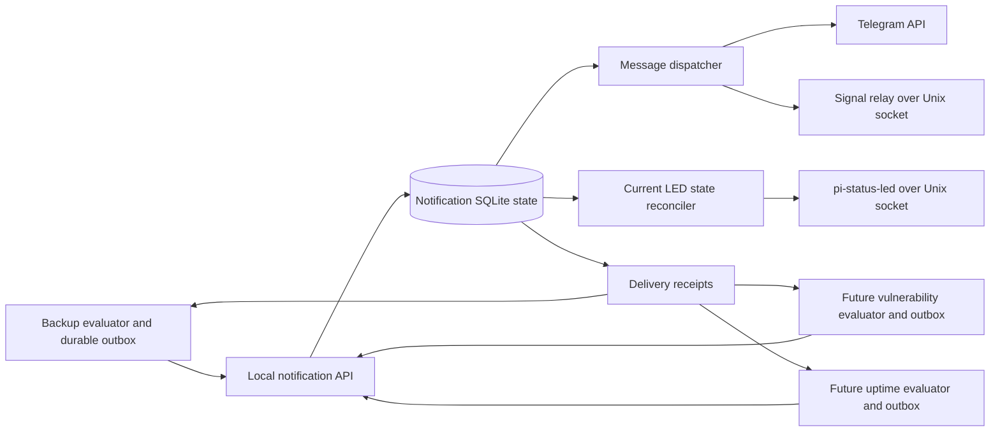

# Notification worker design

This is the retained technical contract for the original implementation, not an
active implementation plan or a beginner setup guide. Original section numbers
are retained for acceptance references. Software completion and live qualification
are separate; see the [roadmap](../roadmap.md) for current work and
[validation](../development/validation.md) for the evidence boundary.

## 1. Objective and initial scope

Introduce a reusable notification worker for the backup worker, a future daily
OS/container vulnerability scanner, and a future uptime monitor. Support Signal,
Telegram, and pi-status-led as first-class outputs. Message delivery and LED status
publishing have different semantics and must have independent execution paths.

The first deployment runs on the same Linux management host and under the same
trusted Unix account as the backup worker. Use a local Unix socket and a separate
SQLite database. Run the notification worker as an unprivileged native systemd
user service; retain the Signal relay as a separate rootless container. This
avoids passing the LED socket through a container UID mapping and gives the LED
daemon a stable host UID for state ownership. The existing deploy CLI can install
and administer the service over its normal SSH connection.

Required in the first release:

- Durable message submission, delivery receipts, retries, primary/fallback routing,
  cancellation, and restart recovery.
- Signal and Telegram adapters with transport-level tests and live qualification.
- Current-status snapshots, freshness checks, and a pi-status-led reconciler.
- Backup integration without losing existing incidents, queued messages, daily
  report coverage, pause semantics, or external monitoring guarantees.
- Independent worker health, bounded resource use, observable failures, and
  recoverable setup, update, migration, and uninstall operations.
- Synthetic vulnerability and uptime producers exercising the public contract.

Actual vulnerability scanning and uptime polling are separate projects. Also defer
a remote producer API, message broker, web dashboard, multi-host clustering,
arbitrary webhooks, and multiple Signal account/recipient profiles. The first
release supports one Signal profile and one Telegram profile, usable by multiple
named routes and producers. LED-only installations are allowed, but LED success
cannot satisfy a producer's requirement for messenger delivery.

The optional interactive extension retains these alert routes but separates account
credentials from enrolled reply conversations. It may use multiple explicitly
enrolled conversations under the same Signal account or Telegram bot. This requires
the destination and relay changes in the interactive plan; existing fixed-recipient
adapters are not sufficient for arbitrary originating-conversation replies.

## 2. Existing implementation and extraction boundaries

| Current location | Treatment |
| --- | --- |
| `internal/backup/notification/delivery.go` | Extract provider transport and secret reading into shared adapters; introduce injectable HTTP and Unix-socket transports. |
| `internal/backup/notification/signal.go` | Retain the separate relay; remove backup-specific command/configuration dependencies and test its lifecycle. |
| `internal/backup/notification/envelope.go` | Share bounded message formatting, preserving valid UTF-8 and provider limits. |
| `internal/backup/notification/monitoring.go` | Extract reusable endpoint validation only; keep domain monitoring decisions with their producers. |
| `internal/backup/notifications.go` | Keep incident creation, reminders, recovery policy, daily report generation, and backup health evaluation in backup. Replace direct delivery with durable submission and receipt import in shared mode. |
| `internal/backup/notification_backlog.go` | Keep backup-specific batching, report coverage, and delivery catch-up decisions in backup. |
| `internal/backup/state.go` | Remains the backup database. Add producer export/import records through a versioned migration; do not give the shared worker access to it. |
| `internal/backup/worker_units.go` | Add shared-mode backup report/export units; migrate the legacy notifier and relay ownership explicitly. |
| `internal/config/worker_config.go` | Separate producer alert policy from shared destination credentials and delivery configuration. |
| `internal/backup/worker_qualification.go` | Preserve backup acceptance gates and bind notification qualification to the shared installation and route revision. |

The shared worker must not import `internal/backup`, read the backup database or
archive, possess source SSH keys, run scans, decide whether a backup is fresh, or
interpret vulnerability severity. Producers make those decisions and publish
bounded messages and status observations.

## 3. Responsibilities and process layout



| Responsibility | Owner |
| --- | --- |
| Findings, incidents, reminders, report periods, suppression and recovery decisions | Producer |
| Frozen submission until its terminal result is durably imported; retained outcome checkpoints after compaction | Producer outbox |
| Destination credentials, provider attempts, fallback and delivery receipts | Notification worker |
| Producer liveness and expiration of published observations | Notification worker, using an enrolled policy and producer evidence |
| Status-to-pattern mapping and reconciliation | Notification worker |
| LED priority arbitration, persistence, animation and sysfs access | pi-status-led |
| Backup coverage and daily-report coverage monitoring decisions | Backup evaluator |

Use one long-running notification process with a single instance lease, a bounded
API server, and separately scheduled message and LED dispatchers. A hung LED socket
must not occupy a messenger execution slot; a slow messenger must not prevent
status ingestion, expiry, receipt reads, or LED refresh.

Local paths, relative to the enrolled account:

```text
~/.local/lib/deploy/notification-worker/deploy
~/.config/deploy/notification-worker/runtime.json
~/.local/state/deploy/notification-worker/state/state.db
~/.local/state/deploy/notification-worker/setup.json
~/.local/share/deploy/notification-worker/signal/
$XDG_RUNTIME_DIR/deploy-notification-worker/api.sock
$XDG_RUNTIME_DIR/deploy-notification-worker/signal/signal.sock
```

Runtime directories are private. Do not create or replace a socket at an arbitrary
caller-controlled path, follow symlinks, or unlink a socket owned by a live process.
Clients reconnect for each request, so a daemon restart or socket replacement does
not leave a permanently bound stale endpoint.

## 4. Local protocol and producer identity

Define a versioned JSON protocol over `AF_UNIX/SOCK_STREAM`, one newline-terminated
request and response per connection. Start with explicit operations:

| Operation | Meaning |
| --- | --- |
| `system.ping` | Process responsiveness and protocol version only. |
| `producer.ownership` | Read the enrolled producer epoch's exact generation state and whether it is active; cannot change ownership. |
| `message.enqueue` | Durably accept an immutable message and its resolved delivery plan; atomically supersede explicitly identified older revisions where allowed. |
| `message.get` | Read delivery state for one submitted event. |
| `message.cancel` | Cancel work that has not started, or consume an unsubmitted sequence with a cancellation tombstone; report in-flight or accepted work accurately. |
| `receipt.list` | Read a bounded, cursor-based stream of delivery transitions, including failed attempts and terminal outcomes. |
| `receipt.ack` | Producer confirms it durably imported outcomes through a cursor. |
| `status.replace` | Atomically replace a producer's complete current-status snapshot. |
| `fault-transition.enqueue` | With the policy-health capability enrolled, durably admit a bounded batch of immutable fault transitions independently of current-status replacement. |
| `producer.reconcile` | Exchange retained submissions, receipts and watermarks for an enrolled producer during a worker recovery session; cannot activate delivery by itself. |
| `system.status` | Bounded health and queue summary without credentials. |

Installation, producer enrollment, credential changes, route changes, retirement,
and administrative retries belong to the managed CLI/configuration path. They are
not unrestricted producer API operations.

Validate duplicate keys, unknown fields, UTF-8, schema versions, enum values,
lengths, request counts, and time bounds. Proposed starting limits: 128 KiB per
request including newline, 256 KiB per response, 32 active connections, two-second
local request deadlines, and at most 128 subjects in one complete status snapshot.
Reject an oversized snapshot atomically; never truncate it and implicitly clear
the missing subjects. Larger installations must use explicitly enrolled producer
partitions or a later protocol extension.

Use socket mode `0600` and verify `SO_PEERCRED` matches the enrolled service UID.
Producer IDs identify enrolled logical applications; they are not an isolation
boundary between processes sharing that UID. All processes under the account are
trusted. Supporting mutually untrusted producers requires separate Unix accounts
and explicit per-UID enrollment in a later release.

Each producer has a stable UUID and an installation epoch. The epoch is enrolled,
not accepted merely because a request supplies a new value. Restoring or replacing
a producer with lost sequence state requires an explicit recovery operation.

Every reply and receipt cursor carries the worker UUID and recovery epoch. Every
mutation after discovery names that expected pair; mismatches are rejected without
changing state. Producers durably pin the pair and never adopt a changed epoch
merely because a socket became reachable again. A delivery job also carries the
producer's migration generation, distinct from either installation epoch; its
attempts require the active ownership fence defined in section 12.

### Message envelope

The typed envelope contains:

- Protocol version, producer UUID/epoch, strictly increasing submission sequence,
  stable event ID, and immutable payload hash.
- Subject key, event kind (`failure`, `reminder`, `recovery`, `report`, `catchup`,
  or `test`), severity, observation time, and bounded plain-text message.
- A configured route name. Producers cannot submit destination addresses,
  credential paths, shell commands, HTTP endpoints, or LED parameters.
- Logical report/incident references and revision/order fields where applicable.
  Reports, catch-ups and recovery messages carry their required `basis_revision`;
  delivery-outage catch-ups also name the producer's stable `outage_id`.
  Backlog reports carry the bounded `incident_refs` defined below.
  Reports, catch-ups, reminders and recovery messages require an explicit expiry;
  original failure events may remain as dated historical alerts. The worker
  enforces these generic guards without inferring domain recovery or coverage.
- When the interactive capability is negotiated, an optional `interaction_context`
  with schema version, producer-scoped context ID/revision, single/summary kind and
  bounded typed targets. Each target names an enrolled subject, target kind/ID,
  occurrence, evidence revision and decision revision. The containing producer
  identity is authoritative; context cannot supply destinations or permissions.
  The [interactive context contract](interactive-commands.md#typed-notification-context)
  specifies validation, selection and retention. Context is part of the frozen
  event hash, never inferred from message text. Without it, delivery still works
  but a reply cannot implicitly select a domain target.

Freeze the serialized envelope in the producer outbox before its first submission.
Retries use the same ID, sequence and payload. Existing backup reports currently
refresh their text before sending; shared mode may refresh only before freezing.
Later observations use a distinct immutable event revision and the mandatory
supersession workflow below.

The first successful acknowledgement means **queued durably**, not delivered.
Replaying the same identity and payload returns the original receipt. Reusing an
identity with different content is a conflict. Out-of-order new submission
sequences are rejected with the expected sequence; producers submit in order,
while delivery itself can prioritize urgent messages.

Once a producer assigns a submission sequence, it cannot silently discard that
record while coalescing a backlog. If a frozen event is superseded before server
admission, submit a cancellation tombstone for that next sequence, event ID and
payload hash. This consumes the sequence without sending the message. Cancellation
of an existing queued event uses its existing identity. An in-flight request may
already have reached the provider; cancellation must expose that uncertainty.

### Report validity and causal ordering

Separate a logical `report_key` (producer, report type and reporting period or
group) from its delivery `event_id`. Each refreshed report has a higher
`report_revision`, a new event ID, a `basis_revision`, an observation timestamp and
`expires_at`. The
producer persists a semantic basis revision in its status snapshot and advances it
when facts or qualification relevant to the report change; an unchanged liveness
refresh alone does not advance it. Backup period coverage must refer to the logical
report key and eligible accepted revisions, replacing fixed-ID-only lookups.

Persist the evaluated snapshot and its frozen outgoing messages in one producer
transaction. Normally publish and acknowledge `status.replace` before exporting
messages that reference that basis. Separate connections and lost acknowledgements
must still be safe: a message may arrive before its referenced snapshot. Basis
revisions are monotonic within the enrolled producer epoch; a newer status sequence
cannot decrease the basis revision. A liveness-only update may retain it.

Set an enrolled maximum report/catch-up/recovery validity window, initially five
minutes, and additionally bound positive claims by the evidence they depend on.
For those message kinds, apply these guards before each primary or fallback
attempt, atomically with the durable attempt grant and without holding the
transaction during external I/O:

- If the required basis is ahead of the worker's snapshot, or no fresh snapshot
  is available, retain the admitted job as `waiting_status`. It consumes ordinary
  queue capacity but makes no provider attempt and consumes no retry budget.
  A status update wakes it for reevaluation; waiting and duplicate submissions
  never extend its immutable expiry or renew snapshot freshness.
- If a newer basis or applicable report/incident revision has already superseded
  the job, mark it superseded. A future basis is not evidence of obsolescence.
- Require matching current basis, fresh observation, no superseding revision,
  and enough remaining validity for the complete bounded provider attempt before
  granting it. Expire even a waiting job once insufficient validity remains;
  cancellation, supersession and ownership fences still apply while it waits.

An expired or superseded job emits a receipt so the producer can evaluate a new
report through the exporter loop. It must not relabel old content with a new
timestamp. Reports about stale or failed backups remain possible: their current
evaluation must be fresh even though the failed backup evidence is old.

`message.enqueue` admits a replacement and marks older unsent revisions of that
report key superseded in one transaction. It preserves their attempt history and
submission sequence records. An older in-flight attempt may already have reached
the provider; record that uncertainty and prevent further retries/fallback of the
obsolete revision. No new variant may reuse the old event ID with different text.

Record acceptance-time eligibility separately from the fact of provider acceptance.
Commit the attempt ID, applicable report/incident references, basis revision,
validating status sequence, effective validity deadline, and
`acceptance_observed_at` with the outcome and receipt. The observation time means
when the worker received a successful provider response, not an invented remote
delivery timestamp. Persist
the dispatch guard result and the eligibility verdict/reason at acceptance: the
observation must be within validity, with fresh matching status and no already
committed supersession. A late response, intervening invalidation or uncertain
clock preserves acceptance as audit evidence without claiming eligible coverage.
Use boot/monotonic timing where available; a lost response cannot manufacture a
successful acceptance-time verdict. Retain this evidence through receipt import
and the existing audit/compaction rules.

At receipt import, preserve actual acceptance and evaluate the producer's period
and supersession policy as of that acceptance observation, using persisted report
history. Import time is not the expiry reference. Expiry or a newer revision after
an eligible acceptance does not retroactively invalidate delivery for that logical
period, even if its receipt arrives much later. Only the matching reporting period
can receive that coverage; importing yesterday's report cannot cover today.

Decide current outage resolution separately from historical report coverage.
Every producer delivery outage has a durable ID; an eligible catch-up must name
the currently unresolved ID and a producer-authorized covering report revision.
A report accepted before a later outage, or a catch-up for an older outage, cannot
clear that newer outage. A revision already obsolete or expired at acceptance
cannot clear it either. If retained timing/history is insufficient to establish
eligibility, record coverage as unknown and require a fresh report/catch-up; do
not infer success from import time. Every report names its observation time and
reporting period, because a provider may display an already accepted message after
local cancellation or expiry. The system cannot recall or guarantee the arrival
time of such messages.

For incident traffic, persist `(subject, incident_id, transition_revision)` and
serialize attempts within that incident. On resolution or retirement, the producer
explicitly supersedes pending failure/reminder attempts before admitting recovery.
Recovery of an incident with no confirmed delivered failure is worded as a dated
resolution with prior delivery unknown, rather than implying receipt of an alert.
Newer episodes do not erase the old audit history; obsolete unsent recovery messages
are superseded, and in-flight messages remain explicitly dated. Cross-producer
priority scheduling must not bypass these per-incident transition guards.

### Backup batch export and member coverage

Map legacy backup `daily` events to `report`, `delivery-catchup` to `catchup`, and
`batch` to `report` with `report_type=backlog`; do not introduce an unrecognized
wire kind or pass legacy envelopes through unchanged. For a backlog report, the
report key's period/group component is its stable producer-assigned batch ID.
Rebuilding that group increments `report_revision` and uses a new event ID. It
requires the same basis, freshness, expiry and supersession guards as other reports.
A backlog report alone cannot satisfy daily-report or delivery-outage catch-up
coverage. The producer owns its summary text and membership decisions.

Persist an immutable membership map for each batch revision, with at most 128
member event IDs and their logical delivery obligations. Its envelope carries a
bounded `incident_refs` list of `(subject, incident_id, transition_revision)` for
the represented incidents, with one current guard per incident and at most 128
entries. Validate duplicates, conflicting revisions and total request size; split
oversized groups before assigning submission sequences, never truncate membership.
These references extend the existing incident guards to reports: the dispatcher
atomically grants an attempt for all referenced incidents or none, using a stable
key order, and leaves no partial reservation on a failed grant. No incident can
have a concurrent individual or batch attempt; no locks are held across provider
I/O. The worker enforces references without interpreting backup incident content.

Only events not yet submitted, or confirmed unsent after cancellation, may enter a
new batch. Consume any previously assigned unsubmitted sequences with tombstones.
Leave accepted, in-flight or ambiguous individual attempts out of automatic
batching. Record planned representation separately from verified coverage and
suppress individual export while a live batch represents that obligation.

Resolution or retirement invalidates any queued batch containing that incident's
obsolete transition. Durably supersede/cancel the old batch before admitting the
new recovery; rebuild a fresh revision for still-required members, or return them
to individual delivery through new successor event IDs. Do not mutate a frozen
batch or lose unrelated members. The shared incident reservations also prevent
recovery from overtaking an already-running batch attempt; uncertain completion
and late acceptance retain the existing dated-message/audit semantics.

Import an eligible batch acceptance and its exact revision's membership coverage
in one producer transaction. Only the batch event is provider-accepted; members
remain explicitly unsent with evidence of coverage by that accepted revision.
Duplicate receipts cannot cover a different revision's members. Without eligible
acceptance, failure, expiry, cancellation or supersession grants no coverage;
preserve remaining obligations for replacement or an explicit producer policy
disposition below. Acceptance before later supersession retains section 4's
acceptance-time treatment even when imported late.

### Current-status envelope

Use a separate strictly increasing status sequence, plus evaluated time, producer
configuration revision, semantic report basis revision, and a complete set of
subjects. Each subject has a stable key, condition (`ok`, `warning`, `critical`,
`unknown`, `paused`, `retired`), a bounded explanation, and the evidence's validity
deadline.

Separate publisher liveness from evidence validity. A vulnerability producer may
publish every minute while its latest completed daily scan is valid for a day plus
an agreed grace period. A fresh publication cannot extend the validity of an old
scan or backup. Producers determine the evidence deadline; enrollment bounds
allowable horizons and permitted subjects or subject namespaces.
For health based on a temporary policy decision, positive validity also ends at
the earliest supporting decision expiry. Validate/clamp this from explicit active
acceptance support; liveness updates cannot extend the decision. The base service can
therefore expire healthy without waiting for a producer to publish the reversal.

An identical replay returns the prior acknowledgement without refreshing liveness
or evidence deadlines. A lower sequence cannot overwrite newer state. On process
restart, require a fresh producer snapshot before displaying aggregate healthy;
retain unresolved failure evidence in the meantime. Clock discontinuities make
time-sensitive success uncertain until reconciled, using host boot/monotonic
evidence where available.

Omitted previously active subjects become unknown pending explicit retirement;
absence does not mean recovery. Retirement requires a newer explicit tombstone and
the producer's policy decision, with an audit record. Healthy observations clear
only states belonging to the same subject/binding and an accepted newer revision.
Keep last-known unresolved faults separately from observation freshness: an
`unknown` snapshot or missing subject cannot erase a previously critical finding.
An explicit newer resolution or retirement clears that latched fault. The optional
policy-health extension below can discharge its actionable indication without
claiming detection resolution; ordinary acknowledgement/snoozing cannot do so.

### Policy dispositions for actionable health

Negotiate this status extension before enabling interactive risk decisions. Enrolled
producers using it publish a monotonic per-subject `fault_revision`, advanced for a
new fault episode or materially changed contributing faults, not for a heartbeat.
Retain it after discharge so later decisions cannot address an ambiguous old fault.
Separate two records: `acceptance_support` contains current decision ID/revision,
kind `risk_accepted`, finding occurrence, accepted assumptions revision and absolute
expiry; `fault_transition` contains an immutable transition ID, the exact prior
subject fault revision, cause (`policy_accepted`, `resolved` or `retired`), supporting
decision/evidence references and resulting status/basis revision. Active support
never authorizes a clear by itself and does not name a fault being discharged.
It can remain valid while another finding changes the current fault revision.
Reject conflicting contents under one decision or transition identity/revision.

Apply current support, subject condition and status/basis revision atomically.
Consume a fault transition only against its matching retained latch/incarnation,
with fresh evidence, and preserve its consumed-ID tombstone. The producer evaluates
all contributors before lowering severity. Establish any remaining adverse indication
before clearing the previous incarnation. Accepting finding A cannot clear B; B's
resolution requires its own evidence. Retain the fault and decision history, without
claiming a detection fix or messenger delivery coverage for an acceptance.

Initial full snapshots with fresh evidence and support may establish current health
when no historical latch/owned fault exists, even if earlier snapshots were skipped.
A nonmatching historical transition is recorded as non-applicable; it neither clears
an existing fault nor invalidates otherwise valid current support. If a retained
latch or restored owned fault needs clearing, require a transition for that exact
revision. Acceptance support alone never substitutes for missing resolution history.

Transport current state and transition history independently. `status.replace`
replaces the complete subject set and active acceptance support (at most 128 subjects
and 128 support records, within existing snapshot byte limits). It carries no fault
transitions and neither acknowledges nor deletes transition history. A transition
backlog cannot make an otherwise valid status snapshot oversized.

`fault-transition.enqueue` admits at most 32 transitions per batch within the
128 KiB request limit. Its request pins notification identity/recovery epoch and
producer UUID/epoch. Validate the whole batch, then atomically persist every ID/hash
and immutable record before returning an identity-bound receipt listing those
IDs/hashes. An identical ID/hash is an idempotent replay; a conflicting payload rejects
the batch without partial admission. This receipt proves durable recording, not
application to a latch or physical LED clearance. Persist pending clear intent until
daemon acknowledgement. Omitted transitions remain untouched; there is no implicit
replacement, removal or acknowledgement of records outside the batch.

Producers retain unacknowledged transitions in a separate durable outbox when
coalescing snapshots and send successive bounded batches. Import batch receipts
transactionally before marking records acknowledged; lost replies replay the same
records. Keep acknowledged identity/hash and required transition evidence under the
existing recovery/retention rules. Admission has independent per-producer quotas and
reserved capacity for current-status updates. On transition pressure, reject only
the transition batch and leave it in the producer outbox; continue status publication
and schedule batches fairly. Physical storage failure still reports degraded health.

Either stream may arrive first. An admitted transition whose resulting status/basis
is not yet observed waits durably; it cannot clear a latch. A newer snapshot does not
discard pending transitions. Apply only after fresh current evidence validates the
exact fault and any required acceptance support; never infer clearance from batch
admission or treat an unmet status dependency as proof of non-applicability. Retain
existing faults while evidence or transitions are pending. Recovery reconciles
retained fault references, producer transition history and fresh evidence; missing
history preserves the fault for explicit reconciliation. Old-epoch receipts cannot
acknowledge the restored stream without the recovery mapping.

Positive subject validity is bounded by the minimum of evidence validity and all
supporting decision deadlines. Keep active support in subsequent full snapshots;
missing/expired support invalidates the positive claim. At expiry, stop healthy
publication and expose unknown unless current evidence supports an actionable fault.
Fresh producer evaluation supplies actual severity. A heartbeat cannot renew acceptance.
The producer retains actor, reason and originating command; the shared service does
not evaluate domain risk. Unsupported protocol versions fail capability enrollment;
never strip support/transition metadata and silently accept the remaining `ok` claim.
During restore, require fresh evidence and matching transition authorization before
clearing the exact owned incarnation. See the
[interactive health contract](interactive-commands.md#policy-dispositions-and-validity-deadlines).

## 5. Persistence and acknowledgement semantics

Use the repository's SQLite driver and safe filesystem helpers. Plan versioned
tables for worker identity/configuration, enrolled producers, messages, delivery
jobs, bounded attempt history, receipt cursors, status snapshots, LED desired and
observed state, and lifecycle/migration journals.

Important uniqueness constraints include producer/epoch/submission sequence,
producer/epoch/event ID, destination job identity, and producer/epoch/status
sequence. Persist accepted payload hashes and resolved route revisions.

Before replying `queued`, atomically persist the message, delivery jobs, and
submission high-water mark with verified SQLite durability settings. Before
calling a provider, commit an attempt ID and in-flight lease. Commit the outcome
before returning a terminal receipt. Never hold a SQLite transaction or global
scheduler mutex during network, subprocess, or LED I/O.

Possible message outcomes include `queued`, `waiting_status`, `sending`, `retry_wait`,
`provider_accepted`, `cancelled`, `superseded`, `expired`, `fenced`, `blocked`, and
`ambiguous`. Acceptance means Telegram acknowledged the API request or the Signal
relay confirmed a successful send invocation. It never means a person read the
message.

If a provider accepted a message but the worker died before recording that result,
the outcome is ambiguous. Retrying may duplicate it. Include a compact event
reference in delivered messages; do not promise exactly-once provider delivery.
A producer crash after enqueue acknowledgement is handled by idempotent resubmission
and receipt import, without assuming that the message was delivered.
The producer retains the frozen payload and submission mapping until a terminal
result has been imported transactionally, not merely until `queued` is returned.
After compaction it retains acknowledged outcome/checkpoint floors so recovery can
detect a worker claiming older history, even when individual payloads are gone.

Terminal receipts may be compacted only after durable producer acknowledgement and
the configured audit retention window. Preserve sequence high-water/floor records
per producer epoch indefinitely until explicit retirement. Replays below a
compacted floor return an explicit retired/unknown-outcome response and are never
treated as new work or fabricated delivery success. A restored producer that lost
acknowledged history enters reconciliation; it cannot silently reset its sequence.

Set queue, attempt-history, database/WAL, and disk-headroom budgets. Initial defaults
to validate under load: 10,000 outstanding messages, 64 MiB of outstanding payload,
512 MiB database/WAL budget, and 128 MiB free-space reserve, with per-producer
quotas and capacity reserved for state/receipt operations. On pressure, reject new
message admission explicitly; the producer retains its outgoing record. Unaccepted
messages are never silently evicted. Physical storage failure is a degraded state,
not a successful enqueue. Test the limits before making them release defaults.

### Worker database restore and recovery epochs

Distinguish an ordinary crash restart from restoration of an older database.
Provide a journaled `notification-worker recover --from <snapshot>` operation.
It stops and fences dispatch, acquires the worker installation lease, records a
new random recovery epoch in independently durable installation identity, restores
the snapshot, and binds the database to that epoch in recovery-only mode. Epoch
publication and database binding have explicit journal stages; interruption or
identity/database disagreement cannot start a dispatcher. Preserve the prior
identity/epoch for reconciliation and audit rather than inventing an empty worker.

Direct replacement of `state.db`, its WAL or an entire installation with old files
is not a supported restore procedure. A rollback of every local identity copy
cannot always be detected locally. Producer-pinned epochs and watermarks provide
an additional detection path: contradictions fence the affected producer and
require recovery rather than treating an unknown ID as a fresh submission. Do not
claim the recovery epoch alone detects an unannounced whole-host rollback.

Before recovery activation, reconcile each producer through a fresh challenge tied
to the recovery epoch. Compare its highest acknowledged submission, imported
receipt/outcome checkpoints, retained immutable payloads and latest full status
with the restored worker's data. Keep every producer's delivery generation fenced
until its reconciliation is durably complete; an absent producer remains fenced
and unhealthy, without preventing independent reconciled producers from operating.

Apply these rules to the reconciled records:

- A producer's retained valid terminal acceptance evidence prevents resending a
  restored queued copy. Preserve its original provenance, timestamp and report
  eligibility; importing it does not create a new current monitoring success.
- A queued submission absent from the restored worker is recovered from the
  producer's retained frozen payload. Recovering its payload does not grant
  permission to dispatch it.
- Apply ambiguity classification to **every restored or reconstructed nonterminal
  job**, including jobs already present as `queued`, `waiting_status`, `sending`
  or `retry_wait`. A queued snapshot may predate an externally accepted attempt
  whose receipt never reached the producer. Matching sequence floors, matching
  pending records on both sides, and absence of attempts in the restored database
  do not prove that no send occurred after the snapshot.
- Without valid retained acceptance evidence, automatic dispatch requires positive
  proof that no external attempt occurred for that event across its destinations
  and delivery generations. Such proof must survive the restored database, for
  example an independent ownership journal proving the event was bound only to
  generations that never authorized attempts. Proof covering only its latest
  generation, an old lease or an empty attempt table is insufficient.
  If this proof is unavailable or contradictory, persist an `ambiguous` outcome
  and require an explicit journaled retry/cancel disposition, acknowledging the
  duplicate-delivery risk of retry. Producer reconciliation or activation alone
  must not turn such jobs back into runnable work. Proven-unsent jobs still pass
  current validity, status and ownership guards before dispatch.
- A restored worker behind a producer's compacted acknowledgement floor must not
  manufacture individual outcomes or recreate historical jobs. Mark unrecoverable
  history unknown, retain the floor, and record the recovery disposition.
- Receipt cursors from the previous epoch cannot acknowledge, skip, or compact the
  new receipt stream. Producers explicitly commit the new identity and reconciled
  cursor in the same local transaction as their recovery mapping.

Keep automatic LED clears disabled during recovery until current producer evidence
and the exact state ownership mapping have been reconciled. A cleanup tombstone
restored from an old snapshot is evidence to inspect, not authority to erase a
newer fault. Require fresh resolution/retirement evidence, or a matching policy
fault transition backed by unexpired acceptance support, for that exact state incarnation;
preserve unknown states for explicit ownership reconciliation.
Ordinary process restart also revokes prior healthy leases and awaits fresh status,
but does not rotate recovery epoch or invalidate valid message receipts.

## 6. Message delivery and provider adapters

Routes specify one primary provider and an optional fallback. Signal and Telegram
can each be primary, and either can be used alone. The LED adapter is configured
independently and does not participate in the messenger fallback chain.

Persist route revision and destination identity at enqueue time. Credential
rotation for the same identity may resume retries after validation. A recipient,
chat, or account change must not silently redirect an old queued message; block
the affected jobs until an explicit audited rebind/cancel decision. Reject duplicate
primary/fallback identities and unavailable provider configurations.

Interactive command results use a separate typed reply-send path and queue namespace.
Freeze the enrolled account, conversation ID/generation, native recipient/chat/thread
and fingerprint at intake; no worker may supply arbitrary recipients. Account
credentials may be shared with alert routes, but a result never inherits their
default destination or fallback. Recheck disclosure and exact destination identity
at each attempt. Changed/removed enrollment blocks queued results; an in-flight send
may already have occurred. The Signal relay must resolve enrolled destination IDs
and reject fingerprint mismatches, and Telegram must use the frozen reply destination
instead of its alert chat file. Implement and qualify these changes before enabling
multiple interactive conversations. See the
[account and destination contract](interactive-commands.md#account-credentials-and-conversation-destinations).

Use separate bounded execution slots, per-destination serialization where required,
fairness between producers, exponential backoff with jitter, and capped retries
per scheduling pass. Honor a bounded Telegram `retry_after` response. Distinguish
invalid credentials/configuration from transient failures and uncertain outcomes.
Do not put raw URLs, tokens, account credentials, or provider response bodies in
logs or durable error records.

Telegram implementation tasks:

- Move the actual HTTP adapter behind an injected transport/client interface.
- Validate HTTP status and the response's `ok` value; handle malformed, oversized,
  truncated, redirecting, rate-limited, timed-out, and ambiguous responses.
- Keep network timeouts and message-size/UTF-8 handling explicit.
- Store only the receipt fields needed for audit and reconciliation.

Signal implementation tasks:

- Keep an isolated relay image pinned by digest, with persistent account state,
  a private Unix socket, and no backup archive or source credentials.
- Separate the relay command from the backup CLI namespace. Retain explicit
  device linking and bounded receive maintenance without logging incoming content.
- Parameterize the relay socket for tests and configuration; do not hard-code a
  test-host `/relay` directory into shared client code.
- Serialize send and receive operations, bound JVM/process resources, and propagate
  uncertain CLI outcomes accurately. Receiving must not permanently starve sends.
- Enforce the account-scoped lease below for relay operation, linking, migration
  and account-state maintenance, independently of upstream CLI locking.
- Verify the selected signal-cli version's arguments and ARM64 runtime during
  qualification. A successful Go cross-build does not qualify the relay image.

### Signal account ownership lease

Use one persistent lock inode, for example `deploy-account.lock`, inside the
canonical Signal account-state directory. Every old/new relay and linking helper
must lock that same inode exclusively, even when socket directories, container
names or installation paths change. Never unlink/recreate the lock or replace the
account directory while an owner or child can still be alive. Do not rely on the
existing relay-socket lock as the account ownership boundary.

The relay holds the account lease for its lifetime and serializes its send/receive
children. Arrange descriptor inheritance so a child still accessing account state
retains the lease if its relay parent is killed; closing the parent's descriptor
must not explicitly unlock the shared open-file description. Test this property
with the actual container runtime and JVM/CLI child tree. If a runtime cannot
preserve the required descriptor lifetime, that path is not qualified for use.

`signal-link` records a bounded maintenance operation, prevents relay auto-start,
drains/stops the relay, and invokes a container entry point that obtains the same
account lease before launching signal-cli. The linking entry point and its children
retain the lease independently of the SSH/Podman coordinator. On completion, restore
the previous relay service state through the lifecycle journal. A busy lease fails
or waits within a stated bound; it never permits a second account owner. Receive,
send, linking and migration all use this path, including compatibility commands.

Before migrating an installation, upgrade both legacy relay and linking entry
points to understand this common lease. Stop and verify termination of any older
unfenced processes before admitting the first new owner. Upstream signal-cli locks
may add protection, but their behavior is not a substitute for this tested contract.

Service health reports provider failures without recursively creating an unlimited
stream of notifications about notification failures. Use stable internal incidents,
bounded reminders, LED state, and the external monitoring path.

## 7. pi-status-led integration contract

Target API v1 from pi-status-led v0.1.0, reviewed at commit
`fbe71f9f6edd108beceb01d568a0b17b5a6eb85c`:

- [Local API](https://github.com/dryaf/pi-status-led/blob/fbe71f9f6edd108beceb01d568a0b17b5a6eb85c/docs/api.md)
- [Security and UID ownership](https://github.com/dryaf/pi-status-led/blob/fbe71f9f6edd108beceb01d568a0b17b5a6eb85c/docs/security.md)
- [Patterns](https://github.com/dryaf/pi-status-led/blob/fbe71f9f6edd108beceb01d568a0b17b5a6eb85c/docs/patterns.md)
- [Hardware acceptance](https://github.com/dryaf/pi-status-led/blob/fbe71f9f6edd108beceb01d568a0b17b5a6eb85c/docs/hardware-test.md)

Use newline-delimited JSON directly over the configured Unix socket, normally
`/run/pi-status-led.sock`. Open one connection per operation. Implement typed
`system.ping`, `status.get`, `state.list`, `state.set`, and `state.clear` calls.
Respect the daemon's 4096-byte request limit including newline, 128 KiB response
limit, 64-character state IDs, and 256-Unicode-scalar message limit. The adapter
uses a shorter bounded deadline than the daemon's five-second connection timeout.

The daemon derives ownership from the peer UID. Run under a stable enrolled UID
with explicit `pi-status-led` group access; never send `owner_uid`, require root
for ordinary updates, or grant the notification process direct sysfs access.
Changing the worker's Unix UID requires a documented LED-state migration because
the new UID cannot clear the previous UID's durable states.

Keep the daemon separately installed and managed. Setup checks socket access and
capabilities and reports missing prerequisites. It must not install a privileged
daemon, alter group memberships, edit LED mappings, or enable PWR as an incidental
effect of notification-worker setup.

### Bindings and state ownership

Bindings select an enrolled producer and exact subjects or a bounded configured
aggregate, then map conditions to an enabled LED and named patterns. Each binding
has a stable logical ID and a deterministic daemon-state namespace. Fault states
also have a distinct incarnation for each new fault episode, including the worker
recovery epoch; a cleared incarnation is never reused for a later fault. Include
these identities in a stored collision-checked hash and emit a valid ID no longer
than 64 characters. Never use unbounded service names directly as IDs. Reserve
separate deterministic IDs for the worker's baseline and healthy leases; these IDs
are never used for fault states.

An aggregate displays the worst current condition among its selected subjects.
Recovering one subject cannot clear another subject's active fault. Unresolved
critical conditions outrank stale/unknown status; unknown outranks an ordinary
warning; paused is visible and is not healthy. Report the contributing subjects in
worker status, even when the LED can show only one winner.

Start with at most 32 configured bindings plus a small reserved set of worker
states. Preflight the daemon's per-UID/global quotas (128/1024 in this API version),
including states belonging to other applications under the same UID. Never evict
another application's states to make room. Namespace separation is an ownership
convention within a shared UID, not protection from another process using that UID.

### Initial visual policy

Use only ACT/green by default. Example configurable priorities and patterns:

| State | Priority | ACT pattern | Lifetime |
| --- | --- | --- | --- |
| Critical domain failure | 90 | `blink-fast` | Persistent until explicit newer resolution, retirement or a matching qualified policy fault transition |
| Notification delivery outage | 85 | `blink-4` | Persistent until verified delivery recovery |
| Missing/stale producer evidence | 80 | `blink-slow` | Reconciled until fresh evidence arrives |
| Domain warning | 60 | `blink-2` | Persistent until newer resolution or a matching qualified policy fault transition |
| Planned pause | 40 | `blink-1` | Bounded by fresh producer observation |
| All required producers fresh and healthy | 10 | `heartbeat` | At most 90 seconds, clamped to evidence/liveness deadlines; refresh normally every 20 seconds |
| Notification worker not refreshing | 5 | `blink-slow` | Persistent baseline |

These are patterns on a green physical LED, not red/amber/green severity colors.
PWR/red requires explicit daemon configuration and operator opt-in because it
replaces the normal power/undervoltage indication. Never enable it automatically.

Install/verify the unknown baseline before asserting aggregate health. Healthy
leases require current producer evidence, healthy required output components,
and successful current reconciliation. Do not renew them during worker database
errors, clock uncertainty, or missing required producer observations. Expiry reveals
the unknown baseline or a higher-priority unresolved fault.

Calculate each healthy TTL immediately before its RPC from the earliest required
producer liveness deadline and the earliest deadline of the positive evidence being
displayed, including every supporting policy-acceptance expiry. Convert remaining
validity to monotonic time at the current evaluation;
subtract the full qualified LED RPC budget plus a rounding/scheduling margin, then
round down to integer seconds and cap at 90 seconds. If the result is below the
daemon's minimum one-second TTL, assert unknown and clear the healthy state instead.
Schedule shorter renewals when needed; never round a TTL up or renew past a basis
deadline just because the previous lease has not expired.

On every process startup or recovery, establish the baseline and explicitly clear
the reserved previous healthy-lease IDs before waiting for fresh producer snapshots.
Do not consider startup reconciliation complete until the daemon acknowledges those
clears. If it is unreachable, do not renew health; the previous bounded lease must
expire while persistent faults remain. Clear acknowledgements for healthy-only IDs
never authorize clearing a fault incarnation.

The TTL bound assumes the LED daemon processes the RPC within its qualified latency
budget. API v1 starts a relative TTL when it processes `state.set`; it cannot enforce
an absolute evidence deadline on a request delayed inside a stalled daemon. Treat
a timed-out set as uncertain, stop healthy refresh and reconcile unknown/clear on
reconnection. Strict guarantees against arbitrarily delayed daemon requests would
require an upstream deadline/fencing extension; this plan does not claim them.

The daemon's existing default ACT `solid` is not an application-health signal.
The runbook must explain the chosen baseline and require a recognizable unknown
default, such as `off`, for the interval before the baseline is recreated after
lost LED state. Report configuration mismatch; do not edit the daemon configuration
silently. The notification process cannot reliably detect its own frozen kernel
or a frozen LED daemon; visual output supplements independent external monitoring.

### Reconciliation rather than replay

Persist desired current state, mapping revision, and last acknowledged LED operation
separately from messenger jobs. Coalesce superseded LED updates. Before each RPC,
read the current desired revision; never dispatch an already superseded queued
healthy/recovery operation merely because it survived a restart.

The staged schema-8 implementation records up to 64 recent attempt intents/outcomes
per binding and separately retains the latest acknowledged operation. History
compaction explicitly reports the discarded revision range and count of discarded
unconfirmed attempts. It is an audit record, never a source of replay authority.
A pending record means the process may have sent the RPC; an uncertain record
means it did not receive a reliable acknowledgement. Neither means "not applied".
Acknowledgements only record past RPC acceptance. Snapshot copies remain old-epoch
history until the separate ownership/recovery protocol is completed.

Serialize LED mutations, establish new adverse indications before clearing old
ones, and re-evaluate after every acknowledgement or uncertain timeout. If the
desired revision changed while an RPC was in flight, immediately reconcile the
newest revision. The LED API has no compare-and-set transaction: document bounded
in-flight staleness rather than claiming atomic display updates across revisions.

On startup/reconnection, inspect daemon status and page through owned states within
bounded limits. Reassert current failures and the baseline, then clear only known
obsolete owned states using persisted tombstones. Never clear an unfamiliar state
solely because its ID resembles a prefix. Preserve a tombstone until its clear is
acknowledged so deletion survives loss of the clear acknowledgement.
Tombstones name the exact fault incarnation, not just the reusable logical binding.
A later episode uses a different state ID, so replaying an old clear cannot remove
it. During worker-state recovery, the additional fresh-evidence and ownership checks
in section 5 apply even to a tombstone whose ID was known in the restored snapshot.

A `state.set` acknowledgement proves registry acceptance, not visible rendering.
Check `status.get` for degraded storage/hardware, enabled/available LED, and expected
state presence. Another application's higher-priority winner is reported as
suppression, not removed. Separate transport acceptance, effective arbitration,
daemon health, and human visual qualification in status output.

## 8. Freshness and monitoring ownership

Enroll expected producers explicitly. A missing producer cannot disappear from
health because it stopped sending snapshots. Proposed default publisher interval
is 60 seconds with a 150-second silence threshold; each producer also supplies
bounded evidence validity appropriate to its workload. Validate these values with
the service scheduling and retry budgets.

The shared worker may report the generic fact that an expected producer is stale;
domain-specific failure/reminder/report rules remain in that producer. Give generic
staleness incidents stable IDs to avoid duplicates across every watchdog tick.

Preserve two existing backup monitoring meanings:

1. Coverage succeeds only from a fresh, complete, qualifying backup evaluation.
2. Daily delivery succeeds only from eligible imported provider acceptance for the
   correct logical report period/revision, or an eligible accepted catch-up that
   the backup producer explicitly records as covering it. Eligibility uses the
   acceptance observation, not receipt-import time. Reports already expired or
   superseded at acceptance remain audit evidence without clearing outage state;
   valid delayed receipts retain their period coverage but cannot clear a later
   outage without an eligible catch-up for that outage ID.

Neither queue admission, LED success, an unrelated producer's delivery, nor a
service liveness heartbeat may clear these checks. Keep the backup coverage and
daily-delivery publishers in the backup host evaluator initially. Retain the
existing pause/resume ordering and bounded scheduler waits around coverage
publication; do not move a precomputed green heartbeat into an asynchronous shared
queue where it could be sent after a pause or newer failed evaluation.

Import unsuccessful delivery transitions as well as terminal receipts. In
particular, primary-and-fallback failure enters the producer's delivery-outage
state while the shared message is still waiting for retry. A bounded receipt poll
and fresh per-route worker status must preserve prompt failure reporting; waiting
for eventual expiry or acceptance would hide an ongoing delivery outage.

Provider credentials move to the shared service. Domain monitoring secrets stay
with the domain publisher. An optional independent notification-service heartbeat
uses its own check identity and establishes only service health. Its success
conditions include functioning ingestion, dispatch loops, storage, and required
adapters; provider delivery claims still require actual accepted events. No
historical success is replayed to refresh a current monitoring period.

## 9. Configuration and CLI

Add `notification_worker` to the existing server inventory model. Keep producer
alert policy separate from destination and adapter configuration. The following
is proposed syntax, not configuration currently accepted by deploy:

```yaml
notification_worker:
  runtime: host
  providers:
    signal:
      relay_image: registry.example/signal-relay@sha256:REPLACE_WITH_VERIFIED_DIGEST
      account_file: /home/backup/.config/deploy/secrets/signal-account
      recipient_file: /home/backup/.config/deploy/secrets/signal-recipient
    telegram:
      token_file: /home/backup/.config/deploy/secrets/telegram-token
      chat_id_file: /home/backup/.config/deploy/secrets/telegram-chat
  routes:
    operations:
      primary: signal
      fallback: telegram
  producers:
    backups:
      kind: backup
      required: true
      max_silence: 150s
      routes: [operations]
  led:
    enabled: true
    required: true
    socket: /run/pi-status-led.sock
    bindings:
      backup-status:
        producer: backups
        subjects: ["*"]
        aggregate: worst
        led: green
        profile: standard
```

Future vulnerability/uptime entries use the same enrollment contract. Do not mark
them required in a real installation until their producers exist and publish.
Producer UUIDs/epochs and worker identities are generated and persisted by setup;
inventory names are human aliases and cannot silently create a new identity.

Proposed backup integration:

```yaml
backup_worker:
  # Existing capture, storage, retention and monitoring settings remain.
  notifications:
    mode: shared
    worker: local
    producer: backups
    route: operations
    failure: immediate
    repeat_after: 6h
    recovery: true
    daily_at: "08:00"
```

Preserve absent `mode` as the legacy behavior during migration. Shared mode must
reject embedded provider secrets and conflicting legacy primary/fallback settings.
The backup exporter resolves its enrolled local endpoint; it does not establish a
remote socket from arbitrary inventory text. Optional LED failure remains visible
but does not block messenger delivery; `required: true` additionally prevents
claiming the overall notification installation is qualified/healthy while LED
checks fail. Neither setting makes LED availability a backup-capture prerequisite.

Planned administration commands, following existing argument ordering:

```text
deploy notification-worker setup <server>
deploy notification-worker status --json <server>
deploy notification-worker logs <server>
deploy notification-worker signal-link <server>
deploy notification-worker notify-test --channel telegram <server>
deploy notification-worker notify-test --channel signal <server>
deploy notification-worker led-test <server>
deploy notification-worker qualify --report <file> <server>
deploy notification-worker activate <server>
deploy notification-worker update <server>
deploy notification-worker recover --from <snapshot> <server>
deploy notification-worker uninstall <server>
deploy backup-worker migrate-notifications --worker local <server>
```

Also provide bounded queue/receipt inspection, explicit blocked-job retry/cancel,
producer retirement, and migration recovery/status commands. Dry-run performs local
validation and prints intended managed changes; it sends no messages, changes no
LEDs, links no device, and starts no service. Message tests require explicit command
invocation. LED tests use temporary names and TTLs, preserve other states, report
suppression, and never opt into PWR.

## 10. Packages and dependency direction

Keep one Go module and the existing `cmd/deploy` entry point. Proposed layout:

```text
internal/notification/
  protocol/       Typed public envelopes, replies, validation and bounds
  client/         Unix API client; no direct database access
  provider/       Telegram and Signal delivery adapters and shared result types
  led/            pi-status-led v1 client and bounded capability validation
  worker/         Store, admission, receipts, dispatch, status reconciliation
  relay/          Signal relay lifecycle and bounded CLI invocation
  install/        Managed units, configuration, identity and lifecycle journals
internal/backup/
  notification_export.go       Producer queue export and receipt import
  notification_status.go       Backup-specific current-status evaluation
  notification_migration.go    Legacy-to-shared handoff and recovery
examples/notification-worker/
  server.yaml
  qualification.template.json
docs/administration/notifications/
  installation.md
  qualification.md
```

Use descriptive feature files within packages rather than one large worker file or
one package per helper. Protocol/client/provider packages must not depend on backup
types. `internal/config` owns inventory configuration, while adapters accept only
their narrow runtime options. Keep SQLite transactions, queue leasing, and recovery
in one worker package so ownership rules are visible together.

Share existing generic `safefs`, `process`, transport, and systemd/Quadlet helpers
where suitable. Extract lifecycle primitives only when both installers need them;
avoid a repository-wide installer rewrite as a prerequisite.
Preserve compatibility entry points for the existing backup notifier and Signal
relay while extracting their adapters. Moving packages must not break an installed
legacy unit before its explicit migration.

## 11. Service lifecycle and installation safety

Create a native `deploy-notification-worker.service` with automatic restart,
resource limits, a private umask, and a systemd sandbox compatible with its Unix
sockets, TLS trust store, database and provider secrets. It needs AF_UNIX/INET/INET6
and no hardware devices, archive access, container-control socket, or source keys.
Validate hardening using the real user manager; do not assume every system-level
systemd restriction is effective in a user service.

Install the Signal relay as `deploy-notification-signal.container` only when
configured. The worker's administration commands manage the relay; the running
message dispatcher does not execute arbitrary `podman` or `systemctl` commands.
Retain account state across update and uninstall by default.

Setup stages managed files, validates binaries/images/schema and socket access,
records before-images, and starts a verification mode that accepts durable
submissions and diagnostic operations but does not dispatch pending messages or
publish healthy LED states. Explicit test commands may send their named tests.
Activation follows the installation's qualification policy. A backup producer is
switched only through the migration state machine below.

Use an independently installed recovery helper and installation/schema leases as
needed, preserving the existing crash-safe installer pattern. An interrupted update
must not silently initialize an empty database, fork the worker identity, start two
dispatchers, or roll back to a binary unable to read the new schema. Prefer additive
schema changes and explicitly record the oldest supported rollback version.

On state loss or database restoration, fail closed, stop healthy indications,
retain persistent LED faults, and use the recovery-epoch procedure in section 5.
Producers retain unimported receipts/submissions and acknowledged floors; do not
pretend their queues are empty. Preserve notification state, credentials, and Signal
identity for inspection during uninstall unless removal is separately requested.
Uninstall refuses active required producers until they are explicitly migrated or
retired. Cleanup removes only owned units, socket paths and exact LED state IDs;
if the LED daemon is unavailable, retain/report cleanup tombstones for completion.

## 12. Backup migration without lost or duplicate ownership

Migration is a durable state machine, not a configuration toggle. The backup
capture service can continue; coordinate notification evaluation/dispatch with the
existing notifier and scheduler locks. Never hold archive writer locks while
waiting for providers or the new service.

### Per-producer delivery ownership fence

Use a canonical per-producer ownership record and stable lock inode shared by the
legacy sender, new dispatcher and lifecycle tools. The record names producer
identity, worker recovery epoch, and at most one `active_generation`. Each generation
has a target owner (`legacy` or `shared`) and state (`staged`, `active`, `draining`,
or `revoked`). An active legacy generation can coexist with a staged shared
generation, but only the one named by `active_generation` may grant attempts.
Journal every transition. Staging does not transfer delivery authority: imported
jobs remain nondispatchable until their exact shared generation becomes active.
Keep revoked generations as tombstones. Missing, inconsistent, or unexpected
enrolled ownership records fail closed.

Every imported/new job is bound to its migration generation. Global worker
activation cannot enable a staged, revoked, or mismatched generation. Before each
external attempt, including fallback, check the canonical ownership record and
durably grant a bounded in-flight attempt under that generation. Serialize grant
creation against fence changes with the per-producer lock; do not hold a database
transaction or global mutex during external I/O.

Revocation first records `draining`, preventing further grants. It then waits for
all granted attempts to finish or be stopped and recorded ambiguous, including
owned relay children, before durably acknowledging `revoked`. A revocation ack
means no process may initiate another attempt under that generation; it cannot
recall a request already accepted by an external provider. Recovery resumes an
interrupted drain and does not assume a missing acknowledgement means success.

Rollback, even before initial shared activation, must revoke the staged generation
and receive a durable acknowledgement before restoring legacy delivery. Old imported
jobs then remain fenced if the shared service is later activated for another
producer. If the previous legacy generation was already revoked, restoring the
legacy owner issues a new legacy generation; a revoked generation is never
reactivated. A retry uses a new shared generation and reconciles legacy outcomes.
Preserve event idempotency across generations: explicitly rebind only proven-unsent
jobs through the migration journal; import accepted outcomes and preserve ambiguous
ones instead of blindly copying every old event into a fresh generation.

An unreachable worker cannot supply a revocation acknowledgement. A local recovery
helper may perform the same durable revoke only after acquiring the service/attempt
leases and proving old dispatcher and relay work has stopped. If that proof is
unavailable, rollback stays blocked and reports the uncertainty. Revoking one
producer must not reset other producers' delivery gates or queues.

### Handoff sequence

1. **Inventory and stage.** Record old units, active/enabled states, configuration,
   route identities, producer/worker UUIDs, and database schema versions. Stage the
   new worker and create a staged generation for this producer with dispatch
   disabled. Existing active producers continue under their own gates. Refuse an
   unresolved previous lifecycle transaction.
2. **Quiesce legacy sending.** Stop the legacy notifier timer/path/service and
   acquire its lease. Wait for an active provider attempt to finish within its
   deadline. A killed or unacknowledged attempt is explicitly ambiguous. Record a
   durable mode fence that an old notifier checks before sending.
3. **Transfer relay ownership.** Stop the old Signal relay before starting the new
   one. Preserve the existing account state and recipient identity under one owner;
   obtain the account-scoped lease described in section 6 before the new relay can
   use it. Never run two independent account owners against that directory. Prefer
   retaining the existing owned data path during the first migration instead of
   copying live identity data.
4. **Export delivery evidence.** Keep original backup event/incident/report IDs,
   provider attempts, accepted timestamps, report membership and `covered_by`
   relationships. Accepted historical rows become receipt evidence and are not
   resent. Submit only live uncovered pending rows under the staged generation.
   Reevaluate and version pending reports under section 4's validity rules; retain
   their original logical period and historical IDs in the migration mapping.
   Map submitted envelopes to new monotonic producer sequences in a durable table.
   Freeze content before submission and resume lost acknowledgements idempotently.
5. **Preserve source semantics.** Keep batching, retirement, daily period coverage,
   and delivery-outage catch-up records in backup. Imported shared acceptance may
   mark the corresponding producer event accepted; queued/cancelled/expired/fenced
   work may not. Historical covered events remain explicitly unsent, with coverage
   attributable only to an eligible accepted covering report revision.
   Apply section 4's batch mapping and the terminal-disposition rules below;
   distinguish legacy `covered_by` links to pending batches from actual accepted
   coverage when importing the existing outbox.
6. **Install the report/export path.** Use distinct host units such as
   `deploy-backup-report.service`, `.timer`, and `.path`, avoiding collisions with
   generated legacy Quadlet units. The host evaluator reads only backup state and
   its existing host evidence, persists evaluated snapshots and their events
   transactionally, publishes status before dependent messages, imports receipts
   with acceptance-time evidence, and publishes domain monitoring. It has no
   messenger credentials. Preserve report eligibility history and outage IDs
   across restart so delayed receipt import follows section 4's rules.
7. **Commit shared ownership.** After the legacy owner is durably fenced and no
   legacy attempt can start, publish shared mode and activate this producer's exact
   generation in the canonical ownership record. Enable its report schedule and
   dispatch. A partial commit has at most one authorized sender and is completed
   through the journal. Update backup health inspection to require the new report
   units and fresh shared-worker evidence instead of the removed legacy notifier
   units. Commit cleanup only after receipt and status flow is verified.

At every phase, a restart must identify which component is authorized to send.
Install a minimum compatible backup helper that understands the migration fence
before beginning the handoff. Backup update and recovery must consult the shared
ownership journal and refuse to restore an older unfenced sender or reenable its
units while shared dispatch owns delivery. Test interruption of both the backup
installer and notification installer during this transition, not just the migration
command itself.

Before shared dispatch is enabled, automatic rollback may restore the old owner
only after the staged generation's durable revocation. After it is enabled,
rollback must drain and revoke that generation, import all available receipts,
and reconcile ambiguous attempts before restoring legacy authority. Do not
automatically reenable a legacy sender from a stale before-image. A disconnected or
uncertain shared worker is a reason to preserve the journal and require reconciliation.

Backups continue when the notification API is unavailable, provided their own
storage/state operations remain healthy. The producer's outbox retains pending
work and its health evaluator reports degraded delivery. Physical exhaustion of
the producer database is still a real failure; a logical queue limit must not be
hidden as successful delivery or cause silent event loss.

Add a regression for every existing backup notification guarantee during
migration, including pause versus coverage heartbeat, accepted catch-up receipts,
retired incidents, mixed batches, missing state, and source qualification changes.

### Producer terminal dispositions and catch-up replacement

Separate a transport event's outcome from its logical delivery obligation. Persist
the obligation's disposition, current representative/successor links, and verified
acceptance/coverage evidence in the backup database. A terminal transport event is
an audit record, not necessarily a satisfied obligation. Use these shared-mode
rules in receipt import, batching, catch-up generation and monitoring:

| Transport outcome | Producer disposition |
| --- | --- |
| Queued, waiting, sending or retrying | Keep the obligation outstanding, represented by its live event or batch; do not export members independently. |
| Eligible provider acceptance | Satisfy only the event's authorized obligations and exact batch membership, preserving the acceptance-time evidence. |
| Acceptance ineligible for required coverage | Keep actual acceptance in the audit; the unsatisfied report/catch-up obligation still needs a fresh eligible successor. |
| Expired or superseded | Retire this transport revision. Keep its required obligation outstanding with a successor or durable reevaluation intent; expiry itself is not delivery. |
| Cancelled | Close the obligation only with an explicit audited producer policy decision, such as retirement or an operator waiver; otherwise retain it for replacement. Cancellation is never acceptance. |
| Fenced, blocked or ambiguous | Keep the unresolved obligation visible. Require ownership repair, configuration repair or the prescribed explicit ambiguity disposition; do not silently treat it as drained. |

Import the receipt, obligation disposition, successor/reevaluation intent and
receipt cursor atomically before acknowledging the worker. New successors use
new event IDs and sequences, link back to their predecessors, and undergo a fresh
evaluation before freezing. Replayed receipts or restarts cannot revive a retired
revision, duplicate its successor or erase an unsatisfied obligation. Planned
representation and verified `covered_by` evidence must remain distinct; only
eligible acceptance creates the latter. Waiving delivery does not resolve the
underlying domain fault or establish monitoring success.
An evaluated incident resolution may explicitly retire obsolete failure/reminder
obligations; any required recovery message remains a separate outstanding obligation.

Replace the legacy shared-mode predicates based only on
`accepted IS NULL AND covered_by IS NULL` with obligation-aware queries. Count each
unresolved obligation once, even when it has several historical revisions or is
represented by a batch. Retired transport rows do not independently block draining;
their unsatisfied obligations still do. Preserve the legacy-mode queries separately.

Treat catch-up delivery as one logical obligation per `outage_id`, with versioned
transport attempts and an explicit current representative. Exclude that outage's
own catch-up obligation from the prerequisite count for creating/replacing its
catch-up; other unresolved obligations still prevent declaring delivery recovery.
Historical daily periods may be reconciled in bounded intermediate catch-up pages
when all non-history prerequisites are settled. Each intermediate page contains
only its exact daily-period membership, explicitly says the outage remains open,
and does not represent or satisfy the outage obligation. Freeze at most one live
page for that source. After eligible acceptance, select the next unresolved page;
expiry, supersession or ineligible acceptance instead requires a fresh replacement
for the still-open periods. Keep the outage ID and increasing report revisions
throughout. The final page contains at most 127 daily periods plus the outage
obligation; only its eligible acceptance can mark the source catch-up delivered.
An empty final page still carries the outage obligation and freshly evaluated report.
Cancelling a catch-up attempt does not waive the recovery obligation while that
outage remains active; its replacement still uses the same outage ID.
An existing `CatchupID` must not short-circuit reevaluation of an expired,
superseded or ineligible revision. Atomically retire that revision, advance the
representative to a freshly evaluated successor (or persist the reevaluation
intent), and retain the same outage ID. Never reuse its frozen event ID or create
a new outage solely because a catch-up expired. Only eligible acceptance for that
outage plus satisfied or explicitly disposed other obligations can permit the
existing monitoring publisher to clear it. An old revision's late receipt cannot
clear a later outage or be attributed to its replacement.

The shared delivery-monitor publisher must use the obligation ledger and exact
accepted membership, including source rows not yet exported. A provider-accepted
intermediate page or a policy waiver is insufficient for a success heartbeat.
Persist failure intent before attempting a failure heartbeat, so an uncertain
failure can be followed by success even within an already acknowledged daily
period. Keep this recovery latch across restart. After successful heartbeat I/O,
revalidate the same authority/outage and complete coverage, then atomically record
the daily acknowledgement, clear that outage and reset the latch. A stale
completion must not acknowledge a newer outage or newly incomplete coverage.

## 13. Future vulnerability and uptime producers

The vulnerability worker owns inventory, scan scheduling, tool invocation, finding
normalization, exemptions, severity thresholds, and comparison with the previous
completed scan. It reports newly actionable findings and resolutions, produces its
own daily summary, and publishes evidence validity. A failed or partial scan cannot
clear previous findings or publish a clean result. OS and container-image findings
can be separate subjects within its status snapshot.

The uptime worker owns probe locations, intervals, retries, outage confirmation,
flapping suppression, maintenance windows, and recovery rules. It publishes fresh
status and incidents through the same contract. An uptime monitor on the same Pi
does not independently prove the Pi or its network is alive; retain a genuinely
external missed-heartbeat path for that failure domain.

Implement synthetic producers before either real worker. Demonstrate concurrent
backup, vulnerability, and uptime states; a vulnerability recovery must not clear
a backup failure, and a successful backup message must not satisfy the vulnerability
producer's report-delivery period.

## 15. Automated test matrix

When the interactive extension is enabled, also require its intake/execution identity,
typed context, conversation routing, policy-health and ordered-result tests. In
particular, test reply context after receipt compaction, private/group/thread reply
isolation without alert fallback, and acceptance expiry with the producer stopped.
Require filtering before subject-scoped summaries, acknowledgement of obsolete
preparation after terminal expiry, and acceptance support surviving unrelated fault
revisions without granting new clear authority. Exercise initial/skipped snapshots
both with and without a retained latch, plus consumed-transition replay.
Fill snapshots to the acceptance-support limit while draining more than 128 pending
transitions through independent batches. Verify continued fresh status, durable
batch replay, retained omissions, quota isolation and status/batch arrival ordering.
These are additions to the base matrix, not evidence that the extension is implemented.

| Area | Required cases |
| --- | --- |
| Protocol | Framing, duplicate/unknown fields, Unicode, oversized input/output, peer UID, unsupported versions, quotas and bounded connections |
| Enqueue | Same ID/same payload, conflicting payload, out-of-order sequence, lost enqueue acknowledgement, concurrent duplicate requests |
| Storage | Disk-full, read-only state, corrupt/missing DB, WAL recovery, failed schema migration, unknown schema, process death before/after commit |
| Worker restore | Present and missing nonterminal jobs, acceptance after snapshot without producer receipt, surviving never-sent proof, ambiguity preserved through activation and restart |
| Status dependencies | Both status/message arrival orders, lost acknowledgements, missing/future/stale basis, decreasing basis rejection, expiry and supersession while waiting, fallback reevaluation |
| Provider attempts | Death before send, acceptance followed by lost local commit, timeout with uncertain outcome, exhausted retry budget, permanent rejection |
| Telegram | Fake HTTPS transport; 2xx with `ok:false`, malformed/truncated body, oversized reply, redirect, 429/retry_after, 5xx and timeout |
| Signal | Fake CLI behind the real relay socket; send/receive serialization, busy reply, process timeout and child cleanup, account-state ownership, relay restart |
| Routing | Primary accepted, fallback accepted, both fail, credential rotation, recipient drift, fair processing across producers |
| Receipts | Crash during import/ack, pagination, compaction floor replay, restored old producer state, accepted versus queued versus expired distinction, persisted acceptance-time eligibility and delayed import |
| Backup batches | Legacy kind mapping, immutable membership, oversized group splitting, overlapping incident reservations, member resolution/retirement, queued versus in-flight supersession, exact-revision coverage, delayed and duplicate receipts |
| Producer dispositions | All outcome-to-obligation mappings, successor creation/replay, pending versus accepted batch coverage, historical-row exclusion, unresolved blocked/ambiguous work, cancelled obligation with and without policy waiver |
| Catch-up replacement | Expired/superseded/ineligible revision replacement under the same outage ID, own-obligation exclusion, other-obligation blocking, old receipt after replacement, receipt/import/successor crash windows |
| Status | Old/duplicate sequence, duplicate without freshness renewal, stale evidence with fresh publisher, omissions, retirement, clock jump, restart |
| LED API | Actual pinned mock daemon; disabled LED, unknown pattern, invalid ID/message bounds, permission denied, capacity and degraded persistence |
| LED reconciliation | Conflicting producers, aggregation, recovery scoped to one subject, expiry to unknown, lost set/clear acknowledgements, daemon restart and socket replacement |
| LED ownership | Foreign UID/state preservation, stable identity across update, worker UID change refusal, removal tombstones, higher-priority suppression |
| Isolation | Slow LED cannot block messages; slow providers cannot block status ingestion/expiry; no DB transaction held during external I/O |
| Monitoring | LED/queue acceptance cannot renew daily delivery; wrong report/producer cannot clear outage; delayed valid receipts preserve only their period coverage; old acceptance/catch-up cannot clear a newer outage; pause/new failure cannot receive queued old green coverage |
| Migration | All pending/accepted/covered/ambiguous row combinations; SIGKILL at every journal transition; relay handoff; schema-compatible rollback |
| Lifecycle | Existing state preserved, absent state not initialized, second worker excluded, repeated setup/update/uninstall, unavailable daemon during cleanup |

### Required acceptance scenarios for review findings

These are implementation gates, not tests already executed for this document.

1. **Rolled-back staged jobs cannot send later.** Import a pending backup event
   into generation G with shared dispatch disabled. Roll back, verify durable G
   revocation, and let legacy delivery accept the event. Then restart/activate the
   shared service and activate a different producer: it must make zero provider
   attempts for G. Retry backup migration as G+1, importing legacy acceptance,
   and verify no duplicate attempt. Kill the coordinator before/after every drain,
   revocation acknowledgement and legacy restore; unconfirmed revocation must
   prevent legacy reactivation. Repeat with a granted in-flight request and prove
   no new attempt starts under the revoked generation.
2. **Queued reports cannot silently retain old health claims.** Queue a healthy
   report while the provider is unavailable, then publish a newer failed basis
   and revised report. On reconnection, only the eligible newer revision may start
   a send; the old one has a superseded/expired receipt. Repeat with unchanged
   status but elapsed validity, and with expiry between primary and fallback.
   Delay an already-started old request through supersession: record any eventual
   acceptance as historical and do not let it clear the current catch-up/outage.
   Resolve an incident during failure backoff and verify old reminders cannot
   overtake recovery; test new-episode versus delayed old recovery as well.
3. **Restoring an old worker database cannot resume stale authority.** Snapshot
   the DB, acknowledge additional submissions/receipts, create a newer persistent
   LED fault, and restore the snapshot through the recovery command. Verify the
   recovery epoch changes, previous cursors cannot ack new history, dispatch
   remains fenced until per-producer reconciliation, retained accepted outcomes
   are not resent, and queued-but-missing payloads are recovered or marked
   ambiguous. Also snapshot an admitted queued job, let a provider accept it
   afterward without importing its receipt, then restore: both sides may still
   agree it is pending, but it must become ambiguous with zero automatic attempts.
   Repeat with restored `waiting_status`, `sending` and `retry_wait` jobs and lost
   provider responses. Matching watermarks and an empty restored attempt table
   must not bypass this rule. Show that independent never-authorized generation
   evidence permits a proven-unsent job to proceed through normal guards, while
   an ambiguous job requires an explicit retry/cancel disposition that survives
   another crash. Test a producer with only a compacted floor and an absent producer;
   neither may fabricate success. Replay an old cleanup tombstone and confirm
   the newer fault incarnation survives. Crash at each identity/restore/binding
   journal transition and verify disagreement never starts delivery.
4. **Healthy LED expiry follows evidence, not a fixed refresh period.** With the
   mock daemon responsive within the qualified RPC budget, publish evidence with
   five seconds of validity remaining, assert the clamped healthy lease, and stop
   the notification process. Allow only the stated measurement margin when checking
   that healthy ends by the evidence deadline. Repeat for the producer silence
   deadline, sub-one-second remaining validity, clock uncertainty and worker restart
   while an older healthy lease still exists. A timed-out or deliberately stalled
   daemon set is uncertain, disables refresh and exercises reconnection cleanup;
   it must not be counted as proof of an absolute-expiry guarantee API v1 lacks.
5. **One Signal account has one owner across every entry point.** Run the old
   relay, new relay and linking wrapper against the same account directory using
   different socket paths. Only one may hold the common lease or launch account
   operations. Kill its relay/link coordinator while a fake CLI or JVM child is
   still alive and verify the competing owner remains excluded until that child
   exits. Exercise interrupted linking and migration with service auto-restart,
   and verify owned service state is restored only after safe lease handoff.
6. **Status/message ordering cannot discard a valid future-basis report.** Publish
   basis 10, enqueue a report requiring basis 11, and delay its snapshot. Verify
   durable `waiting_status`, zero attempts, unchanged expiry and no consumed retry
   budget. Publish fresh basis 11 and verify normal dispatch. Reverse the arrival
   order and lose each acknowledgement in turn; idempotent retries must neither
   duplicate delivery jobs nor renew status freshness. Also test no initial
   snapshot, stale matching status, a dependency that never arrives, basis 12
   overtaking the queued report, and explicit cancellation while waiting. Recheck
   dependencies before fallback; no missing dependency may bypass expiry or an
   ownership fence, and one waiting producer must not block another.
7. **Delayed receipt import preserves valid delivery without clearing later
   outages.** Accept a five-minute report after ten seconds, stop the exporter,
   and import its receipt after ten minutes within the same reporting period.
   Its persisted acceptance-time evidence must still grant that period's coverage.
   Repeat after a later basis/report revision: later supersession alone must not
   revoke the earlier valid coverage. Repeat with a new delivery outage created
   after acceptance: historical coverage survives, but that outage remains open
   until its own eligible catch-up is accepted. An old outage's catch-up cannot
   resolve the new ID. Repeat across a period boundary, with a response observed
   after expiry, supersession before acceptance, and uncertain clock/history;
   none may fabricate current coverage. Crash between outcome commit, receipt
   import and acknowledgement, then replay; evidence and outage decisions must
   remain idempotent and cannot acquire a new acceptance timestamp.
8. **Mixed batches preserve incident ordering and exact member coverage.** Seed
   at least eight pending events across incidents A and B so legacy batching would
   run. Export a backlog report and verify its type mapping, immutable member map
   and incident guards. Resolve A before dispatch: the old batch must make zero
   new attempts, A's recovery must not be followed by its queued obsolete failure,
   and B's remaining obligations must survive in a fresh batch or individual
   successors. Repeat with retirement and with the old batch already in flight;
   recovery waits for its local attempt to settle, and uncertain/late results
   retain their audit meaning without fabricated coverage. Try overlapping batches
   with reversed incident-reference order; verify no concurrent attempt for a
   shared incident, deadlock or partial reservation. Accept the replacement and
   replay its receipt: cover only its member map once, never mark the unsent
   members provider-accepted, and never grant daily or outage catch-up coverage.
   Delay an eligible old acceptance until after supersession and verify its
   original acceptance-time membership evidence is preserved. Test payload/member
   bounds and crash during batch replacement and receipt import; unrelated members
   and assigned submission sequences must survive without gaps or duplicate jobs.
9. **Terminal revisions cannot permanently block catch-up recovery.** Create outage
   O with its other delivery obligations satisfied, enqueue catch-up C1, and let
   C1 expire without acceptance. Import expiry, restart both processes, and verify
   fresh C2 has a new event ID/revision, the same outage ID, and a durable successor
   link. C1 remains explicitly undelivered in history but does not independently
   block C2. Eligible C2 acceptance permits the existing monitoring publisher to
   clear O; a replayed C1 expiry or ineligible late acceptance cannot reverse that
   result or satisfy a newer outage. Repeat for supersession and acceptance that
   is ineligible for coverage. Crash before/after receipt import, reevaluation
   intent, successor creation and receipt acknowledgement; at most one live
   representative and every unsatisfied obligation must survive, with durable
   reevaluation intent whenever a successor has not yet been created. Add another
   unresolved blocked/ambiguous obligation and verify it still prevents recovery.
   Exercise cancellation of a non-catch-up obligation both without a waiver
   (replacement remains required) and with an audited waiver (no acceptance or
   domain recovery is fabricated). Cancel the catch-up itself and verify that its
   recovery obligation persists for replacement under O. A fresh eligible catch-up
   is still required to clear the delivery outage. Migrate
   legacy members whose `covered_by` points to a pending batch and verify they
   remain outstanding until eligible coverage or explicit policy disposition.

Use fake transports for fast deterministic tests, then real Unix sockets and the
pi-status-led mock daemon for protocol integration. Pin the upstream source/wheel
and verify its identity; tests must not depend on a developer's sibling checkout or
download moving branches. Supply an explicit offline fixture/cache path. Missing
integration prerequisites must fail the dedicated release target rather than
silently skipping its required tests.

Add `make test-notification-worker-isolated` and include it in `release-check`.
Use disposable generated credentials and private Podman storage; default tests
never contact real messengers or the host's actual LED socket. No test alters
production LEDs or existing containers. Add VM power-cut cases around durable
admission, receipt acknowledgement, migration ownership commits and installer
publication. Process SIGKILL and container restarts do not prove power-loss durability.

## 16. Live qualification and rollout

Qualification records worker/producer identity, configuration and route fingerprints,
binary digest, Signal image digest, architecture, LED daemon version/configuration,
test time, and observed results. Requalify affected adapters and routes when those
identities change. Do not inherit a generic “notifications qualified” flag across
different recipients, a changed LED UID/mapping, or a different Signal image.

Required live checks for configured outputs:

- Confirm actual receipt of a Telegram test and a Signal test at their configured
  destinations, including recognizable event references.
- Exercise primary failure and fallback receipt, and both-provider failure followed
  by delivery recovery and the correct daily/catch-up monitoring result.
- Run the Signal relay and receive maintenance on native ARM64 when ARM64 is the
  target. Verify restart/reboot and account-state continuity.
- Observe ACT patterns on the actual Pi under representative load. Enable PWR
  tests only after separate explicit opt-in.
- Freeze the notification process while pi-status-led remains running; confirm
  healthy TTL expiry reveals unknown or an unresolved higher-priority fault.
- Stop/restart the LED daemon, disconnect its socket, simulate persistence failure,
  and verify that messenger delivery continues while LED health is degraded.
- Reboot and restore service state without briefly asserting healthy from old
  status snapshots. Verify persistent faults and owned-state cleanup behavior.
- Stop the Pi or its network and verify the independent external missed-heartbeat
  alert reaches its intended destination.

Roll out on a disposable installation first, then one real backup producer with a
reversible, journaled cutover. Keep backup capture schedules and archive ownership
unchanged. Validate actual queued/accepted/catch-up behavior through an outage and
recovery window before enrolling additional producers. Rollback after shared
dispatch requires receipt reconciliation as described above.

## 17. Completion criteria

- Signal, Telegram and pi-status-led work through independently tested adapters.
- Producers remain independent of messenger credentials and LED hardware details.
- Queued acknowledgement is durable; provider acceptance is tracked separately;
  ambiguous delivery is visible and never represented as exactly-once success.
- Failed or unavailable notification outputs do not become prerequisites for
  otherwise healthy backup capture or future scan execution.
- Freshness, explicit retirement, and per-subject ownership prevent unrelated
  recovery or replayed status from clearing a current fault.
- Report revisions and expiry prevent queued old health claims from acquiring
  current delivery/coverage meaning; in-flight late messages remain dated and
  their acceptance is recorded without pretending they can be recalled.
- Messages referencing future status wait within their original validity budget;
  publication order or lost acknowledgements cannot falsely supersede them.
- Acceptance-time evidence preserves valid period coverage through delayed receipt
  import; current outage resolution requires the appropriate outage ID and never
  follows merely from importing older acceptance.
- Healthy LED leases are bounded by evidence/liveness deadlines and expire to
  unknown when refresh stops, within the qualified LED daemon latency assumptions.
- Worker database restore rotates recovery epoch and reconciles producer evidence
  before dispatch or destructive LED cleanup; old cursors and state incarnations
  cannot silently regain authority. Every uncertain restored nonterminal job,
  whether present or reconstructed, requires an explicit disposition before retry.
- Signal linking, relay operation and migration share one account ownership lease,
  including the lifetime of children surviving a killed coordinator.
- The backup migration preserves existing incident/report and monitoring semantics
  and survives interrupted ownership transfer without two active senders. Revoked
  staged generations remain fenced across later service activation.
- Batch revisions preserve member obligations and incident ordering; only eligible
  acceptance of the exact covering revision establishes member coverage.
- Terminal transport rows cannot strand catch-up replacement or erase outstanding
  delivery obligations. Replacement preserves outage identity and monitoring still
  requires eligible acceptance plus disposition of other outstanding obligations.
- Full local checks, required integration/crash gates, and configured live output
  qualification have recorded evidence. Deferred native hardware/provider checks
  remain visibly unqualified rather than being counted as passed.
- Runbooks cover installation, route rotation, queue pressure, ambiguous delivery,
  missing producer/state, LED suppression, UID changes, recovery and uninstall.

This plan extends [the backup worker plan](backup-worker.md). It does not
supersede archive, capture, source authorization, retention, or restore guarantees.
